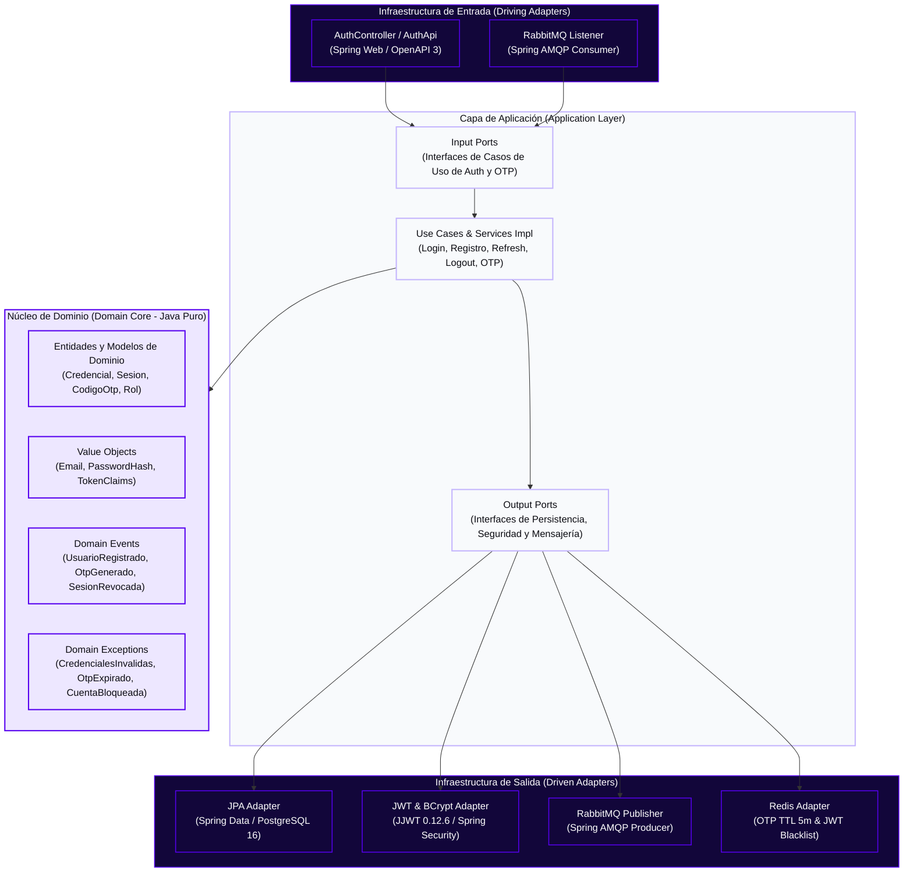
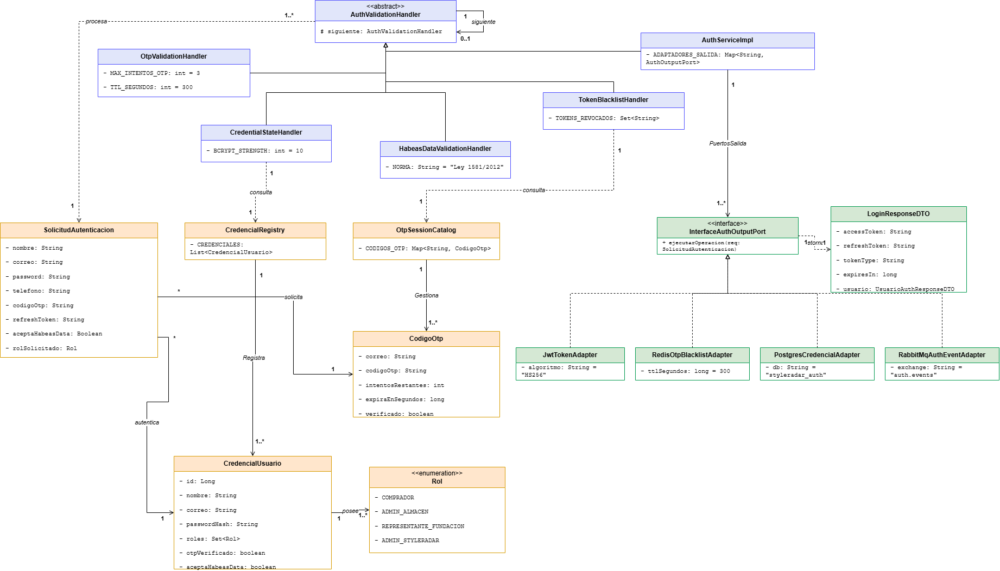
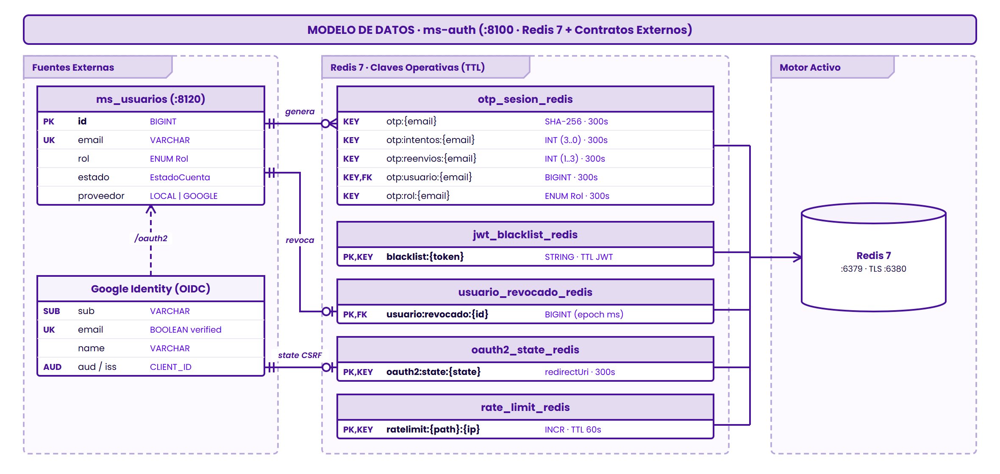
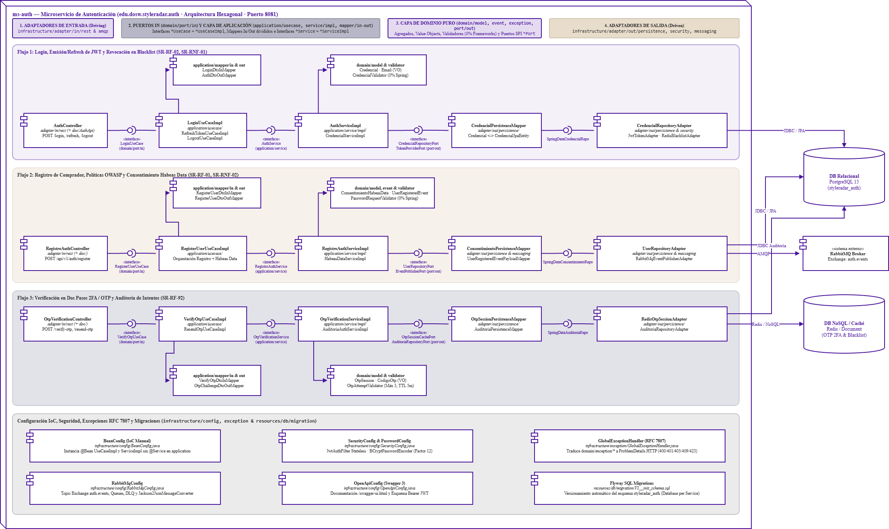
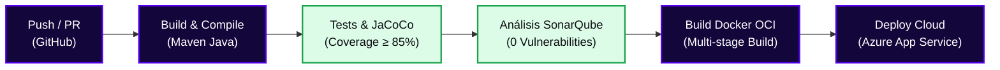

<!-- ==============================================================================
  STYLE RADAR 
  Asignatura: DOSW · 2026
  Estándar obligatorio unificado para los 13 microservicios del proyecto StyleRadar.
============================================================================== -->

<div align="center">

  <a href="https://github.com/StyleRadar1">
    
  </a>

  <h1>STYLE<font color="#5600EF">RADAR</font> &nbsp;·&nbsp; <code>ms-auth</code></h1>

  <p align="center">
    
    
    
  </p>

  <p align="center">
    <strong><font color="#5600EF">Descubre tu estilo. En tu ciudad.</font></strong><br />
    <em>Plataforma de moda local con inventario multi-sede geolocalizado en tiempo real y probador virtual para Bogotá.</em>
  </p>

  <p align="center">
    <a href="https://styleradar-backend-prod.azurewebsites.net/swagger-ui/index.html">
      
    </a>
    <a href="https://styleradar-backend-qa.azurewebsites.net/swagger-ui/index.html">
      
    </a>
    <a href="https://sonarcloud.io/project/overview?id=StyleRadar1_CADCHE-Authentication-Service">
      
    </a>
    <a href="https://sonarcloud.io/component_measures?id=StyleRadar1_CADCHE-Authentication-Service&metric=coverage">
      
    </a>
    <a href="#6-tecnologías-y-dependencias">
      
    </a>
    <a href="#6-tecnologías-y-dependencias">
      
    </a>
    <a href="#7-cómo-ejecutar-local-y-con-docker">
      
    </a>
  </p>

</div>


---

##  ÍNDICE DE CONTENIDOS

1. [Nombre del servicio y su bounded context](#1-nombre-del-servicio-y-su-bounded-context)
2. [Equipo y responsables](#2-equipo-y-responsables)
3. [Arquitectura hexagonal con su diagrama](#3-arquitectura-hexagonal-con-su-diagrama)
4. [Endpoints y enlace a Swagger](#4-endpoints-y-enlace-a-swagger)
5. [Eventos que publica y consume](#5-eventos-que-publica-y-consume)
6. [Tecnologías y dependencias](#6-tecnologías-y-dependencias)
7. [Cómo ejecutar local y con Docker](#7-cómo-ejecutar-local-y-con-docker)
8. [Variables de entorno](#8-variables-de-entorno)
9. [Pruebas y cobertura](#9-pruebas-y-cobertura)
10. [CI/CD con el badge del pipeline](#10-cicd-con-el-badge-del-pipeline)
11. [Ramas y cómo contribuir](#11-ramas-y-cómo-contribuir)
12. [Enlace a la épica en Jira](#12-enlace-a-la-épica-en-jira)
13. [Análisis de tecnologías del servicio](#13-análisis-de-tecnologías-del-servicio)
14. [Análisis de seguridad OWASP Top 10:2025](#14-análisis-de-seguridad-owasp-top-102025)

---

<a id="1-nombre-del-servicio-y-su-bounded-context"></a>

##  1. NOMBRE DEL SERVICIO Y SU BOUNDED CONTEXT

* **Identificador de Servicio:** `ms-auth` (`CADCHE-Authentication-Service`)
* **Paquete Arquitectónico:** `Paquete 1: Identidad`
* **Puerto de Escucha Oficial:** `8100` (definido en la matriz de puertos sin colisión)
* **Base de Datos Asignada:** `Redis 7` (`:6379`, almacenamiento operativo activo para códigos OTP TTL `300 s`, blacklist JWT de `/logout`/`/refresh` y revocación global de usuario, con respaldo en memoria `ConcurrentHashMap`) + `PostgreSQL 16` (`styleradar_auth`, configurado en YAML/Docker pero excluido en perfiles `dev`/`test` sin entidades ni migraciones SQL desplegadas hoy, pues la verificación de credenciales se delega síncronamente vía HTTP Basic a `ms-usuarios` en `:8120`). Ver diseño completo en [docs/DocumentoTecnico.html](docs/DocumentoTecnico.html) y [DiagramaBaseDatos.png](docs/uml/DiagramaBaseDatos.png).
* **Bounded Context:** `Autenticación, Identidad y Control de Acceso (IAM)`

### Responsabilidades del Dominio

Este microservicio encapsula exclusivamente la lógica de negocio correspondiente a `Autenticación, Identidad y Control de Acceso (IAM)`.

| Qué HACE este Microservicio (Alcance) | Qué NO HACE este Microservicio (Límites) |
| :--- | :--- |
| • Autentica de forma unificada a los cuatro roles (`COMPRADOR`, `ADMIN_ALMACEN`, `REPRESENTANTE_FUNDACION`, `ADMIN_STYLERADAR`) y emite tokens JWT (`accessToken` y `refreshToken`) firmados (`SR-RF-02`). | • NO gestiona preferencias de estilo, tallas habituales ni búsquedas guardadas del comprador (delegado a `ms-usuarios` en `:8082`). |
| • Genera, valida y reenvía códigos OTP de 6 dígitos con vigencia estricta de 5 minutos (`300s`) y bloqueo tras 3 intentos fallidos (`SR-RF-92`). | • NO administra almacenes aliados, verificación de RUT ni fundaciones aliadas (delegado a `ms-tiendas` en `:8083`). |
| • Registra credenciales de usuario comprador con cifrado `BCrypt` (costo ≥ 10), valida la aceptación expresa de Habeas Data (`SR-RF-01`, `SR-RNF-02`) y revoca sesiones en logout (`SR-RNF-01`, Deuda Técnica #2). | • NO envía correos electrónicos ni WebSockets de forma directa (publica eventos hacia `ms-notificaciones` en `:8092`). |
| • Gestiona su estado efímero de autenticación exclusivamente sobre su motor `Redis 7` y consulta credenciales mediante contrato HTTP explícito hacia `ms-usuarios` (`VerificarCredencialesResponseDTO`). | • NO accede directamente a bases de datos de otros microservicios. |

### Arquetipos de Moda y Personajes de StyleRadar

<div align="center">

| Antonia (Sastre) | Mateo (Calle) | Aura (Futuro) | Nora (Rebelde) | Tomás (Esencial) |
| :---: | :---: | :---: | :---: | :---: |
| <br>**Sastre**<br><sub>Tiendas & Descubrimiento</sub> | <br>**Calle**<br><sub>Playlists & Cultura Urbana</sub> | <br>**Futuro**<br><sub>Probador Virtual AI</sub> | <br>**Rebelde**<br><sub>Segunda Vida & Vintage</sub> | <br>**Esencial**<br><sub>Fundaciones & Donaciones</sub> |

</div>

---

<a id="2-equipo-y-responsables"></a>

##  2. EQUIPO Y RESPONSABLES

Desarrollado y mantenido por el **Squad `CADche` (`CADCHE`)** para la asignatura DOSW 2026.

<div align="center">

| Rol | Nombre Completo | Usuario GitHub |
| :---: | :---: | :---: |
| **Tech Lead / Arquitecto & Backend Developer** | `Julian Camilo Giral` | `[@jcobos548](https://github.com/jcobos548)` |
| **Product Owner / Scrum Master & Backend Developer** | `Juan Diego Gaitan` | `[@mamagege](https://github.com/mamagege)` |

</div>

---

<a id="3-arquitectura-hexagonal-con-su-diagrama"></a>

##  3. ARQUITECTURA HEXAGONAL CON SU DIAGRAMA

El microservicio implementa **Arquitectura Hexagonal (Puertos y Adaptadores)** combinada con **Domain-Driven Design (DDD)**. El núcleo de negocio permanece 100% puro y aislado de frameworks, bases de datos o brokers de mensajería.

### Diagrama Interactivo de Capas (Mermaid)



<div align="center">
  <table width="100%" style="margin: 18px 0; border: 2px dashed #C4B5FD; border-radius: 8px; background-color: #FBFBFE;">
    <tr>
      <td align="center" style="padding: 20px;">
        <p>
          <br />
          <strong><font color="#5600EF" size="3">DIAGRAMAS DE ARQUITECTURA HEXAGONAL Y UML DEL SERVICIO</font></strong>
        </p>
        <p>
          <sub>Los diagramas de clases, base de datos, componentes específico y secuencia se versionan en <code>docs/uml/</code>. Archivos fuente Draw.io: <a href="docs/uml/DiagramaClases.drawio"><code>DiagramaClases.drawio</code></a> · <a href="docs/uml/DiagramaBaseDatos.drawio"><code>DiagramaBaseDatos.drawio</code></a> · <a href="docs/uml/DiagramaComponentesEspecifico.drawio"><code>DiagramaComponentesEspecifico.drawio</code></a>.</sub>
        </p>
      </td>
    </tr>
  </table>
</div>

#### 7.1 Diagrama de Clases de Dominio (`ms-auth`)

<div align="center">
  <br />
  <sub>Figura 7.1: Diagrama de clases real del núcleo de dominio, excepciones, servicios de aplicación y DTOs inmutables de <code>ms-auth</code> en estilo StyleRadar (Draw.io editable en <a href="docs/uml/DiagramaClases.drawio"><code>docs/uml/DiagramaClases.drawio</code></a> · Explicación ampliada en <a href="docs/DocumentoTecnico.html"><code>docs/DocumentoTecnico.html</code></a>, Pág. 06).</sub>
</div>

##### Justificación Arquitectónica y Alcance del Dominio Real

La inspección directa de los paquetes `domain` y `application` en `src/main/java/edu/dosw/styleradar/auth` refleja un diseño minimalista alineado con los límites reales del microservicio:

- **Sin `@Entity` ni Agregados JPA Locales (Cero Duplicación con `ms-usuarios`):** El agregado de usuario, sus credenciales y su aceptación legal viven actualmente en `ms-usuarios (:8120)`, mientras códigos OTP (`300 s`), contadores de intentos, blacklist JWT y revocación de sesión residen en `Redis 7 (:6379)`. Los paquetes `domain/repository/` y `infrastructure/adapter/out/persistence/{entity,repository}/` solo conservan `.gitkeep` mientras PostgreSQL 16 permanece diferido, evitando inflar el dominio con entidades ORM artificiales o inactivas.
- **Pureza de Tipos de Dominio (`domain` libre de frameworks):** Los paquetes `domain.model`, `domain.event` y `domain.exception` dependen exclusivamente de tipos estándar de Java (`enum`, `record`, `Instant`, `RuntimeException`), desacoplados de Spring Web y de la capa de persistencia.
- **Inmutabilidad y Contratos Segregados (`application`):** El núcleo expone tres contratos explícitos (`OtpService`, `JwtService`, `EmailService`) con sus implementaciones desacopladas (`*ServiceImpl`) y emplea Java `record` inmutables para transportar eventos (`UsuarioEstadoCambiadoEvent`) y respuestas críticas (`LoginResponseDTO`, `VerificarCredencialesResponseDTO`).

##### Inventario Detallado de Clases, Eventos y Servicios Verificados

| Capa / Paquete | Elemento UML | Tipo | Miembros / Responsabilidad Exacta en Código |
| :--- | :--- | :--- | :--- |
| **`domain.model`** | `Rol` | `enum` | `COMPRADOR`, `ADMIN_ALMACEN`, `REPRESENTANTE_FUNDACION`, `ADMIN_STYLERADAR`. Modela los roles RBAC embebidos en claims JWT y sesiones OTP. |
| **`domain.model`** | `EstadoCuenta` | `enum` | `ACTIVA`, `INACTIVA`, `BLOQUEADA`. Valida habilitación de acceso desde `ms-usuarios` y controla eventos de revocación de sesión. |
| **`domain.event`** | `UsuarioEstadoCambiadoEvent` | `record` | `(Long usuarioId, EstadoCuenta estadoAnterior, EstadoCuenta estadoNuevo, Long administradorId, String motivo, Instant fechaCambio)`. Evento inmutable consumido por `UsuarioEstadoCambiadoConsumer` desde RabbitMQ. |
| **`domain.exception`** | `CredencialesIncorrectasException`<br>`CuentaNoActivaException`<br>`OtpExpiradoException`<br>`OtpIntentosAgotadosException`<br>`OtpInvalidoException` | `class extends RuntimeException` | Jerarquía de `5` excepciones tipadas de negocio lanzadas durante validación de credenciales y flujo OTP, traducidas a respuestas HTTP uniformes por `GlobalExceptionHandler`. |
| **`application.service`** + **`impl`** | `OtpService` ← `OtpServiceImpl` | `interface` / `@Service` | `9` métodos: `generarOtp`, `verificarOtp`, `reenviarOtp`, `obtenerUsuarioId`, `obtenerRol`, `obtenerIntentosRestantes`, `eliminarOtp`, `invalidarToken`, `esTokenInvalido`. Usa `StringRedisTemplate`, `localMemoryStore`, `localExpiryStore`, `ttlSeconds` (`300 s`) y `maxAttempts` (`3`). |
| **`application.service`** + **`impl`** | `JwtService` ← `JwtServiceImpl` | `interface` / `@Service` | `5` métodos: `generarToken(Long, Set<Rol>)`, `validarToken`, `obtenerUsuarioId`, `obtenerRoles`, `obtenerTiempoRestanteSegundos`. Opera con `SecretKey` y `Duration`. |
| **`application.service`** + **`impl`** | `EmailService` ← `EmailServiceImpl` | `interface` / `@Service` | `enviarOtp(String, String)`. Envía notificaciones OTP vía `JavaMailSender` y `correoEmisor`. |
| **`application.dto.response`** | `LoginResponseDTO` | `record` | Campos: `accessToken`, `tokenType`, `expiresIn`, `usuarioId`, `roles` (`Set<Rol>`), `requiereOtp`, `otpExpiraEnSegundos`, `intentosOtpRestantes` (con sobrecarga compacta de 5 argumentos cuando no hay desafío pendiente). |
| **`application.dto.response`** | `VerificarCredencialesResponseDTO` | `record` | Campos: `id` (`Long`), `email`, `rol`, `estado`. Contrato recibido síncronamente desde `ms-usuarios` (`POST /internal/api/v1/usuarios/verificar-credenciales`). |

> También complementan la frontera HTTP el DTO de perfil `UsuarioAuthResponseDTO` y los objetos de petición/respuesta mapeados por `AuthController`. La justificación arquitectónica detallada de este modelo se encuentra en [docs/DocumentoTecnico.html](docs/DocumentoTecnico.html) (Sección **06 Modelo de Dominio y Diagrama de Clases**).

---

#### 7.2 Diagrama de Base de Datos (`ms-auth` — Redis 7 Activo + Contrato `ms-usuarios`)

<div align="center">
  <br />
  <sub>Figura 7.2: Modelo real de almacenamiento activo en Redis 7 y fuente externa <code>ms-usuarios (:8120)</code> en formato StyleRadar (Draw.io editable en <a href="docs/uml/DiagramaBaseDatos.drawio"><code>docs/uml/DiagramaBaseDatos.drawio</code></a> · Explicación arquitectónica y estado diferido de PostgreSQL 16 en <a href="docs/DocumentoTecnico.html"><code>docs/DocumentoTecnico.html</code></a>, Pág. 07).</sub>
</div>

##### Justificación Arquitectónica del Modelo de Datos Real (ADR-02 y ADR-04)

Contrario a esquemas teóricos tempranos, la auditoría directa del código fuente (`OtpServiceImpl`, `JwtAuthenticationFilter`, `UsuarioEstadoCambiadoConsumer`, `UsuarioClient` y perfiles YAML) demuestra una arquitectura enfocada en latencia sub-milisegundo y cero duplicación de credenciales:

- **Motor Activo Clave-Valor (`Redis 7` en `:6379` vía `StringRedisTemplate`):** Almacena exclusivamente estado efímero de seguridad que requiere expiración automática por **TTL** o validación en memoria en cada petición (`/refresh`, filtro JWT), evitando sobrecarga transaccional en disco o trabajos *cron* de limpieza. Ante fallos de conectividad (`DataAccessException`), `OtpServiceImpl` conmuta de forma transparente a mapas concurrentes en memoria (`localMemoryStore` y `localExpiryStore` sobre `ConcurrentHashMap`) conservando la ventana temporal de `300 s`.
- **Fuente Externa de Credenciales (`ms-usuarios` en `:8120` vía HTTP Basic):** `ms-auth` no duplica perfiles ni hashes de contraseña en base local. Durante `POST /api/v1/auth/login`, `UsuarioClient` invoca `POST /internal/api/v1/usuarios/verificar-credenciales` y recibe `VerificarCredencialesResponseDTO(id, email, rol, estado)` (con fallback sintético en perfil `dev`).
- **Estado Real de `PostgreSQL 16` (`styleradar_auth`) y `Flyway 10.20.1`:** Aunque `pom.xml`, `application.yml` (`jdbc:postgresql://localhost:5432/styleradar_auth`, `ddl-auto: validate`, `flyway.enabled: false`) y `docker-compose.yml` (`auth-db` sobre `postgres:16-alpine`, puerto `5434:5432`) declaran la base relacional, tanto `application-dev.yml` como `application-test.yml` excluyen `DataSourceAutoConfiguration`, `HibernateJpaAutoConfiguration` y `FlywayAutoConfiguration`. Los directorios `infrastructure/adapter/out/persistence/{entity,repository}/` y `src/main/resources/db/migration/` solo contienen `.gitkeep` mientras `POST /api/v1/auth/registro` opera como stub controlado (`201 Created`, `id=12L`, `Rol.COMPRADOR`), evitando falsa sensación de persistencia hasta implementar entidades JPA reales.

##### Catálogo Exacto de Claves en Redis 7 (`StringRedisTemplate`)

| Espacio de Clave (Grupo Diagrama) | Prefijo Exacto en Código | Tipo / Formato de Valor | TTL Configurado | Escrita Por | Leída / Validada Por |
| :--- | :--- | :--- | :--- | :--- | :--- |
| **`otp_sesion_redis`** | `otp:{email}` | `STRING` (6 dígitos `"%06d"`) | `300 s` (`otp.ttl-seconds`) | `OtpServiceImpl` | `OtpServiceImpl` (`/otp/verificar`) |
| **`otp_sesion_redis`** | `otp:intentos:{email}` | `STRING` (`"3"` → `"0"` decremento) | `300 s` | `OtpServiceImpl` | `OtpServiceImpl` (máx. 3 intentos) |
| **`otp_sesion_redis`** | `otp:usuario:{email}` | `STRING` (`Long usuarioId` desde `ms-usuarios`) | `300 s` | `OtpServiceImpl` | `OtpServiceImpl` (para claim `sub`) |
| **`otp_sesion_redis`** | `otp:rol:{email}` | `STRING` (`Enum Rol.name()`) | `300 s` | `OtpServiceImpl` | `OtpServiceImpl` (para claim `roles`) |
| **`jwt_blacklist_redis`** | `blacklist:{token}` | `STRING` (`"revoked"`) | Restante del JWT (hasta `PT24H`) | `OtpServiceImpl` (en `AuthController.logout()`) | `OtpServiceImpl.esTokenInvalido()` (en `/refresh`) |
| **`usuario_revocado_redis`** | `usuario:revocado:{usuarioId}` | `STRING` (epoch ms `evento.fechaCambio()`) | Sin TTL (persistente en Redis) | `UsuarioEstadoCambiadoConsumer` (`auth.usuario.estado.cambiado`) | `JwtAuthenticationFilter` (`issuedAt <= epoch`) |

##### Contrato Upstream (`ms-usuarios`) y Parámetros Relacionales Diferidos

| Elemento / Grupo | Campo / Propiedad | Detalle Exacto Verificado en Código y Configuración |
| :--- | :--- | :--- |
| **`ms_usuarios` (`VerificarCredencialesResponseDTO`)** | `id`, `email`, `rol`, `estado` | `Long id`, `String email`, `String rol` → `Enum Rol` (`COMPRADOR`, `ADMIN_ALMACEN`, `REPRESENTANTE_FUNDACION`, `ADMIN_STYLERADAR`), `String estado` → `Enum EstadoCuenta` (`ACTIVA`, `INACTIVA`, `BLOQUEADA`). |
| **`PostgreSQL 16` + `Flyway 10` (Diferido en `dev`/`test`)** | `datasource.url`, `ddl-auto`, `flyway.enabled` | `jdbc:postgresql://localhost:5432/styleradar_auth` (`docker-compose`: `auth-db` `5434:5432`), `validate` (`0` `@Entity`), `false` (`db/migration/.gitkeep`); autoconfiguraciones SQL excluidas en `dev` y `test`. |

> Documentación arquitectónica y decisiones de diseño ampliadas en [docs/DocumentoTecnico.html](docs/DocumentoTecnico.html) (Sección **05 ADR-04** y Sección **07 Modelo de Datos Real**).

---

#### 7.3 Diagrama de Componentes Específico en Arquitectura Hexagonal (`ms-auth`)

<div align="center">
  <br />
  <sub>Figura 7.3: Diagrama de componentes específico en arquitectura hexagonal de <code>ms-auth</code> con las piezas ejecutables reales (estilo StyleRadar / referencia <code>CADCHE-Stores-Service</code> · Draw.io editable en <a href="docs/uml/DiagramaComponentesEspecifico.drawio"><code>docs/uml/DiagramaComponentesEspecifico.drawio</code></a> · Explicación en <a href="docs/DocumentoTecnico.html"><code>docs/DocumentoTecnico.html</code></a>, Pág. 04).</sub>
</div>

##### Justificación del Enfoque Hexagonal Real

La vista de componentes excluye deliberadamente entidades, enums y DTOs (documentados en el [Diagrama de Clases](docs/uml/DiagramaClases.png)) y refleja exactamente las clases ejecutables implementadas en `src/main/java/edu/dosw/styleradar/auth`:

- **Separación Entrada → Núcleo → Salida:** Los adaptadores primarios (`AuthController`, `JwtAuthenticationFilter`, `UsuarioEstadoCambiadoConsumer`) aíslan transporte HTTP, filtro de seguridad y escucha AMQP respecto a la lógica de negocio en `application.service.impl`.
- **Interfaces Explícitas en el Núcleo (`—(o—`):** Los conectores *ball-and-socket* modelan exclusivamente las interfaces reales definidas hoy (`EmailService`, `OtpService` y `JwtService`), evitando simular puertos inexistentes.
- **Hexagonal Pragmática sin Sobre-ingeniería:** `AuthController` invoca directamente a `UsuarioClient` (`RestClient` hacia `ms-usuarios`), y los consumidores/servicios de caché y correo inyectan directamente las abstracciones de Spring (`StringRedisTemplate`, `JavaMailSender`). Los paquetes de plantilla vacíos (`domain/port/{in,out}/`, `application/usecase/`, `application/mapper/{in,out}/`, `infrastructure/adapter/out/persistence/{entity,repository}/`) conservan `.gitkeep` mientras los usuarios residen en `ms-usuarios`.

##### Desglose de Componentes Reales y Flujos

| Capa Hexagonal | Componente UML | Ubicación / Origen Real | Responsabilidad e Interacciones Verificadas |
| :--- | :--- | :--- | :--- |
| **Entrada (`IN`)** | `AuthController` | `infrastructure/adapter/in/rest/` | Expone `POST /api/v1/auth/{login, otp/verificar, otp/reenviar, refresh, logout, registro}` implementando `AuthApi`; invoca `UsuarioClient` y orquesta `EmailService`, `OtpService` y `JwtService`. |
| **Entrada (`IN`)** | `JwtAuthenticationFilter` | `infrastructure/security/` | Filtro `OncePerRequestFilter` registrado en `SecurityConfig`; valida firma HS256 vía `JwtService` y consulta revocación por usuario en `StringRedisTemplate`. |
| **Entrada (`IN · AMQP`)** | `UsuarioEstadoCambiadoConsumer` | `infrastructure/adapter/in/messaging/` | `@RabbitListener` sobre la cola `auth.usuario.estado.cambiado` desde `RabbitMQ`; registra el sello de revocación en `StringRedisTemplate`. |
| **Núcleo (`Core`)** | `EmailServiceImpl` | `application/service/impl/` | Implementa `EmailService`; construye y despacha el correo OTP mediante `JavaMailSender` (con fallback a consola local si falla SMTP). |
| **Núcleo (`Core`)** | `OtpServiceImpl` | `application/service/impl/` | Implementa `OtpService`; gestiona códigos de 6 dígitos (`ttlSeconds=300`, `maxAttempts=3`) y blacklist JWT sobre `StringRedisTemplate` con respaldo `ConcurrentHashMap`. |
| **Núcleo (`Core`)** | `JwtServiceImpl` | `application/service/impl/` | Implementa `JwtService`; genera y valida tokens JWT HS256 (`JJWT`) usando `SecretKey` y `Duration`, sin acoplamiento a bases de datos. |
| **Salida (`OUT`)** | `UsuarioClient` | `infrastructure/adapter/out/external/` | Encapsula `RestClient` HTTP Basic contra `ms-usuarios` (`/internal/api/v1/usuarios/verificar-credenciales`), con fallback dev si `ResourceAccessException`. |
| **Salida (`OUT`)** | `JavaMailSender` | Spring Boot Mail | Abstracción SMTP utilizada por `EmailServiceImpl` hacia `SMTP Gmail`. |
| **Salida (`OUT`)** | `StringRedisTemplate` | Spring Data Redis | Cliente clave-valor compartido por `OtpServiceImpl`, `JwtAuthenticationFilter` y `UsuarioEstadoCambiadoConsumer` hacia `Redis 7`. |
| **Externos** | `ms-usuarios` · `SMTP Gmail` · `Redis 7` · `RabbitMQ` | Sistemas pares e infraestructura | Proveedor de credenciales, servidor de correo, almacén efímero en memoria y broker de eventos administrativos (`styleradar.usuarios`). |

> Como soporte transversal de infraestructura Web/AMQP sin lógica de negocio operan [`SecurityConfig`](src/main/java/edu/dosw/styleradar/auth/infrastructure/config/SecurityConfig.java), [`GlobalExceptionHandler`](src/main/java/edu/dosw/styleradar/auth/infrastructure/exception/GlobalExceptionHandler.java), [`RabbitMQConfig`](src/main/java/edu/dosw/styleradar/auth/infrastructure/config/RabbitMQConfig.java), [`SwaggerConfig`](src/main/java/edu/dosw/styleradar/auth/infrastructure/config/SwaggerConfig.java) y [`AuthApi`](src/main/java/edu/dosw/styleradar/auth/infrastructure/adapter/in/rest/doc/AuthApi.java). Detalle arquitectónico completo en [docs/DocumentoTecnico.html](docs/DocumentoTecnico.html) (Sección **04 Arquitectura Hexagonal · Diagrama de Componentes**).

### Estructura Oficial de Paquetes en `src/main/java/`

```text
src/main/java/edu/dosw/styleradar/auth/
├── AuthApplication.java                     <-- Punto de entrada Spring Boot (ms-auth)
├── domain/                                  <-- NÚCLEO DE DOMINIO (Cero dependencias externas)
│   ├── model/                               <-- Modelos y enumeraciones de dominio (Rol)
│   ├── event/                               <-- Definición de Eventos de Dominio
│   ├── exception/                           <-- Excepciones de reglas de negocio
│   └── port/
│       ├── in/                              <-- Input Ports (Interfaces de casos de uso)
│       └── out/                             <-- Output Ports (Interfaces para repositorios, JWT y broker)
├── application/                             <-- CAPA DE APLICACIÓN (Casos de Uso y Servicios)
│   ├── dto/
│   │   ├── request/                         <-- DTOs de entrada (LoginRequestDTO, RegistroAuthRequestDTO, RefreshTokenRequestDTO, VerificarOtpRequestDTO, ReenviarOtpRequestDTO)
│   │   ├── response/                        <-- DTOs de salida (LoginResponseDTO, UsuarioAuthResponseDTO, OtpMensajeResponseDTO, ErrorResponseDTO)
│   │   └── event/                           <-- Payloads de eventos de integración
│   ├── mapper/
│   │   ├── in/                              <-- Mappers de entrada REST/AMQP a Dominio
│   │   └── out/                             <-- Mappers de salida Dominio a Persistencia/Eventos
│   ├── service/
│   │   └── impl/                            <-- Servicios de aplicación e implementaciones (<Nombre>Impl)
│   └── usecase/                             <-- Implementación de casos de uso (<Nombre>UseCaseImpl)
└── infrastructure/                          <-- CAPA DE INFRAESTRUCTURA (Adaptadores)
    ├── adapter/
    │   ├── in/
    │   │   ├── rest/                        <-- Controladores REST (AuthController) y contrato OpenAPI (doc/AuthApi)
    │   │   ├── amqp/                        <-- Consumidores de eventos RabbitMQ
    │   │   └── websocket/                   <-- Adaptadores de entrada en tiempo real
    │   └── out/
    │       ├── persistence/                 <-- Entidades SQL (entity/) y Repositorios JPA (repository/)
    │       ├── security/                    <-- Proveedor JWT (JJWT) y cifrado BCrypt
    │       ├── messaging/                   <-- Productores de eventos RabbitMQ
    │       └── external/                    <-- Clientes de servicios externos y Redis
    ├── config/                              <-- Configuración Spring (SwaggerConfig, Seguridad)
    └── exception/                           <-- Manejo centralizado de errores HTTP (GlobalExceptionHandler)
```

---

<a id="4-endpoints-y-enlace-a-swagger"></a>

##  4. ENDPOINTS Y ENLACE A SWAGGER

La documentación interactiva OpenAPI 3.0 y los contratos de ejecución se encuentran desplegados y clasificados por entorno:

### Matriz Oficial de Enlaces por Entorno (PROD, QA, LOCAL)

| Entorno | Estado | Propósito | URL Base del Servicio | Swagger OpenAPI UI | Health Check |
| :--- | :---: | :--- | :--- | :--- | :--- |
| **Producción (PROD)** | Active | Despliegue productivo de StyleRadar | `https://styleradar-backend-prod.azurewebsites.net` | [Swagger UI PROD](https://styleradar-backend-prod.azurewebsites.net/swagger-ui/index.html) | [`/actuator/health`](https://styleradar-backend-prod.azurewebsites.net/actuator/health) |
| **Calidad / Pruebas (QA)** | Active | Pruebas integradas de Sprint y QA | `https://styleradar-backend-qa.azurewebsites.net` | [Swagger UI QA](https://styleradar-backend-qa.azurewebsites.net/swagger-ui/index.html) | [`/actuator/health`](https://styleradar-backend-qa.azurewebsites.net/actuator/health) |
| **Desarrollo Local (DEV)** | Local | Entorno de desarrollo local en máquina | `http://localhost:8100` | [Swagger UI Local](http://localhost:8100/swagger-ui.html) | [`/actuator/health`](http://localhost:8100/actuator/health) |

* **Especificación OpenAPI (Contrato JSON Schema):** `http://localhost:8100/v3/api-docs` (o `/v3/api-docs` en los dominios de PROD y QA).


<div align="center">
  <table width="100%" style="margin: 18px 0; border: 2px dashed #5600EF; border-radius: 8px; background-color: #FBFBFE;">
    <tr>
      <td align="center" style="padding: 22px;">
        <p>
          <br />
          <strong><font color="#5600EF" size="3">DOCUMENTACIÓN SWAGGER OPENAPI UI ACTIVA</font></strong>
        </p>
        <p>
          <sub>Pega aquí la captura de pantalla de la interfaz interactiva corriendo en <code>http://localhost:8100/swagger-ui.html</code> mostrando los endpoints del controlador.</sub>
        </p>
        <p>
<!-- Al generar tu captura, descomenta la siguiente línea y guarda la imagen en la ruta indicada: -->
<!-- <br /> -->
          <code>[ Pegar captura de Swagger UI aquí · docs/evidencias/swagger-ui.png ]</code>
        </p>
      </td>
    </tr>
  </table>
</div>

### Tabla de Endpoints Expuestos

| Método | Endpoint | Descripción | Rol Requerido | Códigos HTTP |
| :---: | :--- | :--- | :--- | :---: |
| `POST` | `/api/v1/auth/login` | Inicio de sesión unificado multi-rol y emisión de `accessToken` + `refreshToken` (`SR-RF-02`) | Público | `200`, `400`, `401`, `403` |
| `POST` | `/api/v1/auth/registro` | Registro de comprador con contraseña `BCrypt`, validación de Habeas Data y disparo de OTP (`SR-RF-01`, `SR-RNF-02`) | Público | `201`, `400`, `409` |
| `POST` | `/api/v1/auth/refresh` | Renovación de `accessToken` mediante `refreshToken` vigente con rotación segura (`SR-RF-02`, `SR-RNF-01`) | Público (Refresh Token) | `200`, `400`, `401`, `403` |
| `POST` | `/api/v1/auth/logout` | Cierre de sesión e invalidación inmediata del token JWT en lista negra (`SR-RNF-01`, Deuda Técnica #2) | Autenticado (`Bearer JWT`) | `204`, `401` |
| `POST` | `/api/v1/auth/otp/verificar` | Verificación de código OTP de 6 dígitos (TTL 5 minutos, máximo 3 intentos) (`SR-RF-92`) | Público | `200`, `400`, `410`, `429` |
| `POST` | `/api/v1/auth/otp/reenviar` | Invalidación del OTP anterior y generación de nuevo código OTP de 6 dígitos (`SR-RF-92`) | Público | `200`, `400`, `404`, `429` |
| `GET` | `/actuator/health` | Health Check y estado operativo del microservicio | Público | `200` |

<details>
<summary><b>Click para ver Ejemplos Interactivos de Request y Response JSON (Payloads)</b></summary>

<br>

#### Ejemplo Request (`POST /api/v1/auth/login`)

```bash
curl -X POST "http://localhost:8100/api/v1/auth/login" \
  -H "Content-Type: application/json" \
  -d '{
    "correo": "camila.torres@correo.com",
    "password": "Password123*"
  }'
```

#### Ejemplo Response Exitoso (`200 OK`)

```json
{
  "accessToken": "eyJhbGciOiJIUzI1NiIsInR5cCI6IkpXVCJ9.eyJzdWIiOiIxIiwicm9sZXMiOlsiQ09NUFJBRE9SIl19.signature",
  "refreshToken": "eyJhbGciOiJIUzI1NiIsInR5cCI6IkpXVCJ9.eyJzdWIiOiIxIiwidHlwZSI6InJlZnJlc2gifQ.signature",
  "tokenType": "Bearer",
  "expiresIn": 3600,
  "usuario": {
    "id": 1,
    "nombre": "Camila Torres",
    "correo": "camila.torres@correo.com",
    "roles": ["COMPRADOR"],
    "otpVerificado": true
  }
}
```

#### Ejemplo Request (`POST /api/v1/auth/otp/verificar`)

```bash
curl -X POST "http://localhost:8100/api/v1/auth/otp/verificar" \
  -H "Content-Type: application/json" \
  -d '{
    "correo": "camila.torres@correo.com",
    "codigoOtp": "482910"
  }'
```

#### Ejemplo Response Exitoso (`200 OK`)

```json
{
  "correo": "camila.torres@correo.com",
  "mensaje": "Código OTP verificado exitosamente. Cuenta activada.",
  "expiraEnSegundos": 0,
  "intentosRestantes": 3
}
```

</details>

---

<a id="5-eventos-que-publica-y-consume"></a>

##  5. EVENTOS QUE PUBLICA Y CONSUME

La comunicación asíncrona entre microservicios se orquesta a través de **RabbitMQ 3.12** utilizando Topic Exchanges durables.

* **Exchange Principal de Dominio:** `styleradar.auth.events` / `styleradar.events` (`topic`, durable)
* **Exchange de Auditoría:** `styleradar.audit` (`fanout`, durable)
* **Dead Letter Exchange (DLX):** `styleradar.dlx`

### Matriz de Eventos AMQP

| Tipo | Routing Key | Cola (Queue) | Microservicio Emisor / Receptor | Cuándo se Dispara / Acción |
| :---: | :--- | :--- | :--- | :--- |
| **PUBLICA** | `auth.usuario.registrado` | N/A (Exchange) | `ms-auth` &rarr; `ms-usuarios`, `ms-notificaciones` | Se publica al registrar un comprador (`SR-RF-01`) para sincronizar su perfil y disparar bienvenida. |
| **PUBLICA** | `auth.otp.generado` | N/A (Exchange) | `ms-auth` &rarr; `ms-notificaciones` | Se publica al generar o reenviar el código OTP de 6 dígitos (`SR-RF-92`) con vigencia de 5 minutos. |
| **PUBLICA** | `auth.sesion.revocada` | N/A (Exchange) | `ms-auth` &rarr; `api-gateway` | Notifica la invalidación de un token (`jti`) tras logout o bloqueo de seguridad (`SR-RNF-01`). |
| **CONSUME** | `usuario.estado.cambiado` | `q.auth.usuario.estado` | `ms-usuarios` &rarr; `ms-auth` | Bloquea el inicio de sesión y revoca sesiones activas cuando una cuenta pasa a `INACTIVO` o `BLOQUEADO` (`SR-RF-66`). |
| **CONSUME** | `tienda.rol.asignado` | `q.auth.tienda.rol` | `ms-tiendas` &rarr; `ms-auth` | Asigna el rol `ADMIN_ALMACEN` o `REPRESENTANTE_FUNDACION` al usuario vinculado (`SR-RF-62`, `SR-RF-63`). |

<details>
<summary><b>Click para ver Esquema JSON del Evento Publicado (con Idempotencia)</b></summary>

<br>

```json
{
  "eventId": "018e3a2b-3333-7000-8000-000000000001",
  "eventType": "auth.otp.generado",
  "timestamp": "2026-11-01T14:30:00Z",
  "producer": "ms-auth",
  "correlationId": "corr-auth-otp-0001",
  "data": {
    "usuarioId": 1,
    "correo": "camila.torres@correo.com",
    "codigoOtp": "482910",
    "ttlSegundos": 300,
    "maxIntentos": 3,
    "version": 1
  }
}
```

</details>

---

<a id="6-tecnologías-y-dependencias"></a>

##  6. TECNOLOGÍAS Y DEPENDENCIAS

El stack del microservicio cumple con el estándar unificado de arquitectura de StyleRadar:

| Capa / Componente | Tecnología | Versión | Justificación Técnica |
| :--- | :--- | :--- | :--- |
| **Lenguaje Core** | Java LTS | `17 / 21 LTS` | Tipado fuerte, Records inmutables para DTOs y alto rendimiento en ejecución sobre JVM. |
| **Framework Empresarial** | Spring Boot | `3.2.12` | Gestión declarativa de configuración, ecosistema nativo Spring Web, Spring Security y Actuator. |
| **Seguridad & Tokens** | Spring Security + JJWT | `6.2.x / 0.12.6` | Firma y verificación criptográfica de tokens JWT (`accessToken`/`refreshToken`) y hashing `BCrypt`. |
| **Base de Datos** | PostgreSQL | `16` | Integridad transaccional ACID para cuentas, roles, auditoría de accesos y sesiones. |
| **Migraciones de BD** | Flyway | `10.20.1` | Control de versiones reproducible de scripts SQL en el arranque del microservicio. |
| **Broker de Mensajería** | RabbitMQ | `3.12+` | Desacoplamiento temporal de eventos de identidad, OTP y cambios de estado de cuenta. |
| **Caché en Memoria** | Redis | `7.x` | Almacenamiento con TTL exacto de 300 segundos para códigos OTP y lista negra de JWT revocados. |
| **Mapeo de DTOs** | MapStruct + Lombok | `1.5.5.Final / 1.18.42` | Generación de mappers en tiempo de compilación con cero sobrecarga de reflexión. |
| **Documentación API** | SpringDoc OpenAPI | `2.3.0` | Generación automática del contrato OpenAPI 3.0 y consola interactiva `/swagger-ui.html`. |
| **Testing Core & Integración** | JUnit 5, Mockito, Testcontainers | `5.10.x / 1.19.8` | Pruebas unitarias de dominio, contratos MockMvc OpenAPI y contenedores efímeros PostgreSQL. |

> Nota: El análisis formal exhaustivo basado en la Plantilla Maestra Oficial (Drivers de Calidad ISO/IEC 25010, Metodología MCDM/Pugh Matrix, Matrices de Decisión ADR-001 a ADR-005, Costos Cloud TCO/FinOps, Tech Radar, Matriz de Riesgos y Acta de Aprobación) se encuentra documentado en la [Sección 13: Análisis de Tecnologías del Servicio](#13-análisis-de-tecnologías-del-servicio).

---

<a id="7-cómo-ejecutar-local-y-con-docker"></a>

##  7. CÓMO EJECUTAR LOCAL Y CON DOCKER

### Prerrequisitos de Entorno

* **Java Development Kit (JDK):** Versión 17 o 21 LTS instalada (`java -version`).
* **Apache Maven:** Versión 3.9+ instalada (`mvn -version`).
* **Docker Engine & Docker Compose:** Versión 24+ en ejecución (`docker --version`).

### Ejecución Local con Maven (Perfil Dev / Test)

```bash
# 1. Clonar el repositorio
git clone https://github.com/StyleRadar1/CADCHE-Authentication-Service.git
cd CADCHE-Authentication-Service

# 2. Levantar servicios de infraestructura en Docker (PostgreSQL, Redis, RabbitMQ)
docker compose up -d postgres rabbitmq redis

# 3. Ejecutar el microservicio localmente con PostgreSQL (perfil dev)
mvn clean spring-boot:run -Dspring-boot.run.profiles=dev

# Alternativa rápida sin PostgreSQL externo (usando configuración en memoria de test)
mvn spring-boot:run -Dspring-boot.run.useTestClasspath=true -Dspring-boot.run.profiles=test
```

### Ejecución Contenerizada Completa con Docker

<details>
<summary><b>Click para ver Instrucciones de Docker y docker-compose.yml de Ejemplo</b></summary>

<br>

```bash
# Compilar y empaquetar el JAR ejecutable omitiendo tests
mvn clean package -DskipTests

# Construir la imagen OCI local
docker build -t styleradar/ms-auth:v1.0 .

# Ejecutar el contenedor conectado a la red compartida de StyleRadar
docker run -d \
  --name ms-auth \
  --network styleradar-net \
  -p 8100:8100 \
  --env-file .env \
  styleradar/ms-auth:v1.0
```

#### Archivo `docker-compose.yml` de Soporte

```yaml
version: '3.8'

networks:
  styleradar-net:
    driver: bridge

services:
  ms-auth:
    build: .
    container_name: ms-auth
    restart: always
    ports:
      - "8100:8100"
    environment:
      - SPRING_PROFILES_ACTIVE=docker
      - SERVER_PORT=8100
      - DB_URL=jdbc:postgresql://postgres:5432/styleradar_auth
      - DB_USERNAME=postgres
      - DB_PASSWORD=postgres
      - JPA_DDL_AUTO=validate
      - FLYWAY_ENABLED=true
      - RABBITMQ_HOST=rabbitmq
      - RABBITMQ_PORT=5672
      - REDIS_HOST=redis
      - REDIS_PORT=6379
    depends_on:
      - postgres
      - rabbitmq
      - redis
    networks:
      - styleradar-net

  postgres:
    image: postgres:16-alpine
    container_name: sr-postgres-auth
    environment:
      POSTGRES_DB: styleradar_auth
      POSTGRES_USER: postgres
      POSTGRES_PASSWORD: postgres
    ports:
      - "5431:5432"
    networks:
      - styleradar-net

  redis:
    image: redis:7-alpine
    container_name: sr-redis-auth
    ports:
      - "6379:6379"
    networks:
      - styleradar-net

  rabbitmq:
    image: rabbitmq:3.12-management-alpine
    container_name: sr-rabbitmq-auth
    ports:
      - "5672:5672"
      - "15672:15672"
    networks:
      - styleradar-net
```

</details>

### Comprobación de Salud (Health Check)

```bash
curl -s http://localhost:8100/actuator/health | jq .
# Esperado: {"status":"UP"}
```

<div align="center">
  <table width="100%" style="margin: 18px 0; border: 2px dashed #5600EF; border-radius: 8px; background-color: #FBFBFE;">
    <tr>
      <td align="center" style="padding: 22px;">
        <p>
          <br />
          <strong><font color="#5600EF" size="3">CONTENEDOR OCI DOCKER EN EJECUCIÓN (docker compose ps)</font></strong>
        </p>
        <p>
          <sub>Pega aquí la captura de terminal ejecutando <code>docker compose ps</code> mostrando el contenedor del microservicio y sus servicios de persistencia y broker en estado healthy.</sub>
        </p>
        <p>
<!-- Al generar tu captura, descomenta la siguiente línea y guarda la imagen en la ruta indicada: -->
<!-- <br /> -->
          <code>[ Pegar captura de Docker compose ps aquí · docs/evidencias/docker-compose-ps.png ]</code>
        </p>
      </td>
    </tr>
  </table>
</div>


---

<a id="8-variables-de-entorno"></a>

##  8. VARIABLES DE ENTORNO

Todas las configuraciones sensibles y dependientes de entorno se externalizan mediante variables de sistema conformes al estándar **Twelve-Factor App**.

| Variable | Descripción | Valor por Defecto (`dev`) | Requerido en Prod |
| :--- | :--- | :--- | :---: |
| `SERVER_PORT` | Puerto de escucha HTTP del microservicio | `8100` | Sí |
| `SPRING_PROFILES_ACTIVE` | Perfil de configuración Spring Boot activo | `dev` | Sí |
| `DB_URL` | URL JDBC de conexión a PostgreSQL | `jdbc:postgresql://localhost:5432/styleradar_auth` | Sí |
| `DB_USERNAME` | Usuario de conexión a la base de datos | `postgres` | Sí |
| `DB_PASSWORD` | Contraseña del usuario de base de datos | `postgres` | Sí |
| `JPA_DDL_AUTO` | Estrategia de validación de esquema Hibernate | `validate` | Sí |
| `FLYWAY_ENABLED` | Ejecución automática de migraciones Flyway | `false` (`true` en prod) | Sí |
| `JWT_SECRET` | Clave secreta o par de llaves para firma de JWT | `<SECRET_KEY_256_BITS>` | Sí |
| `JWT_ACCESS_EXPIRATION` | Tiempo de expiración del `accessToken` en segundos | `3600` | Sí |
| `JWT_REFRESH_EXPIRATION` | Tiempo de expiración del `refreshToken` en segundos | `604800` | Sí |
| `OTP_EXPIRATION_SECONDS` | Tiempo de vida (TTL) del código OTP de 6 dígitos | `300` | Sí |
| `OTP_MAX_ATTEMPTS` | Número máximo de intentos fallidos de validación OTP | `3` | Sí |
| `REDIS_HOST` | Hostname del servidor de caché Redis (OTP / Blacklist) | `localhost` | Sí |
| `REDIS_PORT` | Puerto de conexión a Redis | `6379` | Sí |
| `RABBITMQ_HOST` | Hostname del broker de mensajería RabbitMQ | `localhost` | Sí |
| `RABBITMQ_PORT` | Puerto AMQP de RabbitMQ | `5672` | Sí |
| `RABBITMQ_USERNAME` | Usuario de conexión a RabbitMQ | `guest` | Sí |
| `RABBITMQ_PASSWORD` | Contraseña de conexión a RabbitMQ | `guest` | Sí |

<details>
<summary><b>Click para copiar la Plantilla de Archivo .env.example</b></summary>

<br>

```dotenv
# ==============================================================================
# STYLERADAR · ms-auth · VARIABLES DE ENTORNO LOCALES (.env)
# ==============================================================================
SERVER_PORT=8100
SPRING_PROFILES_ACTIVE=dev

# Persistencia PostgreSQL
DB_URL=jdbc:postgresql://localhost:5432/styleradar_auth
DB_USERNAME=postgres
DB_PASSWORD=postgres
JPA_DDL_AUTO=validate
FLYWAY_ENABLED=false

# Seguridad JWT y OTP
JWT_SECRET=change_this_secret_in_production_minimum_32_characters
JWT_ACCESS_EXPIRATION=3600
JWT_REFRESH_EXPIRATION=604800
OTP_EXPIRATION_SECONDS=300
OTP_MAX_ATTEMPTS=3

# Caché Redis (OTP & JWT Revocation List)
REDIS_HOST=localhost
REDIS_PORT=6379

# Event Broker RabbitMQ
RABBITMQ_HOST=localhost
RABBITMQ_PORT=5672
RABBITMQ_USERNAME=guest
RABBITMQ_PASSWORD=guest
```

</details>

---

<a id="9-pruebas-y-cobertura"></a>

##  9. PRUEBAS Y COBERTURA (≥ 85%)

El proyecto exige una cobertura de código mínima del **85%** verificada automáticamente mediante el plugin de **JaCoCo** durante la fase de compilación.

### Comandos de Ejecución de Pruebas

```bash
# Ejecutar todas las pruebas unitarias, de contrato OpenAPI y de integración
mvn clean verify

# Generar únicamente el reporte HTML de JaCoCo
mvn jacoco:report
```

* **Ruta del Reporte HTML / XML local:** `target/site/jacoco/index.html` y `target/site/jacoco/jacoco.xml`
* **Reporte publicado en CI/CD:** Artefacto `coverage-report-auth` en cada ejecución de [GitHub Actions](https://github.com/StyleRadar1/CADCHE-Authentication-Service/actions) (además del resumen en el *Workflow Summary*) y métricas en línea en [SonarQube Cloud (Coverage)](https://sonarcloud.io/component_measures?id=StyleRadar1_CADCHE-Authentication-Service&metric=coverage).

<div align="center">
  <table width="100%" style="margin: 18px 0; border: 2px dashed #5600EF; border-radius: 8px; background-color: #FBFBFE;">
    <tr>
      <td align="center" style="padding: 22px;">
        <p>
          <br />
          <strong><font color="#5600EF" size="3">REPORTE CONSOLIDADO DE COBERTURA JACOCO (≥ 85%)</font></strong>
        </p>
        <p>
          <sub>Pega aquí la captura del reporte HTML (<code>target/site/jacoco/index.html</code>) evidenciando el cumplimiento de la cobertura mínima obligatoria (≥ 85%).</sub>
        </p>
        <p>
<!-- Al generar tu captura, descomenta la siguiente línea y guarda la imagen en la ruta indicada: -->
<!-- <br /> -->
          <code>[ Pegar captura de JaCoCo ≥ 85% aquí · docs/evidencias/cobertura-jacoco.png ]</code>
        </p>
      </td>
    </tr>
  </table>
</div>


### Pirámide de Pruebas Implementada

| Nivel de Prueba | Alcance | Tecnologías Utilizadas | Ubicación en el Código | Cobertura Meta |
| :--- | :--- | :--- | :--- | :---: |
| **Pruebas Unitarias** | Lógica de Dominio y Casos de Uso aislados | JUnit 5, Mockito, AssertJ | `src/test/java/edu/dosw/styleradar/auth/domain/`, `application/` | ≥ 90% |
| **Pruebas de Integración** | Repositorios JPA y Adaptadores de Seguridad | Spring Boot Test, Testcontainers | `src/test/java/edu/dosw/styleradar/auth/infrastructure/` | ≥ 85% |
| **Pruebas de Contrato** | Verificación de contratos OpenAPI 3 y Endpoints REST | MockMvc, SpringDoc OpenAPI Test (`SwaggerOpenApiTest`) | `src/test/java/edu/dosw/styleradar/auth/infrastructure/adapter/in/rest/` | ≥ 85% |

> [!IMPORTANT]
> **Criterio de Fallo en CI:** El archivo `pom.xml` contempla la regla `<limit><minimum>0.85</minimum></limit>`. Si la cobertura total consolidada es inferior al 85%, el comando `mvn verify` fallará con error y el pipeline bloqueará el Pull Request.

---

<a id="10-cicd-con-el-badge-del-pipeline"></a>

##  10. CI/CD CON EL BADGE DEL PIPELINE

El ciclo de vida del software implementa integración continua y entrega continua automatizada mediante **GitHub Actions / Azure Pipelines**:

### Matriz de Pipelines por Entorno (PROD y QA)

| Pipeline | Entorno Destino | Desencadenador (Trigger) | Quality Gate Exigido | Badge de Estado |
| :--- | :--- | :--- | :--- | :---: |
| **CI - Staging / QA** | Calidad (`QA`) | Pull Request o Push a rama `develop` | Build OK + Tests Unitarios/Integración + JaCoCo ≥ 85% + SonarQube OK | [](https://github.com/StyleRadar1/CADCHE-Authentication-Service/actions) |
| **CD - Producción (PROD)** | Producción (`PROD`) | Merge a rama `main` / `master` tras validación QA | Aprobación manual + Imagen OCI desplegada en Azure App Service | [](https://github.com/StyleRadar1/CADCHE-Authentication-Service/actions) |
| **Quality Gate SonarQube** | Transversal | Ejecutado en cada build de CI | 0 Vulnerabilidades, 0 Bugs, Calificaciones en A (Reliability, Security, Maintainability, Security Review), Cobertura ≥ 80% en New Code (JaCoCo ≥ 85% global) y SpotBugs 0 hallazgos | [](https://sonarcloud.io/project/overview?id=StyleRadar1_CADCHE-Authentication-Service) |

### Diagrama del Flujo Automatizado (Pipeline Stages)



### Reglas de Calidad en SonarQube (*Quality Gate Passed*)

* **Bugs:** 0
* **Vulnerabilidades:** 0
* **Hotspots de Seguridad:** 0 revisados al 100%
* **Code Smells Críticos:** 0
* **Deuda Técnica:** < 5%

<div align="center">
  <table width="100%" style="margin: 18px 0; border: 2px dashed #5600EF; border-radius: 8px; background-color: #FBFBFE;">
    <tr>
      <td align="center" style="padding: 22px;">
        <p>
          <br />
          <strong><font color="#5600EF" size="3">EJECUCIÓN DEL PIPELINE CI/CD EN VERDE (BUILD & QUALITY GATE PASSED)</font></strong>
        </p>
        <p>
          <sub>Pega aquí la captura del pipeline de integración continua (Azure DevOps / GitHub Actions) finalizado con éxito en todas sus fases.</sub>
        </p>
        <p>
<!-- Al generar tu captura, descomenta la siguiente línea y guarda la imagen en la ruta indicada: -->
<!-- <br /> -->
          <code>[ Pegar captura del Pipeline CI/CD en verde aquí · docs/evidencias/pipeline-ci-cd.png ]</code>
        </p>
      </td>
    </tr>
  </table>
</div>

---

<a id="11-ramas-y-cómo-contribuir"></a>

##  11. RAMAS Y CÓMO CONTRIBUIR

El equipo sigue el modelo de trabajo **GitFlow adaptado para microservicios**. Las ramas `main` (`master`) y `develop` se encuentran protegidas y solo reciben cambios mediante Pull Requests aprobados.

### Estructura de Ramas Oficial

```text
main / master           <-- Código en producción (Desplegado en Azure PROD con CMV)
└── develop             <-- Rama de integración continua (Staging / QA)
    ├── feature/<tarea-o-HU>                  <-- Nuevas funcionalidades (ej. feature/swagger, feature/readme)
    ├── bugfix/<descripcion-corta>            <-- Corrección de defectos
    └── hotfix/<descripcion-corta>            <-- Parche urgente a main
```

### Convención de Commits (*Conventional Commits*)

Todo mensaje de commit debe escribirse en **minúsculas** y en **modo imperativo** siguiendo la estructura:

```text
<tipo>(<alcance>): <descripción corta en imperativo>

Tipos permitidos:
- feat: nueva funcionalidad (endpoints, casos de uso, etc.)
- fix: corrección de un bug
- refactor: cambios de código que no arreglan bugs ni añaden funciones (ej. reorganizar a hexagonal)
- test: agregar o corregir pruebas unitarias/integración
- docs: cambios en la documentación (README.md, Swagger, etc.)
- build: modificaciones en dependencias o archivos de construcción (pom.xml, etc.)
- ci: cambios en los pipelines de integración continua
- chore: tareas de mantenimiento general (archivos de configuración, .env.example, etc.)

Ejemplos válidos:
feat(auth): agregar soporte de verificacion y reenvio otp y revocacion de sesion
docs(auth): especificar contrato openapi 3 completo en endpoints de autenticacion
test(auth): agregar prueba de integracion para verificar contrato openapi
docs(readme): estructurar documentacion tecnica del servicio ms-auth
```

### Checklist Obligatorio para Pull Requests

- [ ] La rama parte de la versión más reciente de `develop` (o de la rama feature base acordada).
- [ ] El código compila limpiamente con `mvn clean compile`.
- [ ] Todas las pruebas unitarias e integración pasan (`mvn verify`).
- [ ] La cobertura JaCoCo es mayor o igual al 85%.
- [ ] No se introducen credenciales, contraseñas ni tokens en el código fuente.
- [ ] El PR tiene asignado al menos 1 revisor del squad antes del merge.

---

<a id="12-enlace-a-la-épica-en-jira"></a>

##  12. ENLACE A LA ÉPICA EN JIRA

El seguimiento de requerimientos, evidencias y artefactos de entrega se centraliza en los siguientes enlaces oficiales:

### Enlaces de Gestión, Repositorios y Evidencias

* **Épica Oficial del Microservicio (Jira):** [https://mail-team-nyjtgqcj.atlassian.net/jira/software/projects/CADCHE/boards/75/backlog](https://mail-team-nyjtgqcj.atlassian.net/jira/software/projects/CADCHE/boards/75/backlog)
* **Tablero Scrum del Squad CADche (Jira):** [https://mail-team-nyjtgqcj.atlassian.net/jira/software/projects/CADCHE/boards/75/backlog](https://mail-team-nyjtgqcj.atlassian.net/jira/software/projects/CADCHE/boards/75/backlog)
* **API Swagger en Producción (PROD):** [https://styleradar-backend-prod.azurewebsites.net/swagger-ui/index.html](https://styleradar-backend-prod.azurewebsites.net/swagger-ui/index.html)
* **API Swagger en Calidad (QA):** [https://styleradar-backend-qa.azurewebsites.net/swagger-ui/index.html](https://styleradar-backend-qa.azurewebsites.net/swagger-ui/index.html)
* **Colección de Pruebas Postman:** [CatrachoINXS/StyleRadar-Backend/tree/main/postman](https://github.com/CatrachoINXS/StyleRadar-Backend/tree/main/postman)
* **Contenedor OCI Oficial (Docker Hub):** [hub.docker.com/r/juanamunoz/styleradar](https://hub.docker.com/r/juanamunoz/styleradar)
* **Video de Respaldo de la Demostración:** [Demostración Funcional en Google Drive](https://drive.google.com/file/d/1W6dklNVi8Bp8LQUx1dkGrkMlly0gRjd7/view?usp=sharing)


<div align="center">
  <table width="100%" style="margin: 18px 0; border: 2px dashed #5600EF; border-radius: 8px; background-color: #FBFBFE;">
    <tr>
      <td align="center" style="padding: 22px;">
        <p>
          <br />
          <strong><font color="#5600EF" size="3">TABLERO SCRUM Y SEGUIMIENTO DE LA ÉPICA EN JIRA</font></strong>
        </p>
        <p>
          <sub>Pega aquí la captura del tablero de Jira mostrando la Épica, User Stories y tareas asignadas al microservicio para el sprint.</sub>
        </p>
        <p>
<!-- Al generar tu captura, descomenta la siguiente línea y guarda la imagen en la ruta indicada: -->
<!-- <br /> -->
          <code>[ Pegar captura del Tablero de Jira aquí · docs/evidencias/jira-tablero-epica.png ]</code>
        </p>
      </td>
    </tr>
  </table>
</div>

### Requerimientos Funcionales Asignados

| Código RF | Nombre del Requerimiento | Actor Principal | Criterio de Aceptación Clave |
| :---: | :--- | :--- | :--- |
| `SR-RF-01` | Registro de usuario comprador con credenciales seguras | `COMPRADOR` | Almacena la contraseña con cifrado `BCrypt` (costo ≥ 10), valida unicidad de correo (`409 Conflict` si ya existe) y exige aceptación de Habeas Data (`SR-RNF-02`). |
| `SR-RF-02` | Inicio de sesión unificado multi-rol y renovación de token | `COMPRADOR`, `ADMIN_ALMACEN`, `REPRESENTANTE_FUNDACION`, `ADMIN_STYLERADAR` | Valida credenciales contra el hash `BCrypt`, verifica que la cuenta esté activa y emite `accessToken` + `refreshToken` firmados con los roles del usuario. |
| `SR-RF-92` | Verificación de correo electrónico con código OTP de 6 dígitos | `COMPRADOR`, `ADMIN_ALMACEN`, `REPRESENTANTE_FUNDACION` | Genera código numérico de 6 dígitos con expiración estricta de 5 minutos (`300s`) y bloquea tras 3 intentos fallidos (`429 Too Many Requests`), permitiendo reenvío. |
| `SR-RNF-01` | Revocación de sesión activa y rotación de tokens (Deuda Técnica #2) | Usuario Autenticado | Invalida de inmediato el `accessToken` (`jti`) en lista negra al ejecutar `POST /api/v1/auth/logout`, impidiendo su reutilización antes del vencimiento natural. |
| `SR-RNF-02` | Cumplimiento de Habeas Data (Ley 1581 de 2012) | `COMPRADOR` | Rechaza cualquier solicitud de registro donde `aceptaHabeasData` sea `false` o nulo con código `400 Bad Request`. |

---

<a id="13-análisis-de-tecnologías-del-servicio"></a>

##  13. ANÁLISIS DE TECNOLOGÍAS DEL SERVICIO (PLANTILLA MAESTRA OFICIAL)

Este apartado constituye la transcripción y aplicación integral de la **Plantilla Maestra Oficial de Análisis de Tecnologías** de StyleRadar para el microservicio `ms-auth` (`CADCHE-Authentication-Service`), desarrollada conforme al estándar de entrega de arquitectura de software para DOSW 2026.

### Ficha Técnica del Documento

* **Proyecto / Asignatura:** StyleRadar · DOSW 2026
* **Microservicio:** `CADCHE-Authentication-Service` (`ms-auth`, Puerto `8100`)
* **Paquete Arquitectónico:** Paquete 1: Identidad
* **Alcance Arquitectónico:** Evaluación multicriterio de 13 Microservicios, API Gateway y Arquitectura Orientada a Eventos
* **Equipo Responsable (CADche):** Juan Nicolás Álvarez, Camilo Ortiz, Daniel Valero, Juan Diego Valderrama, Paula Alejandra Díaz
* **Versión y Fecha:** v1.0 · Noviembre 2026

---

### 00. Resumen Ejecutivo y Estructura del Documento

El presente documento define el marco formal para evaluar, justificar y documentar la selección del stack tecnológico del microservicio `ms-auth`, garantizando alineación entre los atributos de calidad definidos en la norma ISO/IEC 25010 y las restricciones presupuestales y operativas del proyecto StyleRadar.

* **Servicios del Ecosistema:** 13 Microservicios + 1 API Gateway Perimetral
* **Capas Evaluadas:** 8 capas tecnológicas de extremo a extremo
* **Estándar de Empaquetado:** 100% Contenedores compatibles con OCI (Docker)
* **Latencia Meta del Sistema:** Percentil P95 inferior a 200 ms en consultas operativas

---

### 01. Contexto y Drivers Arquitectónicos (ISO/IEC 25010)

#### 1.1 Declaración del Problema y Justificación de Microservicios

El sistema StyleRadar requiere desacoplar el procesamiento intensivo de inteligencia artificial (inferencia del probador virtual) del catálogo de alta concurrencia de lectura y de las operaciones críticas de identidad. Específicamente, `ms-auth` debe aislar las funciones de autenticación, emisión y validación de tokens criptográficos JWT, control de acceso basado en roles (RBAC) y verificación de segundo factor OTP. Si se mantuviera una arquitectura monolítica, una saturación por intentos masivos de inicio de sesión o ataques de fuerza bruta degradaría la búsqueda de prendas o el checkout de clientes. Por tanto, se adopta una arquitectura de microservicios con límites de contexto basados en Domain-Driven Design (DDD), donde `ms-auth` opera de forma autónoma con su propia base de datos.

#### 1.2 Atributos de Calidad Clave (ISO/IEC 25010)

| Atributo de Calidad | Métrica / Escenario Objetivo | Impacto en la Selección Tecnológica |
| :--- | :--- | :--- |
| **Rendimiento y Latencia** | P95 < 200 ms en consultas de catálogo; P99 < 500 ms | Exige motores de persistencia con índices B-Tree, caching distribuido L2 y frameworks con bajo overhead. |
| **Escalabilidad Horizontal** | Soporte de 0 a 1,000 req/s en eventos de ferias de moda | Microservicios stateless en contenedores OCI; escalado elástico independiente por réplicas. |
| **Consistencia de Datos** | ACID estricto en pagos, credenciales y stock; eventual en métricas | PostgreSQL para transaccionalidad relacional estricta; RabbitMQ para propagación de eventos asíncronos. |
| **Disponibilidad y Resiliencia** | SLA 99.9%; tolerancia al fallo de servicios downstream | Circuit Breakers (Resilience4j), degradación elegante si la API externa de notificación o IA no responde. |
| **Seguridad y Privacidad** | Zero Trust; JWT RS256/HS512; RBAC granular; HTTPS TLS 1.3 | Spring Cloud Gateway y Spring Security validan firmas criptográficas antes de enrutar a la red interna. |
| **Eficiencia de Costos (FinOps)** | Costo mensual < $35 USD en fase MVP / académica | Aprovechamiento de Free Tiers y serverless (Container Apps con escala a cero y databases B-series). |
| **Mantenibilidad & Equipo** | Time-to-market de 8 semanas para el core MVP | Uso de tecnologías ampliamente dominadas por el equipo (Java 21 / Spring Boot) para mitigar riesgo de entrega. |

#### 1.3 Restricciones Técnicas y Organizacionales

El sistema debe empaquetarse en imágenes Docker compatibles con estándares OCI; las pruebas unitarias e integración deben alcanzar una cobertura mínima de JaCoCo igual o superior al 85% y superar el Quality Gate estricto de SonarQube con cero vulnerabilidades y cero code smells graves. La evaluación de tecnologías en esta plantilla sigue el método ATAM (Architecture Tradeoff Analysis Method), priorizando los drivers que generan mayor impacto en los riesgos del negocio y la viabilidad técnica del sistema.

---

### 02. Metodología de Evaluación Multicriterio (MCDM / Matriz de Pugh)

Para evitar decisiones basadas en preferencias subjetivas, se utiliza una matriz de decisión cuantitativa multicriterio (MCDM / Matriz de Pugh), asignando ponderaciones porcentuales basadas en los drivers arquitectónicos de StyleRadar.

#### 2.1 Criterios de Selección y Ponderaciones

| Criterio | Peso (%) | Definición y Justificación | Métrica Objetiva de Medición |
| :---: | :---: | :--- | :--- |
| **C1: Rendimiento** | 25 % | Capacidad de atender alto throughput con latencia mínima P95 y bajo consumo de memoria RAM y CPU. | Benchmarks oficiales, tiempo de respuesta bajo carga (JMeter/k6), consumo de memoria por contenedor. |
| **C2: Madurez & LTS** | 20 % | Estabilidad de APIs, soporte extendido (LTS), documentación oficial y tamaño del ecosistema. | Años en el mercado, frecuencia de parches CVE, comunidad activa en GitHub y respaldo de fundaciones. |
| **C3: Velocidad Dev** | 20 % | Curva de aprendizaje del equipo, disponibilidad de librerías listas para producción y velocidad de prototipado. | Horas requeridas para implementar un CRUD reactivo con seguridad JWT y persistencia relacional. |
| **C4: Operabilidad** | 15 % | Facilidad de contenedorización con Docker, compatibilidad CI/CD y observabilidad con métricas y logs. | Tamaño de la imagen Docker final, soporte nativo de métricas de salud (Actuator / Healthchecks). |
| **C5: Costo & TCO** | 20 % | Costo total de propiedad en nubes públicas, tipo de licenciamiento open-source y ausencia de vendor lock-in. | Licencia OSI (Apache 2.0 / MIT / PostgreSQL), costo de instancias administradas en Azure Calculator. |

#### 2.2 Escala de Calificación Objetiva (Rúbrica 1 a 5)

* **1 - 2 (Deficiente):** No cumple el driver. Curva prohibitiva, consumo desmedido de RAM o licenciamiento restrictivo.
* **3 (Aceptable):** Cumple parcialmente con trade-offs significativos que requieren mitigación técnica adicional.
* **4 - 5 (Sobresaliente):** Excelente desempeño, soporte LTS probado en la industria y alta productividad para el equipo.

#### 2.3 Estándar de Architectural Decision Records (ADR)

Cada decisión se documenta bajo el formato formal de ADR (Michael Nygard), sintetizando el contexto, las opciones evaluadas, la decisión final justificada y las consecuencias derivadas. La puntuación total ponderada se calcula mediante la fórmula oficial:

$$\text{Puntaje Total} = \sum_{i=1}^{5} (\text{Calificación}_{i} \times \text{Peso}_{i})$$

---

### 03. Matrices de Decisión Técnicas Detalladas (ADRs de Capa)

#### 3.1 Lenguaje & Runtime de Ejecución Backend (ADR-001)

| Criterio (Peso) | Java 21 LTS (OpenJDK) | Node.js (TypeScript) | Go (Golang 1.22) | Python 3.12 (FastAPI) |
| :--- | :---: | :---: | :---: | :---: |
| C1: Rendimiento (25 %) | 5 | 4 | 5 | 3 |
| C2: Madurez & LTS (20 %) | 5 | 4 | 4 | 4 |
| C3: Velocidad Dev (20 %) | 4 | 4 | 3 | 5 |
| C4: Operabilidad (15 %) | 5 | 4 | 5 | 3 |
| C5: Costo & TCO (20 %) | 4 | 4 | 4 | 3 |
| **Total Ponderado** | **4.65 / 5.00 (Seleccionado)** | **3.95 / 5.00** | **4.30 / 5.00** | **3.55 / 5.00** |

* **Decisión ADR-001:** Se adopta Java 21 LTS como lenguaje estándar transversal para todos los microservicios backend de StyleRadar.
* **Por qué Java 21:** Soporte de hilos virtuales (Project Loom) para alta concurrencia de entrada/salida sin complejidad reactiva asíncrona; Records inmutables y tipado estricto ideal para modelos de dominio DDD y arquitectura hexagonal.
* **Por qué no los otros:** Node.js bloquea el Event Loop ante operaciones CPU intensivas (hashing criptográfico BCrypt); Python presenta alto consumo de RAM y debilidad en concurrencia por el Global Interpreter Lock (GIL); Go carece de un ecosistema empresarial tan integrado para seguridad y persistencia relacional como Spring.

#### 3.2 Framework Backend & Microservicios (ADR-002)

| Criterio (Peso) | Spring Boot 3.2.x | Quarkus 3.x | Micronaut 4.x | NestJS (Node/TS) |
| :--- | :---: | :---: | :---: | :---: |
| C1: Rendimiento (25 %) | 5 | 5 | 4 | 4 |
| C2: Madurez & LTS (20 %) | 5 | 4 | 3 | 4 |
| C3: Velocidad Dev (20 %) | 5 | 3 | 3 | 4 |
| C4: Operabilidad (15 %) | 5 | 5 | 4 | 4 |
| C5: Costo & TCO (20 %) | 4 | 5 | 5 | 4 |
| **Total Ponderado** | **4.80 / 5.00 (Seleccionado)** | **4.40 / 5.00** | **3.80 / 5.00** | **3.95 / 5.00** |

* **Decisión ADR-002:** Se adopta Spring Boot 3.2.x como framework base para la construcción de microservicios.
* **Por qué Spring Boot:** Integración completa y nativa con Spring Data JPA, Spring Security con soporte JWT, Spring Cloud Gateway y Spring Boot Actuator para telemetría y healthchecks. Dominio técnico previo total por parte del equipo CADche.
* **Por qué no los otros:** Quarkus y Micronaut ofrecen ventajas en arranque en frío para entornos Serverless puros mediante compilación nativa GraalVM, pero agregan fricción y complejidad en tiempo de compilación innecesaria para el ciclo de desarrollo ágil del equipo.

#### 3.3 Persistencia Relacional y Transaccional ACID (ADR-003)

| Criterio (Peso) | PostgreSQL 16 | MySQL 8.0 | MongoDB 7.0 (NoSQL) | Amazon Aurora / Cloud DB |
| :--- | :---: | :---: | :---: | :---: |
| C1: Rendimiento (25 %) | 5 | 4 | 4 | 5 |
| C2: Madurez & LTS (20 %) | 5 | 5 | 4 | 5 |
| C3: Velocidad Dev (20 %) | 5 | 4 | 4 | 4 |
| C4: Operabilidad (15 %) | 5 | 4 | 4 | 5 |
| C5: Costo & TCO (20 %) | 5 | 4 | 3 | 2 |
| **Total Ponderado** | **4.95 / 5.00 (Seleccionado)** | **4.15 / 5.00** | **3.75 / 5.00** | **4.10 / 5.00** |

* **Decisión ADR-003:** Se adopta PostgreSQL 16 como motor de base de datos relacional primario para el microservicio `ms-auth`.
* **Por qué PostgreSQL:** Garantiza transacciones ACID estrictas para el registro de usuarios, almacenamiento de contraseñas hasheadas, roles y auditoría de accesos; excelente control de concurrencia multiversión (MVCC) y cumplimiento de estándares SQL sin riesgo de vendor lock-in.
* **Por qué no los otros:** MySQL tiene capacidades analíticas y de indexación inferiores; MongoDB no garantiza atomicidad transaccional estricta ni integridad referencial requerida para identidades y permisos; Aurora genera vendor lock-in y costos incompatibles con el presupuesto académico.

#### 3.4 In-Memory Caching, TTL de Sesiones y Blacklist JWT (ADR-004)

| Criterio (Peso) | Redis 7.x | Memcached | Hazelcast IMDG | Ehcache (Local JVM) |
| :--- | :---: | :---: | :---: | :---: |
| C1: Rendimiento (25 %) | 5 | 5 | 4 | 5 |
| C2: Madurez & LTS (20 %) | 5 | 5 | 4 | 4 |
| C3: Velocidad Dev (20 %) | 5 | 3 | 3 | 4 |
| C4: Operabilidad (15 %) | 5 | 4 | 3 | 5 |
| C5: Costo & TCO (20 %) | 4 | 5 | 3 | 5 |
| **Total Ponderado** | **4.80 / 5.00 (Seleccionado)** | **4.30 / 5.00** | **3.40 / 5.00** | **4.40 / 5.00** |

* **Decisión ADR-004:** Se adopta Redis 7.x como capa de caché distribuido en memoria, gestión de sesiones OTP y lista negra de tokens revocados.
* **Por qué Redis:** Provee latencia sub-milisegundo, soporte nativo de expiración automática de claves por Time-To-Live (TTL de 300 segundos para códigos OTP y TTL dinámico para JWT revocados) y coordinación distribuida sin recargar PostgreSQL.
* **Por qué no los otros:** Memcached no soporta estructuras complejas ni persistencia ligera; Ehcache es local por instancia y generaría inconsistencia de revocación entre réplicas de `ms-auth`; Hazelcast introduce sobrecarga de clustering innecesaria.

#### 3.5 Mensajería Asíncrona & Event-Driven Architecture (ADR-005)

| Criterio (Peso) | RabbitMQ 3.12+ (AMQP 0-9-1) | Apache Kafka 3.6 | AWS SQS / SNS | Redis Streams |
| :--- | :---: | :---: | :---: | :---: |
| C1: Rendimiento (25 %) | 5 | 5 | 4 | 4 |
| C2: Madurez & LTS (20 %) | 5 | 5 | 5 | 3 |
| C3: Velocidad Dev (20 %) | 5 | 3 | 4 | 4 |
| C4: Operabilidad (15 %) | 5 | 2 | 5 | 4 |
| C5: Costo & TCO (20 %) | 5 | 2 | 3 | 5 |
| **Total Ponderado** | **4.95 / 5.00 (Seleccionado)** | **3.40 / 5.00** | **4.15 / 5.00** | **3.95 / 5.00** |

* **Decisión ADR-005:** Se adopta RabbitMQ 3.12+ con Topic Exchanges para la arquitectura orientada a eventos.
* **Por qué RabbitMQ:** Bajo consumo de memoria (<150 MB por instancia), enrutamiento flexible por patrones de clave (`routing key`), soporte nativo del estándar AMQP 0-9-1, confirmaciones de entrega y facilidad de despliegue tanto en Docker local como en la nube mediante CloudAMQP.
* **Por qué no los otros:** Apache Kafka está sobredimensionado para el volumen de 13 microservicios y requiere clústeres pesados de RAM (mínimo 4 GB por broker); AWS SQS no permite ejecución 100% offline sin emuladores propietarios.

---

### 04. Análisis de Costos en la Nube (TCO Azure & FinOps)

Para garantizar la viabilidad financiera del proyecto se proyecta el Costo Total de Propiedad (TCO) comparando el escenario de desarrollo/MVP contra el escenario de producción comercial escalada en Microsoft Azure.

#### 4.1 Topología Cloud y Supuestos de Dimensionamiento

Los microservicios se ejecutan en Azure Container Apps (serverless sobre Kubernetes gestionado). La base de datos corre en Azure Database for PostgreSQL Flexible Server. El almacenamiento estático se hospeda en Azure Blob Storage (Hot LRS) y el broker de mensajería en CloudAMQP.

#### 4.2 Desglose Mensual Estimado de Costos (Azure Cloud Provider)

| Capa de Servicio | SKU / Tier Fase MVP | SKU / Tier Fase Producción | Costo MVP ($) | Costo Prod ($) |
| :--- | :--- | :--- | :---: | :---: |
| **Cómputo (13 MS + GW)** | Azure Container Apps (Consumo < 180k vCPU-s) | Container Apps Dedicado (4 réplicas activas) | $0.00 (Free) | $58.00 / mes |
| **Base de Datos Relacional** | PostgreSQL Flexible Server B1ms (1 vCPU, 2GB) | PostgreSQL Flexible Server B2s (2 vCPU, 4GB, HA) | $15.50 / mes | $42.00 / mes |
| **Caché Distribuido** | Azure Cache for Redis Basic C0 (250 MB) | Azure Cache for Redis Standard C1 (1 GB Replicado) | $16.00 / mes | $38.00 / mes |
| **Broker de Mensajería** | CloudAMQP Little Lemur (Plan Gratuito Compartido) | CloudAMQP Lemur (Dedicado 1 vCPU, 1GB) | $0.00 (Free) | $19.00 / mes |
| **Storage & CDN** | Azure Blob Storage Hot (10 GB) | Azure Blob Storage (100 GB) + Azure Front Door | $1.50 / mes | $12.00 / mes |
| **IA Probador Virtual** | FASHN AI API Free Tier (50 transformaciones) | FASHN AI Pro (500 transformaciones mensuales) | $0.00 (Free) | $45.00 / mes |
| **Logs y Monitoreo** | Log Analytics / App Insights (5 GB gratis/mes) | Application Insights Pay-as-you-go | $0.00 (Free) | $12.00 / mes |
| **TOTAL MENSUAL ESTIMADO (USD)** | | | **$33.00 / mes** | **$226.00 / mes** |

#### 4.3 Directrices FinOps para Optimización de Costos

1. **Escala a cero en valle:** Configurar reglas KEDA en Azure Container Apps para apagar réplicas inactivas entre 12:00 AM y 6:00 AM en entornos de desarrollo y staging.
2. **Caché agresivo con Redis:** Almacenar tokens JWT validados y sesiones activas en Redis para evitar consultas redundantes a la base de datos relacional.
3. **Connection Pooling controlado:** HikariCP configurado a un máximo de 5 conexiones por pod en staging para evitar sobrepasar los límites de memoria RAM de la instancia PostgreSQL B1ms.

---

### 05. Radar Tecnológico (Tech Radar)

El Technology Radar de StyleRadar categoriza las tecnologías según su nivel de adopción institucional, mitigando el riesgo de obsolescencia o dispersión técnica:

#### Cuadrante 1: Lenguajes & Frameworks
* **ADOPT:** Java 21 LTS, Spring Boot 3.2.x, React 18, Tailwind CSS, Vite.
* **TRIAL:** Spring Cloud Gateway Reactive, Spring Data Specifications.
* **ASSESS:** Virtual Threads en producción masiva, Keycloak OpenID Connect.
* **HOLD:** Monolito no modular, Node.js sin TypeScript, frameworks sin tipado.

#### Cuadrante 2: Almacenamiento & Datos
* **ADOPT:** PostgreSQL 16, PostGIS, Redis 7 (Cache L2 & Locks), Azure Blob Storage.
* **TRIAL:** Índices GIN Full-Text Search en PostgreSQL para búsqueda textil.
* **ASSESS:** pgvector para búsqueda por similitud semántica de prendas.
* **HOLD:** MongoDB para transacciones de stock, MySQL sin soporte geoespacial.

#### Cuadrante 3: Plataforma & DevOps
* **ADOPT:** Docker, Docker Compose, Azure Container Apps, GitHub Actions.
* **TRIAL:** CloudAMQP RabbitMQ gestionado, Azure Front Door CDN.
* **ASSESS:** Kubernetes (AKS) bare-metal, Istio Service Mesh, OpenTelemetry.
* **HOLD:** Instancias GPU dedicadas sin auto-escalado, despliegues manuales SSH.

#### Cuadrante 4: Herramientas & Calidad
* **ADOPT:** JUnit 5, Mockito, Testcontainers, SonarQube, JaCoCo, Flyway.
* **TRIAL:** FASHN AI VTON API, SpringDoc OpenAPI (Swagger 3 UI).
* **ASSESS:** Playwright para pruebas E2E automatizadas en web móvil.
* **HOLD:** Apache Kafka para comunicación simple entre 13 microservicios.

*Criterio de transición:* Una tecnología pasa de TRIAL a ADOPT únicamente tras validar su desempeño en un sprint productivo, haber alcanzado cobertura de pruebas igual o superior al 85% y contar con documentación de arquitectura aprobada.

---

### 06. Matriz de Riesgos Técnicos y Estrategias de Mitigación

| ID | Riesgo Técnico Identificado | Prob. / Imp. | Impacto Potencial | Estrategia de Mitigación Diseñada |
| :---: | :--- | :---: | :--- | :--- |
| **R1** | Vendor Lock-In de Servicios Cloud | Baja / Medio | Dificultad de migrar la infraestructura si los costos de Azure aumentan imprevistamente. | Empaquetado OCI estándar (Docker), uso de APIs abiertas (PostgreSQL, AMQP 0-9-1) y repositorios agnósticos de almacenamiento. |
| **R2** | Latencia Elevada en Inferencia IA | Alta / Alto | Tiempos de espera de 8 a 15 segundos en el probador virtual degradando la UX del usuario. | Procesamiento asíncrono con colas RabbitMQ; polling o WebSockets en frontend; compresión previa de fotos a 720p. |
| **R3** | Agotamiento de Pool de Conexiones DB | Media / Crítico | 13 microservicios x N réplicas saturando el límite de conexiones de PostgreSQL Flexible Server. | Configuración restrictiva de HikariCP (`maximum-pool-size: 5`) por pod; uso de PgBouncer en capas de persistencia compartidas. |
| **R4** | Inconsistencia Distribuida en Inventario | Media / Crítico | Sobreventa de prendas de talla única en eventos de alta concurrencia de compras. | Bloqueos distribuidos en Redis (`Redlock`) con TTL de 5 minutos durante checkout y patrón Transaccional Outbox. |
| **R5** | Deuda Técnica por Curva de Aprendizaje | Baja / Medio | Errores de configuración o lentitud de entrega por adopción de stacks desconocidos. | Unificación del stack core en Java 21 / Spring Boot dominado por el equipo; Quality Gate obligatorio en CI/CD con SonarQube. |

#### Riesgo Crítico Específico de `ms-auth`: Ataques de Fuerza Bruta y Saturación OTP
* **Riesgo:** Intentos masivos automatizados de adivinación de contraseñas o solicitudes continuas de códigos OTP para agotar saldo del proveedor SMTP.
* **Mitigación:** Filtro de limitación de tasa por IP en Spring Cloud Gateway y Redis; bloqueo temporal automático de la cuenta tras 3 intentos fallidos de OTP o 5 intentos fallidos de login; expiración estricta por TTL de 300 segundos administrada directamente en memoria por Redis.

---

### 07. Matriz de Asignación Tecnológica por Microservicio (13 Servicios + GW)

Consolidación técnica oficial del ecosistema StyleRadar:

| Servicio / Puerto | Paquete de Dominio | Persistencia Primaria | Caché / In-Memory | Eventos RabbitMQ / Herramientas Clave |
| :--- | :--- | :--- | :--- | :--- |
| **`sr-api-gateway`** (`:8080`) | Perímetro | Sin estado (Stateless) | Redis (Rate Limiting) | Spring Cloud Gateway, Nimbus JWT RS256 |
| **`ms-auth`** (`:8100`) | **P1: Identidad** | **PostgreSQL 16 (`styleradar_auth`)** | **Redis 7 (Blacklist JWT, OTP 300s)** | **Emisión JWT RS256, BCrypt, Exchange `styleradar.auth.events`** |
| **`ms-usuarios`** (`:8082`) | **P1: Identidad** | **PostgreSQL 16 (`styleradar_usuarios`)** | **Redis 7 (Perfiles activos)** | **Publica: `usuario.perfil.actualizado`; Spring Security** |
| **`ms-tiendas`** (`:8083`) | **P1: Identidad** | **PostgreSQL 16 + PostGIS** | **Redis 7 (Metadatos tienda)** | **Azure Blob Storage (Fotos tiendas aliadas, RUT PDF)** |
| **`ms-inventario`** (`:8084`) | P2: Catálogo | PostgreSQL (`stock_tallas`) | Redis Redlock (Reservas) | Publica: `stock.agotado`; Escucha: `orden.pagada` |
| **`ms-item-catalogo`** (`:8085`) | P2: Catálogo | PostgreSQL + GIN Search | Redis (Catálogo L2 TTL 1h) | Azure Blob (Fotos prendas); Moderación RF-87 |
| **`ms-probador-virtual`** (`:8086`) | P3: Experiencia | PostgreSQL (Historial VTON) | Redis (Status cola VTON) | FASHN AI API, Azure Blob, RabbitMQ async |
| **`ms-favoritos-interac`** (`:8087`) | P3: Experiencia | PostgreSQL (Favoritos) | Redis (Contadores likes) | Publica: `prenda.favorito.agregado` |
| **`ms-pagos-suscripc`** (`:8088`) | P4: Transacciones | PostgreSQL (Suscripciones) | Redis (Idempotencia) | Wompi / PSE Webhooks; Publica: `pago.exitoso` |
| **`ms-geolocalizacion`** (`:8089`) | P2: Catálogo | PostgreSQL + PostGIS | Redis (Coordenadas sedes) | Consultas ST_DWithin radio Bogotá, Nominatim |
| **`ms-notificaciones`** (`:8090`) | P5: Soporte | PostgreSQL (Logs envíos) | Redis (Plantillas correo) | Escucha topics RabbitMQ; JavaMail / WebSockets |
| **`ms-estadisticas`** (`:8091`) | P5: Soporte | PostgreSQL (Vistas mat.) | Redis (KPIs de tiendas) | Consumidor asíncrono de métricas de catálogo |
| **`ms-resenas`** (`:8092`) | P3: Experiencia | PostgreSQL (Reseñas/Calific.) | Redis (Promedios rating) | Publica: `resena.publicada`; filtro antispam |
| **`ms-auditoria-logs`** (`:8093`) | P5: Soporte | PostgreSQL (`audit_events`) | Buffer en memoria | RabbitMQ Fanout Exchange (Auditoría transversal) |

*Aislamiento por base de datos (Database-per-Service):* Cada microservicio posee su propio esquema o base de datos aislada en PostgreSQL para garantizar bajo acoplamiento e independencia total de despliegue.

#### Justificación de las Cuatro Preguntas Clave para `ms-auth`:

1. **¿Requiere Base de Datos o no?**
   **Sí requiere base de datos propia.** Aunque el cómputo HTTP es sin estado basado en tokens JWT, el microservicio es con estado en su capa de datos. Persiste credenciales maestras, hashes BCrypt, roles de seguridad, registros legales de consentimiento de Habeas Data (Ley 1581 de 2012), sesiones activas y la bitácora inmutable de auditoría de accesos. Delegar estos datos rompería el principio de mínimo privilegio y expondría secretos criptográficos a otros dominios.

2. **Tipo de Base de Datos y Motor Seleccionado:**
   **Persistencia políglota híbrida: Relacional en PostgreSQL 16 + Clave-Valor en memoria en Redis 7.** PostgreSQL garantiza consistencia estricta ACID para la creación atómica de cuentas y auditoría de accesos. Redis gestiona datos altamente efímeros con expiración automática (TTL de 300 segundos para códigos OTP y TTL dinámico para la lista negra de tokens revocados), ofreciendo tiempos de respuesta sub-milisegundo y liberando a PostgreSQL de tareas periódicas de borrado en disco.

3. **Frameworks, Lenguaje y Herramientas:**
   **Java 21 LTS, Spring Boot 3.2.12, Spring Security 6, Spring Data JPA, Flyway 10 y MapStruct 1.5.5.** Java 21 aporta Records inmutables y ejecución robusta. Spring Security y JJWT estandarizan la firma y validación de tokens JWT sin depender de servicios SaaS externos pagos. Flyway versiona el esquema SQL de forma determinista y reproducible, mientras MapStruct realiza conversiones entre DTOs y entidades en compilación sin sobrecarga de reflexión. La arquitectura hexagonal desacopla completamente el dominio del framework mediante ensamblado manual en `BeanConfig`.

4. **Broker de Mensajería:**
   **RabbitMQ 3.12+ con protocolo AMQP 0-9-1.** Se utiliza para propagar eventos de forma asíncrona mediante Topic Exchanges (`styleradar.auth.events`). Publica eventos como `auth.usuario.registrado`, `auth.otp.solicitado` y `auth.cuenta.bloqueada`, permitiendo que servicios como `ms-usuarios` y `ms-notificaciones` reaccionen sin bloquear el hilo HTTP de respuesta al cliente. Asimismo, consume eventos de cambio de estado y asignación de roles emitidos por `ms-usuarios` y `ms-tiendas` con confirmaciones de entrega y colas de mensajes fallidos (DLQ).

---

### 08. Conclusiones Arquitectónicas y Validación Formal

#### 8.1 Resumen de Decisiones y Factores de Éxito

La adopción de Java 21 LTS y Spring Boot 3.2.x garantiza un ecosistema robusto, tipado y altamente mantenible. La persistencia híbrida con PostgreSQL 16 y Redis 7 resuelve con máxima eficiencia la integridad ACID de las credenciales de identidad y la latencia sub-milisegundo en la validación de sesiones. El uso de RabbitMQ 3.12+ desacopla los microservicios sin la sobrecarga operativa ni los costos de memoria de Kafka, asegurando una solución viable técnica y financieramente para StyleRadar.

#### 8.2 Roadmap de Evolución Tecnológica

| Fase / Sprint | Objetivo Tecnológico Clave | Criterio de Aceptación |
| :--- | :--- | :--- |
| **Sprint 1 (Semanas 1-2)** | Core arquitectónico: Gateway, Autenticación JWT y DB schemas. | Tokens validados en Gateway; Flyway migraciones ejecutadas. |
| **Sprint 2 (Semanas 3-4)** | Catálogo, geolocalización PostGIS y stock con Redis Redlock. | Búsquedas geoespaciales < 200 ms; prevención de sobreventa. |
| **Sprint 3 (Semanas 5-6)** | Integración de pagos (Wompi) y probador virtual (FASHN AI). | Webhooks procesados con idempotencia; inferencia asíncrona. |
| **Sprint 4 (Semanas 7-8)** | Pruebas E2E, Quality Gate SonarQube ≥ 85 % y despliegue cloud. | 0 vulnerabilidades; pipeline CI/CD en Azure automatizado. |

#### 8.3 Acta de Validación y Firmas del Equipo de Arquitectura

| Rol en el Proyecto | Nombre del Ingeniero | Decisión / Estado | Firma / Aprobación |
| :--- | :--- | :---: | :---: |
| **Líder de Proyecto / Product Owner** | Juan Nicolás Álvarez | APROBADO | `J. Nicolás Álvarez` |
| **Arquitecto de Software / Tech Lead** | Camilo Ortiz | APROBADO | `Camilo Ortiz` |
| **Scrum Master / Backend Developer** | Daniel Valero | APROBADO | `Daniel Valero` |
| **Fullstack / Integración Pagos** | Juan Diego Valderrama | APROBADO | `J. D. Valderrama` |
| **QA Lead & DevOps Engineer** | Paula Alejandra Díaz | APROBADO | `Paula A. Díaz` |

*Aprobación para el Desarrollo:* El presente documento constituye la línea base técnica (Technical Baseline) autorizada por el equipo CADche para el desarrollo de los microservicios de StyleRadar.

---

<a id="14-análisis-de-seguridad-owasp-top-102025"></a>

##  14. ANÁLISIS DE SEGURIDAD OWASP TOP 10:2025

Evaluación técnica y verificación automatizada de **`CADCHE-Authentication-Service` (`ms-auth`)** frente a las **10 categorías oficiales del estándar OWASP Top 10:2025** (`A01:2025` – `A10:2025`), contrastada directamente contra el código endurecido, la configuración por perfiles (`dev`, `test`, `qa`, `prod`), el contenedor `Dockerfile` y el pipeline `.github/workflows/ci.yml`.

> [!NOTE]
> **Verificación automatizada post-remediación:** Suite ejecutada sobre **Java 21 LTS** y **Spring Boot 3.2.12** mediante `mvn -B clean verify com.github.spotbugs:spotbugs-maven-plugin:4.8.6.6:check --no-transfer-progress`: **12 clases de prueba (`src/test/java`)**, **84 pruebas ejecutadas (0 fallos, 0 errores, 0 omitidas)** incluyendo [`OwaspTop10SecurityTest`](src/test/java/edu/dosw/styleradar/auth/infrastructure/security/OwaspTop10SecurityTest.java), cobertura **JaCoCo `0.8.12`** de **91.05 % en instrucciones (`3417 / 3753`, mínimo 85 %)**, **SpotBugs `0` bugs / `0` errores** y generación de **SBOM CycloneDX 1.6 (`target/bom.json` / `target/bom.xml`, 121 componentes)**. *(En perfiles `dev`/`test` la persistencia SQL/JPA/Flyway permanece excluida al delegarse credenciales a `ms-users`).*

### 14.1 Matriz Consolidada OWASP Top 10:2025

| Identificador | Categoría Oficial (OWASP Top 10:2025) | Riesgo | ¿Aplica? | Estado | Controles Técnicos Verificados en `ms-auth` |
| :--- | :--- | :---: | :---: | :---: | :--- |
| **A01:2025** | **Broken Access Control** *(incluye SSRF)* | Crítico | **SÍ** | 🟢 **PASS *(Mitigado)*** | `/api/v1/auth/logout` exige JWT autenticado; `JwtAuthenticationFilter` verifica `blacklist:<token>` y `usuario:revocado:<id>`; `UsuarioClient.validarUrlExterna()` bloquea esquemas no HTTP(S), credenciales embebidas, metadata SSRF (`169.254.*`, `metadata.google.internal`) y exige HTTPS en `prod`. |
| **A02:2025** | **Security Misconfiguration** | Alto | **SÍ** | 🟢 **PASS *(Mitigado)*** | `SecurityHeadersFilter` (`nosniff`, `DENY`, `HSTS`, `CSP`, `Referrer-Policy`, `Permissions-Policy`, `no-store` en `/api/**`); CORS inyectado desde `${styleradar.cors.allowed-origins}` rechazando `*`; perfiles `qa`/`prod` con `show-sql: false`, SSL en PostgreSQL/Redis/RabbitMQ, Swagger deshabilitado en `prod` y `UserDetailsServiceAutoConfiguration` excluida. |
| **A03:2025** | **Software Supply Chain Failures** | Alto | **SÍ** | 🟢 **PASS *(Mitigado)*** | Actualizado a **Java 21 LTS** en `pom.xml`, `Dockerfile` y CI; `Dockerfile` multi-stage con usuario no-root `appuser:appgroup`, etiquetas OCI y `HEALTHCHECK`; `cyclonedx-maven-plugin:2.9.3` genera SBOM CycloneDX 1.6 subido en CI; Actions fijadas por SHA, Buildx `provenance: true`/`sbom: true`, `SpotBugs` (`0` bugs) y SonarCloud Quality Gate. |
| **A04:2025** | **Cryptographic Failures** | Crítico | **SÍ** | 🟢 **PASS *(Mitigado)*** | `JwtServiceImpl` firma `HS256` exigiendo clave Base64 `>= 256` bits y rechaza el secreto de ejemplo en `qa`/`prod`; `OtpServiceImpl` genera OTP con `SecureRandom` y almacena hash SHA-256 salteado de 16 bytes (`MessageDigest.isEqual`); TLS en SMTP (`starttls.required`), DB, Redis y RabbitMQ; `.env.example` completo. |
| **A05:2025** | **Injection** | Alto | **SÍ** | 🟢 **PASS *(Mitigado)*** | `@Valid` con regex de nombre seguro, contraseña fuerte (`8–72` chars con mayúscula, minúscula, dígito y símbolo), longitud de correo/token y `^\d{6}$`; `SecuritySanitizer.normalizeEmail()` rechaza `\r\n\t`; `sanitizeForLog()` evita CRLF Injection; `RabbitMQConfig` restringe `setTrustedPackages`. |
| **A06:2025** | **Insecure Design** | Crítico | **SÍ** | 🟢 **PASS *(Mitigado)*** | `RateLimitingFilter` distribuido en Redis con `429` + `Retry-After`; tope `maxResends = 3` en `otp:reenvios:<email>`; rotación de token en `/refresh` e invalidación OTP al fallar correo; `UsuarioClient` fallback aislado a `dev` puro; stub `/registro` bloqueado (`503`) fuera de `dev`/`test`. |
| **A07:2025** | **Authentication Failures** | Crítico | **SÍ** | 🟢 **PASS *(Mitigado)*** | Flujo 2FA (`ms-users` -> OTP hash SHA-256 -> JWT `HS256`), `/logout` autenticado con revocación en Redis verificada tanto en `JwtAuthenticationFilter` como en `/refresh`, revocación global por eventos RabbitMQ y pruebas dedicadas en `JwtAuthenticationFilterTest` y `AuthControllerTest`. |
| **A08:2025** | **Software or Data Integrity Failures** | Alto | **SÍ** | 🟢 **PASS *(Mitigado)*** | Firma `HS256` verificada contra alteraciones; caché local RAM deshabilitada en `qa`/`prod` (`fail-closed`); `UsuarioEstadoCambiadoConsumer` filtra `BLOQUEADA`/`INACTIVA`, valida campos nulos y relanza `DataAccessException`; `DefaultJackson2JavaTypeMapper` acotado y `provenance`/`sbom` en Buildx. |
| **A09:2025** | **Security Logging and Alerting Failures** | Medio-Alto | **SÍ** | 🟢 **PASS *(Mitigado)*** | `SecuritySanitizer.maskEmail()` oculta PII en logs; `EmailServiceImpl` suprime códigos OTP fuera de `dev` puro; trazas de auditoría SLF4J en bloqueos `401`/`403`/`429`, rotaciones, revocaciones globales y fallos externos `503` con sanitización anti-CRLF. |
| **A10:2025** | **Mishandling of Exceptional Conditions** | Alto | **SÍ** | 🟢 **PASS *(Mitigado)*** | Modo estricto **fail-closed (`503`)** vía `ServicioExternoNoDisponibleException` ante indisponibilidad de `ms-users`, Redis o SMTP fuera de `dev`; rollback de OTP en fallos SMTP; `GlobalExceptionHandler` sin stack traces en `500` ni detalles internos en `503`, cubierto por `GlobalExceptionHandlerTest`. |

---

### 14.2 Evaluación Detallada por Categoría

#### A01:2025 – Broken Access Control *(incluye SSRF)*

* **¿Aplica?:** **SÍ (Crítico).** Valida tokens JWT con roles en peticiones entrantes y realiza llamadas HTTP salientes hacia `ms-users`.
* **Estado:** 🟢 **PASS *(Mitigado)***
* **Controles verificados en código:**
  1. `SecurityConfig` opera en modo `STATELESS`, habilita `@EnableMethodSecurity`, protege `anyRequest().authenticated()` y excluye `POST /api/v1/auth/logout` de `permitAll()`, exigiendo portador JWT válido.
  2. `JwtAuthenticationFilter` valida firma y expiración, exige `subject` e `issuedAt`, consulta `otpService.esTokenInvalido(token)` (`blacklist:<token>`) y `usuario:revocado:<usuarioId>`, ignora roles desconocidos al construir autoridades `ROLE_*` y devuelve `401` JSON vía `SecurityErrorResponseWriter`.
  3. **Mitigación SSRF:** `UsuarioClient.validarUrlExterna()` valida sintácticamente `USUARIOS_SERVICE_URL`, restringe esquemas a `http`/`https`, bloquea credenciales `userInfo` en la URL, impide hosts vacíos o metadata cloud (`169.254.*`, `metadata.google.internal`) y exige `https` obligatorio cuando el perfil `prod` está activo.

#### A02:2025 – Security Misconfiguration

* **¿Aplica?:** **SÍ (Alto).** Afecta cabeceras HTTP, política CORS, Actuator, Swagger, perfiles Spring y contenedor Docker.
* **Estado:** 🟢 **PASS *(Mitigado)***
* **Controles verificados en código:**
  1. `SecurityHeadersFilter` (`@Order(Ordered.HIGHEST_PRECEDENCE)`) añade `X-Content-Type-Options: nosniff`, `X-Frame-Options: DENY`, `X-XSS-Protection: 1; mode=block`, `Strict-Transport-Security: max-age=31536000; includeSubDomains; preload`, `Content-Security-Policy`, `Referrer-Policy: strict-origin-when-cross-origin`, `Permissions-Policy` y `Cache-Control: no-store, no-cache, must-revalidate` / `Pragma: no-cache` en rutas `/api/**`.
  2. `SecurityConfig` lee orígenes desde `${styleradar.cors.allowed-origins}`, rechaza configuraciones vacías o con comodín `'*'` y limita métodos y cabeceras HTTP permitidas.
  3. `application.yml` desactiva `show-sql`, oculta detalles en `server.error.*` y establece en `false` todas las banderas de fallback local y stub; `application-qa.yml` y `application-prod.yml` fuerzan TLS en PostgreSQL (`sslmode=require`), Redis y RabbitMQ, deshabilitan `springdoc` en `prod` y limitan Actuator (`health`); `AuthApplication` excluye `UserDetailsServiceAutoConfiguration`.

#### A03:2025 – Software Supply Chain Failures

* **¿Aplica?:** **SÍ (Alto).** Depende de versión de JVM, dependencias Maven, imagen Docker y flujo de CI/CD.
* **Estado:** 🟢 **PASS *(Mitigado)***
* **Controles verificados en código:**
  1. Runtime y compilación unificados a **Java 21 LTS** en `pom.xml`, `Dockerfile` y `.github/workflows/ci.yml`, junto con dependencias fijadas (`Spring Boot 3.2.12`, `jjwt 0.12.6`, `postgresql 42.7.4`, `flyway 10.20.1`).
  2. `Dockerfile` multi-stage construye con `maven:3.9.9-eclipse-temurin-21-alpine` y ejecuta sobre `eclipse-temurin:21-jre-alpine` con usuario sin privilegios `appuser:appgroup`, etiquetas OCI, flags JVM conscientes de contenedor y `HEALTHCHECK` contra `/actuator/health`.
  3. `cyclonedx-maven-plugin:2.9.3` genera en fase `package` el SBOM CycloneDX 1.6 (`target/bom.xml` y `target/bom.json`, `121` componentes), publicado en CI (`sbom-cyclone-dx-auth`), junto a Actions fijadas por hash SHA, `SpotBugs` (`0` bugs), `JaCoCo` (`91.05 % >= 85 %`), SonarCloud Quality Gate y `provenance: true` / `sbom: true` en Docker Buildx.

#### A04:2025 – Cryptographic Failures

* **¿Aplica?:** **SÍ (Crítico).** Firma tokens JWT de sesión, genera/verifica OTP y protege secretos y transporte.
* **Estado:** 🟢 **PASS *(Mitigado)***
* **Controles verificados en código:**
  1. `JwtServiceImpl` valida en arranque que `JWT_SECRET_BASE64` sea Base64 válido con mínimo `32` bytes (`256` bits para `HS256`) y prohíbe el uso de la clave de ejemplo de desarrollo (verificada por huella SHA-256 `DISALLOWED_EXAMPLE_FINGERPRINT`, sin literales secretos en código) en perfiles `qa` y `prod`.
  2. `OtpServiceImpl` genera OTPs de 6 dígitos con `java.security.SecureRandom` y persiste únicamente un **hash SHA-256 salteado** (`<saltB64>$<hashB64>`, sal aleatoria de 16 bytes) verificado en tiempo constante con `MessageDigest.isEqual()`.
  3. `.env.example` y perfiles `qa`/`prod` parametrizan `JWT_SECRET_BASE64`, `REDIS_PASSWORD`, `RABBITMQ_PASSWORD`, `sslmode=require`, Redis SSL, RabbitMQ SSL y SMTP con `starttls.required: true`.

#### A05:2025 – Injection

* **¿Aplica?:** **SÍ (Alto).** Procesa entradas REST, construye claves Redis, redacta correos y emite logs.
* **Estado:** 🟢 **PASS *(Mitigado)***
* **Controles verificados en código:**
  1. Bean Validation (`@Valid`) estricta en los 5 DTOs de petición: `@Email` con `@Size(max=254)`, `@Size(max=2048)` en `refreshToken`, regex segura en `nombre`, contraseña robusta en `RegistroAuthRequestDTO` (`^(?=.*[a-z])(?=.*[A-Z])(?=.*\d)(?=.*[^A-Za-z0-9]).{8,72}$`) y `^\d{6}$` en `codigoOtp`.
  2. `SecuritySanitizer.normalizeEmail()` rechaza caracteres de control (`\r`, `\n`, `\t`, `Cntrl`) antes de indexar Redis o enviar SMTP; `SecuritySanitizer.sanitizeForLog()` sanea URIs y mensajes en filtros, consumidores y `GlobalExceptionHandler`.
  3. `RabbitMQConfig` configura `DefaultJackson2JavaTypeMapper` restringiendo deserialización a paquetes confiables (`edu.dosw.styleradar.auth.*`, `java.util`, `java.time`).

#### A06:2025 – Insecure Design

* **¿Aplica?:** **SÍ (Crítico).** Cubre fuerza bruta sobre login/OTP, reenvíos, rotación de sesiones y stubs.
* **Estado:** 🟢 **PASS *(Mitigado)***
* **Controles verificados en código:**
  1. `RateLimitingFilter` (`@Order(Ordered.HIGHEST_PRECEDENCE + 5)`) aplica limitación distribuida por IP/ruta en Redis sobre `/login`, `/otp/verificar`, `/otp/reenviar`, `/refresh` y `/registro`, devolviendo `429` con cabecera `Retry-After`.
  2. `OtpServiceImpl` impone TTL de `300 s`, máx. `3` intentos fallidos y límite de reenvíos (`maxResends = 3` en `otp:reenvios:<email>`) lanzando `OtpIntentosAgotadosException` (`429`) con limpieza de sesión al excederse.
  3. `AuthController.refresh()` revoca el token previo al rotar uno nuevo (`invalidarToken`), valida `estaUsuarioRevocado()`, y `AuthController.registrar()` bloquea el stub (`503`) cuando `registration.stub-enabled=false` (activo en `application.yml`, `qa` y `prod`).

#### A07:2025 – Authentication Failures

* **¿Aplica?:** **SÍ (Crítico).** Es la responsabilidad central del microservicio de identidad (`ms-auth`).
* **Estado:** 🟢 **PASS *(Mitigado)***
* **Controles verificados en código:**
  1. Verificación en dos factores (`UsuarioClient` + OTP SHA-256 + JWT `HS256`), cierre de sesión autenticado en `/logout` con bloqueo inmediato en `JwtAuthenticationFilter` (`blacklist:<token>`) y revocación global por cuenta (`usuario:revocado:<usuarioId>`).
  2. Respaldo simulado de `UsuarioClient` restringido exclusivamente a `dev` puro (`SecuritySanitizer.isDevProfileOnly`) con bandera `dev-fallback-enabled=false` por defecto.
  3. Validado mediante `JwtAuthenticationFilterTest`, `AuthControllerTest`, `OtpServiceTest`, `JwtServiceTest` y `OwaspTop10SecurityTest`.

#### A08:2025 – Software or Data Integrity Failures

* **¿Aplica?:** **SÍ (Alto).** Abarca tokens JWT, estado compartido en Redis, mensajería RabbitMQ y artefactos CI.
* **Estado:** 🟢 **PASS *(Mitigado)***
* **Controles verificados en código:**
  1. Verificación estricta de firma HMAC-SHA256 en `JwtServiceImpl` y desactivación del fallback local en RAM fuera de `dev` para evitar divergencia de blacklists entre réplicas.
  2. `UsuarioEstadoCambiadoConsumer` valida eventos/campos nulos, aplica revocación únicamente ante estados `BLOQUEADA` o `INACTIVA` y relanza `DataAccessException` para no perder revocaciones ante errores de Redis; `RabbitMQConfig` fija `defaultRequeueRejected(false)` y paquetes confiables.
  3. `.github/workflows/ci.yml` habilita `provenance: true` y `sbom: true` en Buildx al construir la imagen Docker.

#### A09:2025 – Security Logging and Alerting Failures

* **¿Aplica?:** **SÍ (Medio-Alto).** Registra eventos de seguridad protegiendo PII y secretos temporales (OTP).
* **Estado:** 🟢 **PASS *(Mitigado)***
* **Controles verificados en código:**
  1. Enmascaramiento de direcciones electrónicas mediante `SecuritySanitizer.maskEmail()` en `AuthController`, `OtpServiceImpl`, `EmailServiceImpl` y `UsuarioClient`, junto con saneamiento anti-CRLF (`sanitizeForLog`).
  2. `EmailServiceImpl` elimina cualquier impresión de OTP fuera de perfil `dev` explícito.
  3. Trazas de seguridad (`warn`/`error`) en rechazos `401`/`403` (`JwtAuthenticationFilter`, `SecurityConfig`), bloqueos `429` (`RateLimitingFilter`, `OtpServiceImpl`), revocaciones globales (`UsuarioEstadoCambiadoConsumer`) y errores `503`/`500` (`GlobalExceptionHandler`).

#### A10:2025 – Mishandling of Exceptional Conditions

* **¿Aplica?:** **SÍ (Alto).** Garantiza comportamiento seguro *fail-closed* sin fuga de trazas ni estados inconsistentes.
* **Estado:** 🟢 **PASS *(Mitigado)***
* **Controles verificados en código:**
  1. Comportamiento **fail-closed (`503 Service Unavailable`)** mediante `ServicioExternoNoDisponibleException` cuando `ms-users`, Redis o SMTP fallan fuera de `dev` puro (`UsuarioClient`, `OtpServiceImpl`, `EmailServiceImpl`, `JwtAuthenticationFilter`, `RateLimitingFilter`).
  2. Compensación automática en `AuthController.enviarOtpConRollback()` eliminando el OTP de Redis si falla el envío SMTP.
  3. `GlobalExceptionHandler` mapea todas las excepciones de dominio, validación, seguridad (`AuthenticationException`, `AccessDeniedException`) y fallos externos (`503`) manteniendo respuestas opacas en `500` y `503`, verificado por `GlobalExceptionHandlerTest` y `OwaspTop10SecurityTest`.

---

### 14.3 Resumen de Endurecimiento y Evidencia de Pruebas

| Eje de Remediación | Implementación y Cobertura Verificada | Evidencia en Código / Pruebas |
| :--- | :--- | :--- |
| **Control de Acceso, Blacklist y SSRF (`A01`, `A07`)** | Validación de `blacklist:<token>` en filtro, `/logout` protegido y validación SSRF de `USUARIOS_SERVICE_URL`. | `JwtAuthenticationFilter.java`, `SecurityConfig.java`, `UsuarioClient.java`, `JwtAuthenticationFilterTest.java` |
| **Criptografía y Diseño Resistente (`A04`, `A05`, `A06`)** | OTP con hash SHA-256 salteado + `MessageDigest.isEqual`, entropía JWT `>= 256` bits, `RateLimitingFilter` Redis (`429`), tope de reenvíos y rotación en `/refresh`. | `OtpServiceImpl.java`, `JwtServiceImpl.java`, `RateLimitingFilter.java`, `SecuritySanitizer.java`, DTOs, `RateLimitingFilterTest.java` |
| **Fail-Closed, Auditoría y Mensajería (`A08`, `A09`, `A10`)** | Excepción `503` unificada fuera de `dev`, rollback OTP en fallo SMTP, máscara PII, filtro `BLOQUEADA`/`INACTIVA` y paquetes confiables RabbitMQ. | `ServicioExternoNoDisponibleException.java`, `EmailServiceImpl.java`, `UsuarioEstadoCambiadoConsumer.java`, `RabbitMQConfig.java`, `GlobalExceptionHandlerTest.java` |
| **Endurecimiento de Infraestructura y Supply Chain (`A02`, `A03`)** | Cabeceras defensivas, perfiles `qa`/`prod`, Java 21 LTS, `Dockerfile` no-root con `HEALTHCHECK`, SBOM CycloneDX 1.6 y `SpotBugs` `0` bugs. | `SecurityHeadersFilter.java`, `application*.yml`, `pom.xml`, `Dockerfile`, `.github/workflows/ci.yml`, `OwaspTop10SecurityTest.java` |

*Última actualización del análisis: Remediación integral y verificación automatizada sobre la rama `feature/ArreglosGenerales` (`84` pruebas PASS, JaCoCo `91.05 %`, SpotBugs `0` bugs, SBOM CycloneDX `121` componentes).*
