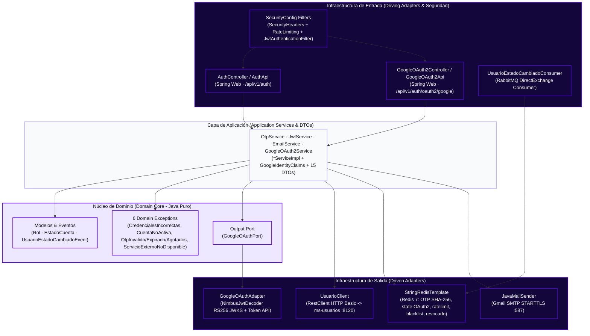
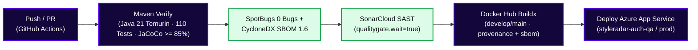

<!-- ==============================================================================
  STYLE RADAR 
  Asignatura: DOSW · 2026
  Estándar obligatorio unificado para los 13 microservicios del proyecto StyleRadar.
============================================================================== -->

<div align="center">

  <a href="https://github.com/StyleRadar1">
    
  </a>

  <h1>STYLE<font color="#5600EF">RADAR</font> &nbsp;·&nbsp; <code>ms-auth</code></h1>

  <p align="center">
    
    
    
  </p>

  <p align="center">
    <strong><font color="#5600EF">Descubre tu estilo. En tu ciudad.</font></strong><br />
    <em>Plataforma de moda local con inventario multi-sede geolocalizado en tiempo real y probador virtual para Bogotá.</em>
  </p>

  <p align="center">
    <a href="https://styleradar-auth-prod.azurewebsites.net/actuator/health">
      
    </a>
    <a href="https://styleradar-auth-qa.azurewebsites.net/swagger-ui.html">
      
    </a>
    <a href="docs/DocumentoTecnico.html">
      
    </a>
    <a href="https://github.com/StyleRadar1/CADCHE-Authentication-Service/actions/workflows/ci.yml">
      
    </a>
    <a href="https://sonarcloud.io/project/overview?id=StyleRadar1_CADCHE-Authentication-Service">
      
    </a>
    <a href="https://sonarcloud.io/component_measures?id=StyleRadar1_CADCHE-Authentication-Service&metric=coverage">
      
    </a>
    <a href="#6-tecnologías-y-dependencias">
      
    </a>
    <a href="#6-tecnologías-y-dependencias">
      
    </a>
    <a href="#6-tecnologías-y-dependencias">
      
    </a>
    <a href="#7-cómo-ejecutar-local-y-con-docker">
      
    </a>
  </p>

</div>


---

##  ÍNDICE DE CONTENIDOS

1. [Nombre del servicio y su bounded context](#1-nombre-del-servicio-y-su-bounded-context)
2. [Equipo y responsables](#2-equipo-y-responsables)
3. [Arquitectura hexagonal con su diagrama](#3-arquitectura-hexagonal-con-su-diagrama)
4. [Endpoints y enlace a Swagger](#4-endpoints-y-enlace-a-swagger)
5. [Eventos que publica y consume](#5-eventos-que-publica-y-consume)
6. [Tecnologías y dependencias](#6-tecnologías-y-dependencias)
7. [Cómo ejecutar local y con Docker](#7-cómo-ejecutar-local-y-con-docker)
8. [Variables de entorno](#8-variables-de-entorno)
9. [Pruebas y cobertura](#9-pruebas-y-cobertura)
10. [CI/CD con el badge del pipeline](#10-cicd-con-el-badge-del-pipeline)
11. [Ramas y cómo contribuir](#11-ramas-y-cómo-contribuir)
12. [Enlace a la épica en Jira](#12-enlace-a-la-épica-en-jira)
13. [Análisis de tecnologías del servicio](#13-análisis-de-tecnologías-del-servicio)
14. [Análisis de seguridad OWASP Top 10:2025](#14-análisis-de-seguridad-owasp-top-102025)

---

<a id="1-nombre-del-servicio-y-su-bounded-context"></a>

##  1. NOMBRE DEL SERVICIO Y SU BOUNDED CONTEXT

* **Identificador de Servicio:** `ms-auth` (`CADCHE-Authentication-Service`)
* **Paquete Arquitectónico:** `Paquete 1: Identidad`
* **Puerto de Escucha Oficial:** `8100` (definido en la matriz de puertos sin colisión)
* **Base de Datos Asignada:** `Redis 7` (`:6379`, TLS `:6380` en `qa`/`prod`; almacenamiento operativo activo para códigos OTP SHA-256 TTL `300 s`, contadores de reenvíos, estados anti-CSRF Google `oauth2:state`, rate limiting, blacklist JWT de `/logout`/`/refresh` y revocación global de usuario, con respaldo en memoria `ConcurrentHashMap` aislado exclusivamente a `dev`/`test`) + `PostgreSQL 16` (`styleradar_auth`, configurado en YAML/Docker pero excluido en `dev`/`test` sin entidades JPA ni migraciones SQL desplegadas hoy, delegando credenciales e identidad federada vía HTTP Basic a `ms-usuarios` en `:8120`). Ver diseño completo en [docs/DocumentoTecnico.html](docs/DocumentoTecnico.html) y [DiagramaBaseDatos.png](docs/uml/DiagramaBaseDatos.png).
* **Bounded Context:** `Autenticación, Identidad Federada y Control de Acceso (IAM)`

### Responsabilidades del Dominio

Este microservicio encapsula exclusivamente la lógica de negocio correspondiente a `Autenticación, Identidad Federada y Control de Acceso (IAM)`.

| Qué HACE este Microservicio (Alcance) | Qué NO HACE este Microservicio (Límites) |
| :--- | :--- |
| • Autentica de forma unificada a los cuatro roles (`COMPRADOR`, `ADMIN_ALMACEN`, `REPRESENTANTE_FUNDACION`, `ADMIN_STYLERADAR`) mediante **dos flujos paralelos**: credenciales + OTP de 6 dígitos (hash SHA-256 en Redis) o **Google OAuth2 / OpenID Connect** (`idToken` RS256/JWKS y Authorization Code + `state` CSRF), emitiendo JWT (`HS256`, `LoginResponseDTO`) (`SR-RF-02`, `SR-RF-03`). | • NO almacena perfiles, tallas, preferencias ni hashes de contraseña locales (delega verificación y aprovisionamiento OAuth2 vía HTTP Basic a `ms-usuarios`, `:8120` en local). |
| • Genera, verifica y reenvía códigos OTP de 6 dígitos con vigencia de `300 s` (`TTL`), máximo `3` intentos y máximo `3` reenvíos (`429`), despachándolos vía SMTP (`EmailServiceImpl` / `JavaMailSender`) con rollback transaccional si falla el envío (`SR-RF-92`). | • NO administra almacenes aliados, verificación de RUT ni fundaciones aliadas (delegado a `ms-tiendas`). |
| • Rota JWT vigentes (`/refresh`), revoca tokens en lista negra al cerrar sesión (`/logout`, `blacklist:*`), escucha cambios administrativos de cuenta vía RabbitMQ (`auth.usuario.estado.cambiado`) para revocación anti-replay (`usuario:revocado:*`) y expone `/registro` (stub en `dev`/`test`, `503` fail-closed en `qa`/`prod`, `SR-RF-01`, `SR-RNF-01`). | • NO publica eventos AMQP actualmente hacia `ms-notificaciones` ni accede directamente a bases de datos de otros microservicios. |
| • Aplica endurecimiento OWASP Top 10:2025: cabeceras defensivas (`SecurityHeadersFilter`), limitador de tasa en Redis (`RateLimitingFilter`), validación anti-Open Redirect (`GOOGLE_ALLOWED_REDIRECT_URIS`), anti-SSRF (`SecuritySanitizer`) y modo *fail-closed* (`503`) en `qa`/`prod` (`SR-RNF-02`). | • NO gestiona catálogos, inventario ni pasarelas de pago. |

### Arquetipos de Moda y Personajes de StyleRadar

<div align="center">

| Antonia (Sastre) | Mateo (Calle) | Aura (Futuro) | Nora (Rebelde) | Tomás (Esencial) |
| :---: | :---: | :---: | :---: | :---: |
| <br>**Sastre**<br><sub>Tiendas & Descubrimiento</sub> | <br>**Calle**<br><sub>Playlists & Cultura Urbana</sub> | <br>**Futuro**<br><sub>Probador Virtual AI</sub> | <br>**Rebelde**<br><sub>Segunda Vida & Vintage</sub> | <br>**Esencial**<br><sub>Fundaciones & Donaciones</sub> |

</div>

---

<a id="2-equipo-y-responsables"></a>

##  2. EQUIPO Y RESPONSABLES

Desarrollado y mantenido por el **Squad `CADche` (`CADCHE`)** para la asignatura DOSW 2026.

<div align="center">

| Rol | Nombre Completo | Usuario GitHub |
| :---: | :---: | :---: |
| **Tech Lead / Arquitecto & Backend Developer** | `Julian Camilo Giral` | `[@jcobos548](https://github.com/jcobos548)` |
| **Product Owner / Scrum Master & Backend Developer** | `Juan Diego Gaitan` | `[@mamagege](https://github.com/mamagege)` |

</div>

---

<a id="3-arquitectura-hexagonal-con-su-diagrama"></a>

##  3. ARQUITECTURA HEXAGONAL CON SU DIAGRAMA

El microservicio implementa **Arquitectura Hexagonal Minimalista (Puertos y Adaptadores)** con dominio Java puro desacoplado de frameworks y comunicación explícita hacia sistemas externos.

### Diagrama Interactivo de Capas (Mermaid)



> **Diagramas UML oficiales (formato StyleRadar):** Versionados en Draw.io editable y PNG 2x dentro de `docs/uml/`: [`DiagramaClases.drawio`](docs/uml/DiagramaClases.drawio) · [`DiagramaBaseDatos.drawio`](docs/uml/DiagramaBaseDatos.drawio) · [`DiagramaComponentesEspecifico.drawio`](docs/uml/DiagramaComponentesEspecifico.drawio).

### 3.1 Diagrama de Clases de Dominio (`ms-auth`)

<div align="center">
  <br />
  <sub>Figura 3.1: Diagrama de clases real del núcleo de dominio, puerto <code>GoogleOAuthPort</code>, 6 excepciones, 4 servicios de aplicación y 15 DTOs (9 Request / 6 Response) en estilo StyleRadar (Draw.io editable en <a href="docs/uml/DiagramaClases.drawio"><code>docs/uml/DiagramaClases.drawio</code></a> · Explicación ampliada en <a href="docs/DocumentoTecnico.html"><code>docs/DocumentoTecnico.html</code></a>, Sección <strong>12 · Dominio y Red</strong>).</sub>
</div>

#### Justificación Arquitectónica y Alcance del Dominio Real

La inspección directa de los paquetes `domain` y `application` en `src/main/java/edu/dosw/styleradar/auth` (`51` archivos fuente Java) refleja un diseño minimalista alineado con los límites reales del microservicio:

- **Sin `@Entity` ni Agregados JPA Locales (Cero Duplicación con `ms-usuarios`):** El agregado de usuario, sus credenciales y su aceptación legal viven actualmente en `ms-usuarios` (`:8120` en local), mientras códigos OTP (`300 s`, hash SHA-256), reenvíos, `oauth2:state`, rate limiting, blacklist JWT y revocación de sesión residen en `Redis 7 (:6379)`. Los paquetes `domain/repository/` y `infrastructure/adapter/out/persistence/{entity,repository}/` solo conservan `.gitkeep` mientras PostgreSQL 16 permanece diferido, evitando inflar el dominio con entidades ORM artificiales.
- **Pureza de Tipos de Dominio (`domain` libre de frameworks):** Los paquetes `domain.model`, `domain.event`, `domain.exception` y `domain.port.out` dependen exclusivamente de tipos estándar de Java (`enum`, `record`, `Instant`, `RuntimeException`) e interfaces puras (`GoogleOAuthPort`).
- **Contratos Segregados e Inmutabilidad (`application`):** El núcleo expone `4` contratos explícitos (`OtpService`, `JwtService`, `EmailService`, `GoogleOAuth2Service`) con sus implementaciones desacopladas (`*ServiceImpl`), usa `GoogleIdentityClaims` para aislar los claims OIDC verificados y transporta entradas/salidas en `15` DTOs (`9` Request, `6` Response, incluyendo Java `record` inmutables).

#### Inventario Detallado de Clases, Eventos y Servicios Verificados

| Capa / Paquete | Elemento UML | Tipo | Miembros / Responsabilidad Exacta en Código |
| :--- | :--- | :--- | :--- |
| **`domain.model`** | `Rol` | `enum` | `COMPRADOR`, `ADMIN_ALMACEN`, `REPRESENTANTE_FUNDACION`, `ADMIN_STYLERADAR`. Modela roles RBAC embebidos en JWT y sesiones OTP. |
| **`domain.model`** | `EstadoCuenta` | `enum` | `ACTIVA`, `INACTIVA`, `BLOQUEADA`. Valida habilitación desde `ms-usuarios` y gobierna eventos de revocación de sesión. |
| **`domain.event`** | `UsuarioEstadoCambiadoEvent` | `record` | `(Long usuarioId, EstadoCuenta estadoAnterior, EstadoCuenta estadoNuevo, Long administradorId, String motivo, Instant fechaCambio)`. Consumido por `UsuarioEstadoCambiadoConsumer` desde RabbitMQ. |
| **`domain.exception`** | `CredencialesIncorrectasException`<br>`CuentaNoActivaException`<br>`OtpExpiradoException`<br>`OtpIntentosAgotadosException`<br>`OtpInvalidoException`<br>`ServicioExternoNoDisponibleException` | `class extends RuntimeException` | Jerarquía de `6` excepciones de dominio traducidas a `401`, `403`, `429` y `503` (fail-closed) con formato uniforme `ErrorResponseDTO` en `GlobalExceptionHandler`. |
| **`domain.port.out`** | `GoogleOAuthPort` | `interface` | Puerto de salida (`verificarIdToken(idToken): GoogleIdentityClaims`, `intercambiarCodigoPorIdToken(code, redirectUri): String`) implementado por `GoogleOAuthAdapter`. |
| **`application.service`** + **`impl`** | `OtpService` ← `OtpServiceImpl` | `interface` / `@Service` | `10` métodos: `generarOtp`, `verificarOtp`, `reenviarOtp`, `obtenerUsuarioId`, `obtenerRol`, `obtenerIntentosRestantes`, `eliminarOtp`, `invalidarToken`, `esTokenInvalido`, `estaUsuarioRevocado`. Hash SHA-256 salteado con `SecureRandom` + `MessageDigest.isEqual()`, `ttlSeconds=300`, `maxAttempts=3`, `maxResends=3`. |
| **`application.service`** + **`impl`** | `JwtService` ← `JwtServiceImpl` | `interface` / `@Service` | `5` métodos: `generarToken(Long, Set<Rol>)`, `validarToken`, `obtenerUsuarioId`, `obtenerRoles`, `obtenerTiempoRestanteSegundos`. Opera con `SecretKey` Base64 (`>= 256` bits, huella bloqueada en `qa`/`prod`) y `Duration`. |
| **`application.service`** + **`impl`** | `EmailService` ← `EmailServiceImpl` | `interface` / `@Service` | `enviarOtp(String, String)`. Despacha correos OTP vía `JavaMailSender` (solo fallback consola cuando el perfil activo es `dev` puro y flag habilitado). |
| **`application.service`** + **`impl`** | `GoogleOAuth2Service` ← `GoogleOAuth2ServiceImpl` | `interface` / `@Service` | `3` métodos: `generarUrlAutorizacion(redirectUri)`, `autenticarConIdToken(idToken)`, `autenticarConCodigo(code, state, redirectUri)`. Usa `GoogleIdentityClaims`, `oauth2:state:{state}` de un solo uso y `allowedRedirectUris` anti-Open Redirect. |
| **`application.dto`** | `9` Request DTOs + `6` Response DTOs (`15` totales) | `class` / `record` | **Requests:** `LoginRequestDTO`, `VerificarOtpRequestDTO`, `ReenviarOtpRequestDTO`, `RefreshTokenRequestDTO`, `RegistroAuthRequestDTO`, `VerificarCredencialesRequestDTO`, `GoogleLoginRequestDTO`, `GoogleCodeLoginRequestDTO`, `OAuthUsuarioRequestDTO`. **Responses:** `LoginResponseDTO`, `OtpMensajeResponseDTO`, `UsuarioAuthResponseDTO`, `VerificarCredencialesResponseDTO`, `GoogleAuthUrlResponseDTO`, `ErrorResponseDTO`. |

> La justificación arquitectónica detallada de este modelo se encuentra en [docs/DocumentoTecnico.html](docs/DocumentoTecnico.html) (Sección **12 · Dominio y Red**).

---

### 3.2 Diagrama de Base de Datos (`ms-auth` — Redis 7 Activo + Contrato `ms-usuarios` + `Google Identity`)

<div align="center">
  <br />
  <sub>Figura 3.2: Modelo real de almacenamiento activo en Redis 7 (`9` prefijos / `5` grupos), identidad externa federada en Google OIDC y fuente de usuarios <code>ms-usuarios (:8120)</code> (Draw.io editable en <a href="docs/uml/DiagramaBaseDatos.drawio"><code>docs/uml/DiagramaBaseDatos.drawio</code></a> · Estado diferido de PostgreSQL 16 en <a href="docs/DocumentoTecnico.html"><code>docs/DocumentoTecnico.html</code></a>, Sección <strong>07 · Datos</strong>).</sub>
</div>

#### Justificación Arquitectónica del Modelo de Datos Real (ADR-02 y ADR-04)

Contrario a esquemas teóricos tempranos, la auditoría directa del código fuente (`OtpServiceImpl`, `GoogleOAuth2ServiceImpl`, `RateLimitingFilter`, `JwtAuthenticationFilter`, `UsuarioEstadoCambiadoConsumer`, `UsuarioClient` y perfiles YAML) demuestra una arquitectura enfocada en latencia sub-milisegundo y cero duplicación de credenciales:

- **Motor Activo Clave-Valor (`Redis 7` en `:6379`, TLS `:6380` en `qa`/`prod`):** Almacena exclusivamente estado efímero de seguridad (`9` prefijos exactos) que requiere expiración automática por **TTL** o validación en cada petición (`/refresh`, `/oauth2/google/callback`, `RateLimitingFilter`, filtro JWT). En `qa`/`prod` (`redis-local-fallback-enabled=false`), cualquier caída de Redis dispara un comportamiento estricto **fail-closed (`503`)** vía `ServicioExternoNoDisponibleException`; únicamente con perfil `dev` o `test` activo conmuta a mapas concurrentes locales (`ConcurrentHashMap`).
- **Fuente Externa de Credenciales e Identidad OAuth2 (`ms-usuarios` en `:8120` vía HTTP Basic):** `ms-auth` no duplica perfiles ni contraseñas en base local. Durante `POST /login`, `UsuarioClient` consulta `/internal/api/v1/usuarios/verificar-credenciales`; durante flujos Google OAuth2 (`/oauth2/google`, `/callback`, `/code`), resuelve o aprovisiona al usuario vía `/internal/api/v1/usuarios/oauth2` (`OAuthUsuarioRequestDTO` &rarr; `VerificarCredencialesResponseDTO`).
- **Estado Real de `PostgreSQL 16` (`styleradar_auth`) y `Flyway 10.20.1`:** Aunque `pom.xml`, `application.yml` (`ddl-auto: validate`, `flyway.enabled: false`) y `docker-compose.yml` (`auth-db` en `5434:5432`) parametrizan la base relacional, `application-dev.yml` y `application-test.yml` excluyen `DataSourceAutoConfiguration`, `HibernateJpaAutoConfiguration` y `FlywayAutoConfiguration`. Hoy existen `0` `@Entity` y `POST /registro` responde como stub controlado (`201`, `id=12L`) en `dev`/`test` o `503` fail-closed en `qa`/`prod`.

#### Tabla de Bases de Datos y Almacenamiento por Ambiente

| Ambiente / Perfil | Almacenamiento Activo (`Redis 7`) | Persistencia Relacional (`PostgreSQL 16`) | Fuente de Identidad (`ms-usuarios`) | Comportamiento de Respaldo / Seguridad |
| :--- | :--- | :--- | :--- | :--- |
| **Local / `dev`** | `${REDIS_HOST:localhost}:${REDIS_PORT:6379}` (sin SSL) | Excluida (`DataSource`, `JPA`, `Flyway`). En `docker-compose.yml`: servicio `auth-db` (`postgres:16-alpine`, `styleradar_auth`, puerto `5434:5432`) | `http://localhost:8120` (`USUARIOS_SERVICE_URL`) | Fallbacks locales activos solo en `dev` (`redis-local-fallback-enabled: true`, `dev-fallback-enabled: true`, `registration.stub-enabled: true`) |
| **Pruebas / `test`** | Mocks `StringRedisTemplate` y fallback en memoria para tests | Excluida (`DataSourceAutoConfiguration`, `HibernateJpaAutoConfiguration`, `FlywayAutoConfiguration`) | Mockeado en suite (`dev-fallback-enabled: false`) | Fallbacks Redis/SMTP deshabilitados (`false`); `registration.stub-enabled: true` para pruebas de contrato |
| **Calidad / `qa`** | `${REDIS_HOST}:${REDIS_PORT:6380}` (`REDIS_SSL_ENABLED=true`) | `jdbc:postgresql://styleradar-pg-qa.postgres.database.azure.com:5432/styleradar_auth?sslmode=require` (`styleradaradmin`, Hikari max `5`, `ddl-auto: validate`, `FLYWAY_ENABLED=false`) | `https://styleradar-usuarios-qa.azurewebsites.net` | **Fail-closed (`503`)**, sin fallbacks en memoria ni stubs (`false`); secreto JWT de ejemplo bloqueado; Swagger activo (`SWAGGER_ENABLED=true`) |
| **Producción / `prod`** | `${REDIS_HOST}:${REDIS_PORT:6380}` (`REDIS_SSL_ENABLED=true`) | `jdbc:postgresql://styleradar-pg-prod.postgres.database.azure.com:5432/styleradar_auth?sslmode=require` (`styleradaradmin`, Hikari max `10`, `ddl-auto: validate`, `FLYWAY_ENABLED=false`) | `https://styleradar-usuarios-prod.azurewebsites.net` | **Fail-closed (`503`)**, sin fallbacks ni stubs (`false`); secreto JWT de ejemplo bloqueado; Swagger off (`false`); rate limit `10` req/min |

> *(Nota arquitectónica: hoy la base operativa real en ejecución para OTP, `oauth2:state`, `ratelimit`, blacklist y revocaciones es `Redis 7`; `PostgreSQL 16` queda parametrizado por perfil para futura persistencia JPA sin entidades activas en este corte.)*

#### Catálogo Exacto de Claves en Redis 7 (`9` Prefijos · `StringRedisTemplate`)

| Grupo en Diagrama | Prefijo Exacto en Código | Tipo / Formato de Valor | TTL Configurado | Escrita Por | Leída / Validada Por |
| :--- | :--- | :--- | :--- | :--- | :--- |
| **`otp_sesion_redis`** | `otp:{email}` | `STRING` (Hash SHA-256 salteado `<saltB64>$<hashB64>`) | `300 s` (`otp.ttl-seconds`) | `OtpServiceImpl` | `OtpServiceImpl` (`/otp/verificar`, `MessageDigest.isEqual`) |
| **`otp_sesion_redis`** | `otp:intentos:{email}` | `STRING` (`"3"` &rarr; `"0"` decremento) | `300 s` | `OtpServiceImpl` | `OtpServiceImpl` (máx. `3` intentos -> `429`) |
| **`otp_sesion_redis`** | `otp:reenvios:{email}` | `STRING` (`"1"` &rarr; `"3"` incremento) | `300 s` | `OtpServiceImpl` (`/otp/reenviar`) | `OtpServiceImpl` (máx. `3` reenvíos -> `429`) |
| **`otp_sesion_redis`** | `otp:usuario:{email}` | `STRING` (`Long usuarioId` desde `ms-usuarios`) | `300 s` | `OtpServiceImpl` | `OtpServiceImpl` (para claim `sub` JWT) |
| **`otp_sesion_redis`** | `otp:rol:{email}` | `STRING` (`Enum Rol.name()`) | `300 s` | `OtpServiceImpl` | `OtpServiceImpl` (para claim `roles` JWT) |
| **`jwt_blacklist_redis`** | `blacklist:{token}` | `STRING` (`"revoked"`) | Restante del JWT (hasta `PT24H`) | `OtpServiceImpl` (`/logout` y rotación `/refresh`) | `JwtAuthenticationFilter` y `/refresh` |
| **`usuario_revocado_redis`** | `usuario:revocado:{usuarioId}` | `STRING` (epoch ms `evento.fechaCambio()`) | Sin TTL (persistente) | `UsuarioEstadoCambiadoConsumer` (`auth.usuario.estado.cambiado`) | `JwtAuthenticationFilter` y `/refresh` (`issuedAt <= epoch` -> `401`) |
| **`oauth2_state_redis`** | `oauth2:state:{state}` | `STRING` (`redirectUri` autorizada, `32` bytes `SecureRandom`) | `300 s` (`state-ttl-seconds`) | `GoogleOAuth2ServiceImpl` (`GET /oauth2/google/url`) | `GoogleOAuth2ServiceImpl` (`getAndDelete` 1 uso en `/callback` y `/code`) |
| **`rate_limit_redis`** | `ratelimit:{ruta}:{ip}` | `STRING` (contador por ventana fija IP + endpoint) | `60 s` (`window-seconds`) | `RateLimitingFilter` (`INCR` + `EXPIRE`) | `RateLimitingFilter` (`> 15` dev/qa o `> 10` prod -> `429` + `Retry-After`) |

#### Contratos Externos (`ms-usuarios` + `Google Identity`) y Parámetros SQL Diferidos

| Elemento / Grupo | Campo / Propiedad | Detalle Exacto Verificado en Código y Configuración |
| :--- | :--- | :--- |
| **`ms_usuarios`** | `id`, `email`, `rol`, `estado` | Recibido en `VerificarCredencialesResponseDTO` tanto tras `/verificar-credenciales` como tras `/oauth2` (`OAuthUsuarioRequestDTO(email, nombre, "GOOGLE", sub)`). Valida `Rol` (`4` roles) y `EstadoCuenta.ACTIVA`. |
| **`google_oidc_claims`** | `subject`, `email`, `emailVerified`, `name` | Extraído tras validar firma `RS256` contra Google JWKS (`iss` Google, `aud` = `GOOGLE_CLIENT_ID`, `exp` vigente, `email_verified=true`). |
| **`PostgreSQL 16` + `Flyway 10` (Diferido)** | `datasource.url`, `ddl-auto`, `flyway.enabled` | `jdbc:postgresql://localhost:5432/styleradar_auth` (`docker-compose`: `auth-db` `5434:5432`), `validate` (`0` `@Entity`), `false` (`db/migration/.gitkeep`); autoconfiguraciones SQL excluidas en `dev` y `test`. |

> Documentación arquitectónica y decisiones de diseño ampliadas en [docs/DocumentoTecnico.html](docs/DocumentoTecnico.html) (Sección **03 · Arquitectura** y Sección **07 · Datos**).

---

### 3.3 Diagrama de Componentes Específico en Arquitectura Hexagonal (`ms-auth`)

<div align="center">
  <br />
  <sub>Figura 3.3: Diagrama de componentes específico en arquitectura hexagonal de <code>ms-auth</code> con filtros de seguridad, controladores OTP + Google OAuth2, puerto <code>GoogleOAuthPort</code> y adaptadores reales (Draw.io editable en <a href="docs/uml/DiagramaComponentesEspecifico.drawio"><code>docs/uml/DiagramaComponentesEspecifico.drawio</code></a> · Explicación en <a href="docs/DocumentoTecnico.html"><code>docs/DocumentoTecnico.html</code></a>, Sección <strong>04 · Componentes</strong>).</sub>
</div>

#### Justificación del Enfoque Hexagonal Real

La vista de componentes excluye deliberadamente entidades, enums y DTOs (documentados en el [Diagrama de Clases](docs/uml/DiagramaClases.png)) y refleja exactamente los artefactos ejecutables implementados en `src/main/java/edu/dosw/styleradar/auth`:

- **Separación Filtros / Entrada &rarr; Núcleo &rarr; Salida:** Los adaptadores primarios (`AuthController`, `GoogleOAuth2Controller`, `UsuarioEstadoCambiadoConsumer`) y los filtros de seguridad (`SecurityHeadersFilter`, `RateLimitingFilter`, `JwtAuthenticationFilter`) aíslan el transporte HTTP, el limitador de tasa y la escucha AMQP respecto a la lógica de negocio en `application.service.impl`.
- **Interfaces y Puerto Explícito (`—(o—`):** Los conectores *ball-and-socket* modelan exclusivamente las interfaces reales definidas hoy (`EmailService`, `OtpService`, `JwtService`, `GoogleOAuth2Service`) y el puerto de salida explícito `domain.port.out.GoogleOAuthPort` implementado por `GoogleOAuthAdapter`.
- **Hexagonal Pragmática sin Sobre-ingeniería:** `AuthController` y `GoogleOAuth2ServiceImpl` invocan directamente a `UsuarioClient` (`RestClient` hacia `ms-usuarios`), mientras los servicios de dominio e infraestructura operan con `StringRedisTemplate` y `JavaMailSender`. Los paquetes de plantilla vacíos (`domain/port/in/`, `application/usecase/`, `application/mapper/{in,out}/`, `infrastructure/adapter/out/persistence/{entity,repository}/`) conservan `.gitkeep` mientras los usuarios residen en `ms-usuarios`.

#### Desglose de Componentes Reales y Flujos

| Capa Hexagonal | Componente UML | Ubicación / Origen Real | Responsabilidad e Interacciones Verificadas |
| :--- | :--- | :--- | :--- |
| **Seguridad (`Chain`)** | `SecurityHeadersFilter`, `RateLimitingFilter`, `JwtAuthenticationFilter` | `infrastructure/security/` | Inyectan cabeceras OWASP (`CSP`, `HSTS`, `DENY`, `no-store`), limitan tasa en Redis (`429`) sobre 9 endpoints de acceso y validan JWT `HS256`, `blacklist:*` y `usuario:revocado:*`. |
| **Entrada (`IN`)** | `AuthController` (`AuthApi`) | `infrastructure/adapter/in/rest/` | Expone `POST /api/v1/auth/{login, otp/verificar, otp/reenviar, refresh, logout, registro}`; invoca `UsuarioClient` y orquesta `EmailService`, `OtpService` y `JwtService`. |
| **Entrada (`IN`)** | `GoogleOAuth2Controller` (`GoogleOAuth2Api`) | `infrastructure/adapter/in/rest/` | Expone `/api/v1/auth/oauth2/google` (`POST` One Tap), `/url` (`GET`), `/callback` (`GET`) y `/code` (`POST`); delega en `GoogleOAuth2Service`. |
| **Entrada (`IN · AMQP`)** | `UsuarioEstadoCambiadoConsumer` | `infrastructure/adapter/in/messaging/` | `@RabbitListener` sobre la cola `auth.usuario.estado.cambiado` (`DirectExchange styleradar.usuarios`); registra sello de revocación en `StringRedisTemplate` y propaga `DataAccessException`. |
| **Núcleo (`Core`)** | `EmailServiceImpl` | `application/service/impl/` | Implementa `EmailService`; construye y despacha correos OTP mediante `JavaMailSender` (fail-closed fuera de `dev`). |
| **Núcleo (`Core`)** | `OtpServiceImpl` | `application/service/impl/` | Implementa `OtpService`; gestiona OTP con hash SHA-256 salteado, reenvíos, `blacklist:*` y revocación de usuario en Redis (fallback solo `dev`/`test`). |
| **Núcleo (`Core`)** | `JwtServiceImpl` | `application/service/impl/` | Implementa `JwtService`; genera y valida JWT `HS256` (`JJWT 0.12.6`) verificando entropía mínima Base64 y bloqueando la clave dev en `qa`/`prod`. |
| **Núcleo (`Core`)** | `GoogleOAuth2ServiceImpl` | `application/service/impl/` | Implementa `GoogleOAuth2Service`; genera URLs autorizadas (`allowedRedirectUris`), protege Authorization Code con `oauth2:state` y emite JWT StyleRadar tras `UsuarioClient.resolverUsuarioOAuth`. |
| **Salida (`OUT`)** | `GoogleOAuthAdapter` (`GoogleOAuthPort`) | `infrastructure/adapter/out/external/` | Implementa `GoogleOAuthPort`; verifica ID Tokens RS256 contra Google JWKS (`NimbusJwtDecoder`) e intercambia códigos contra `oauth2.googleapis.com/token`. |
| **Salida (`OUT`)** | `UsuarioClient` | `infrastructure/adapter/out/external/` | `RestClient` HTTP Basic contra `ms-usuarios` (`/verificar-credenciales` y `/oauth2`) con validación anti-SSRF en URL (`SecuritySanitizer`) y fallback solo en `dev`. |
| **Salida (`OUT`)** | `JavaMailSender` · `StringRedisTemplate` | Spring Mail / Data Redis | Adaptadores Spring hacia `SMTP Gmail` (`:587`) y `Redis 7` (`:6379` / TLS `:6380`). |
| **Externos** | `Google Identity` · `ms-usuarios` · `Redis 7` · `SMTP Gmail` · `RabbitMQ` | Sistemas externos | Proveedor OIDC RS256, servicio maestro de usuarios, almacenamiento clave-valor TTL, correo STARTTLS y broker `DirectExchange("styleradar.usuarios")`. |

> Como soporte transversal de infraestructura operan [`SecurityConfig`](src/main/java/edu/dosw/styleradar/auth/infrastructure/config/SecurityConfig.java), [`GlobalExceptionHandler`](src/main/java/edu/dosw/styleradar/auth/infrastructure/exception/GlobalExceptionHandler.java), [`RabbitMQConfig`](src/main/java/edu/dosw/styleradar/auth/infrastructure/config/RabbitMQConfig.java), [`SwaggerConfig`](src/main/java/edu/dosw/styleradar/auth/infrastructure/config/SwaggerConfig.java), [`SecurityErrorResponseWriter`](src/main/java/edu/dosw/styleradar/auth/infrastructure/security/SecurityErrorResponseWriter.java) y [`SecuritySanitizer`](src/main/java/edu/dosw/styleradar/auth/infrastructure/security/SecuritySanitizer.java). Detalle arquitectónico completo en [docs/DocumentoTecnico.html](docs/DocumentoTecnico.html) (Sección **04 · Componentes**).

### Estructura Oficial de Paquetes en `src/main/java/` (`51` clases fuente)

```text
src/main/java/edu/dosw/styleradar/auth/
├── AuthApplication.java                     <-- Punto de entrada Spring Boot (ms-auth, excluye UserDetailsServiceAutoConfiguration)
├── domain/                                  <-- NÚCLEO DE DOMINIO (Cero dependencias externas de framework)
│   ├── model/                               <-- Enumeraciones de dominio (Rol, EstadoCuenta)
│   ├── event/                               <-- Evento de dominio inmutable (UsuarioEstadoCambiadoEvent)
│   ├── exception/                           <-- 6 excepciones tipadas (CredencialesIncorrectas, CuentaNoActiva, OtpInvalido/Expirado/Agotados, ServicioExternoNoDisponible)
│   └── port/
│       ├── in/                              <-- (.gitkeep) Reservado para casos de uso entrantes explícitos
│       └── out/                             <-- Output Port GoogleOAuthPort (verificarIdToken, intercambiarCodigoPorIdToken)
├── application/                             <-- CAPA DE APLICACIÓN (Servicios, Claims OIDC y DTOs)
│   ├── dto/
│   │   ├── request/                         <-- 9 Request DTOs (Login, VerificarOtp, ReenviarOtp, RefreshToken, RegistroAuth, VerificarCredenciales, GoogleLogin, GoogleCodeLogin, OAuthUsuario)
│   │   ├── response/                        <-- 6 Response DTOs (LoginResponse, OtpMensajeResponse, UsuarioAuthResponse, VerificarCredencialesResponse, GoogleAuthUrlResponse, ErrorResponse)
│   │   └── event/                           <-- (.gitkeep)
│   ├── mapper/{in,out}/                     <-- (.gitkeep)
│   ├── service/                             <-- OtpService, JwtService, EmailService, GoogleOAuth2Service, GoogleIdentityClaims
│   │   └── impl/                            <-- OtpServiceImpl, JwtServiceImpl, EmailServiceImpl, GoogleOAuth2ServiceImpl
│   └── usecase/                             <-- (.gitkeep)
└── infrastructure/                          <-- CAPA DE INFRAESTRUCTURA (Adaptadores, Seguridad y Configuración)
    ├── adapter/
    │   ├── in/
    │   │   ├── rest/                        <-- AuthController, GoogleOAuth2Controller
    │   │   │   └── doc/                     <-- Contratos OpenAPI 3 (AuthApi, GoogleOAuth2Api)
    │   │   ├── messaging/                   <-- Consumidor RabbitMQ (UsuarioEstadoCambiadoConsumer)
    │   │   └── {amqp,websocket}/            <-- (.gitkeep)
    │   └── out/
    │       ├── external/                    <-- Clientes salientes HTTP/OIDC (UsuarioClient, GoogleOAuthAdapter)
    │       └── persistence/{entity,repository}/ <-- (.gitkeep - PostgreSQL/Flyway diferidos)
    ├── security/                            <-- SecurityHeadersFilter, RateLimitingFilter, JwtAuthenticationFilter, SecurityErrorResponseWriter, SecuritySanitizer
    ├── config/                              <-- SecurityConfig, RabbitMQConfig (DirectExchange), SwaggerConfig
    └── exception/                           <-- GlobalExceptionHandler (manejo centralizado 400/401/403/405/429/500/503)
```

---

<a id="4-endpoints-y-enlace-a-swagger"></a>

##  4. ENDPOINTS Y ENLACE A SWAGGER

La documentación interactiva OpenAPI 3.0 y los contratos de ejecución se encuentran desplegados y clasificados por entorno (`SwaggerConfig` agrupa endpoints bajo dos tags públicos: **Autenticación** y **Autenticación con Google (OAuth2 / OIDC)**):

### Matriz Oficial de Enlaces por Entorno (PROD, QA, LOCAL)

| Entorno | Perfil | Propósito | URL Base del Servicio | Swagger OpenAPI UI | Health Check |
| :--- | :---: | :--- | :--- | :--- | :--- |
| **Producción (PROD)** | `prod` | Despliegue productivo (`main` → `styleradar-auth-prod`) | `https://styleradar-auth-prod.azurewebsites.net` | Deshabilitado en PROD (`springdoc.swagger-ui.enabled: false`, OWASP) | [`/actuator/health`](https://styleradar-auth-prod.azurewebsites.net/actuator/health) |
| **Calidad / Pruebas (QA)** | `qa` | Pruebas integradas y verificación (`develop` → `styleradar-auth-qa`) | `https://styleradar-auth-qa.azurewebsites.net` | [Swagger UI QA](https://styleradar-auth-qa.azurewebsites.net/swagger-ui.html) (`200 OK`) | [`/actuator/health`](https://styleradar-auth-qa.azurewebsites.net/actuator/health) |
| **Desarrollo Local (DEV)** | `dev` | Ejecución local / Docker Compose en puerto oficial `8100` | `http://localhost:8100` | [Swagger UI Local](http://localhost:8100/swagger-ui.html) | [`/actuator/health`](http://localhost:8100/actuator/health) |

* **Especificación OpenAPI (JSON Schema):** `http://localhost:8100/v3/api-docs` en local y [`https://styleradar-auth-qa.azurewebsites.net/v3/api-docs`](https://styleradar-auth-qa.azurewebsites.net/v3/api-docs) en QA (`/swagger-ui/index.html` también resuelve en QA y local). En `prod`, tanto `/v3/api-docs` como `/swagger-ui/**` y `/actuator/info` permanecen deshabilitados, exponiendo únicamente `/actuator/health`.

### Tabla de Endpoints Expuestos (`10` rutas REST + Actuator)

| Método | Endpoint | Request / Parámetros | Response Exitosa | Acceso / Rate Limit | Códigos HTTP Reales |
| :---: | :--- | :--- | :--- | :---: | :---: |
| `POST` | `/api/v1/auth/login` | `LoginRequestDTO` (`email`, `password`) | `200` · `OtpMensajeResponseDTO` | Público (`RateLimitingFilter`) | `200`, `400`, `401`, `403`, `429`, `503` |
| `POST` | `/api/v1/auth/otp/verificar` | `VerificarOtpRequestDTO` (`email`, `codigoOtp`) | `200` · `LoginResponseDTO` (JWT `HS256`) | Público (`RateLimitingFilter`) | `200`, `400`, `401`, `429`*, `503` |
| `POST` | `/api/v1/auth/otp/reenviar` | `ReenviarOtpRequestDTO` (`email`) | `200` · `OtpMensajeResponseDTO` | Público (`RateLimitingFilter`, máx `3`) | `200`, `400`, `401`, `429`, `503` |
| `POST` | `/api/v1/auth/oauth2/google` | `GoogleLoginRequestDTO` (`idToken`) | `200` · `LoginResponseDTO` (JWT, sin OTP) | Público (`RateLimitingFilter`) | `200`, `400`, `401`, `403`, `429`, `503` |
| `GET` | `/api/v1/auth/oauth2/google/url` | Query `?redirectUri` (opcional, validado en allowlist) | `200` · `GoogleAuthUrlResponseDTO` | Público (`RateLimitingFilter`) | `200`, `400`, `429`, `503` |
| `GET` | `/api/v1/auth/oauth2/google/callback` | Query `code`, `state`, `redirectUri`, `error` | `200` · `LoginResponseDTO` (JWT, sin OTP) | Público (`RateLimitingFilter`) | `200`, `400`, `401`, `403`, `429`, `503` |
| `POST` | `/api/v1/auth/oauth2/google/code` | `GoogleCodeLoginRequestDTO` (`code`, `state`, `redirectUri`) | `200` · `LoginResponseDTO` (JWT, sin OTP) | Público (`RateLimitingFilter`) | `200`, `400`, `401`, `403`, `429`, `503` |
| `POST` | `/api/v1/auth/refresh` | `RefreshTokenRequestDTO` (`refreshToken`) | `200` · `LoginResponseDTO` (rotado) | Público (`RateLimitingFilter`) | `200`, `400`, `401`, `429`, `503` |
| `POST` | `/api/v1/auth/logout` | Header `Authorization: Bearer <jwt>` | `204` · `No Content` (sin cuerpo) | **Autenticado (`Bearer JWT`)** | `204`, `401`, `503` |
| `POST` | `/api/v1/auth/registro` | `RegistroAuthRequestDTO` (`nombre`, `email`, `telefono`, `password`, `aceptaHabeasData`) | `201` · `UsuarioAuthResponseDTO` (`dev/test` stub) | Público (`dev`/`test`; **`503` en `qa`/`prod`**) | `201`, `400`, `429`, `503` |
| `GET` | `/actuator/health` | Sin parámetros | Estado operativo UP / DOWN | Público | `200`, `503` |

> *Nota de auditoría OpenAPI vs Runtime:* En `/api/v1/auth/otp/verificar`, la anotación Swagger `AuthApi` declara `422`, mientras `GlobalExceptionHandler` retorna **`429 Too Many Requests`** para `OtpIntentosAgotadosException` y **`401 Unauthorized`** para `OtpInvalidoException` / `OtpExpiradoException`.

<details>
<summary><b>Click para ver Ejemplos Reales de Request, Response JSON y Prueba en Swagger UI</b></summary>

<br>

#### 1. Inicio de sesión y desafío OTP (`POST /api/v1/auth/login`)

```bash
curl -X POST "http://localhost:8100/api/v1/auth/login" \
  -H "Content-Type: application/json" \
  -d '{
    "email": "comprador@styleradar.com",
    "password": "StyleRadar2026*"
  }'
```

Response (`200 OK`):

```json
{
  "email": "comprador@styleradar.com",
  "mensaje": "Se envió un código de verificación de 6 dígitos a su correo registrado",
  "expiraEnSegundos": 300,
  "intentosRestantes": 3
}
```

#### 2. Verificación de código OTP y emisión JWT (`POST /api/v1/auth/otp/verificar`)

```bash
curl -X POST "http://localhost:8100/api/v1/auth/otp/verificar" \
  -H "Content-Type: application/json" \
  -d '{
    "email": "comprador@styleradar.com",
    "codigoOtp": "482915"
  }'
```

Response (`200 OK`):

```json
{
  "accessToken": "eyJhbGciOiJIUzI1NiJ9.eyJzdWIiOiIxMiIsInJvbGVzIjpbIkNPTVBSQURPUiJdLCJpYXQiOjE3MzA2NTkyMDAsImV4cCI6MTczMDc0NTYwMH0.firma",
  "tokenType": "Bearer",
  "expiresIn": 86400,
  "usuarioId": 12,
  "roles": ["COMPRADOR"],
  "requiereOtp": false,
  "otpExpiraEnSegundos": null,
  "intentosOtpRestantes": 0
}
```

#### 3. Autenticación federada con Google OAuth2 / OIDC (`Swagger UI` y `curl`)

**Opción A — Flujo Authorization Code completo en Swagger UI (sin frontend):**

1. Verifica que `GOOGLE_CLIENT_ID` y `GOOGLE_CLIENT_SECRET` estén cargados (`.env` en local o App Settings en QA) y que Google Cloud Console tenga autorizado `http://localhost:8100/api/v1/auth/oauth2/google/callback` (o el callback QA).
2. En `/swagger-ui.html`, expande el tag **`Autenticación con Google (OAuth2 / OIDC)`** y ejecuta **`GET /api/v1/auth/oauth2/google/url`**:

```json
{
  "authorizationUrl": "https://accounts.google.com/o/oauth2/v2/auth?client_id=...&redirect_uri=http://localhost:8100/api/v1/auth/oauth2/google/callback&response_type=code&scope=openid%20email%20profile&state=...",
  "state": "<STATE_ANTI_CSRF_32B>",
  "expiresInSeconds": 300,
  "redirectUri": "http://localhost:8100/api/v1/auth/oauth2/google/callback"
}
```

3. Abre `authorizationUrl` en tu navegador e inicia sesión con una cuenta de Google (o usuario de prueba autorizado).
4. Google redirigirá automáticamente a `GET /api/v1/auth/oauth2/google/callback?code=...&state=...`, el cual consume el `state` de un solo uso en Redis, intercambia el `code` en `oauth2.googleapis.com/token`, verifica firma `RS256`/JWKS + `email_verified=true` y devuelve el `LoginResponseDTO` con tu `accessToken` Bearer de StyleRadar.
5. Si el callback apunta al frontend SPA (`http://localhost:3000/auth/google/callback`), el frontend envía `{ "code", "state", "redirectUri" }` a **`POST /api/v1/auth/oauth2/google/code`**.

**Opción B — Flujo ID Token directo (`POST /api/v1/auth/oauth2/google`, Google Sign-In / One Tap / Móvil):**

```bash
curl -X POST "http://localhost:8100/api/v1/auth/oauth2/google" \
  -H "Content-Type: application/json" \
  -d '{
    "idToken": "<GOOGLE_ID_TOKEN_RS256>"
  }'
```

#### 4. Renovación (`POST /refresh`) y cierre autenticado (`POST /logout`)

```bash
curl -X POST "http://localhost:8100/api/v1/auth/logout" \
  -H "Authorization: Bearer <ACCESS_TOKEN_JWT>"
```

</details>

---

<a id="5-eventos-que-publica-y-consume"></a>

##  5. EVENTOS QUE PUBLICA Y CONSUME

La integración asíncrona real implementada en [`RabbitMQConfig`](src/main/java/edu/dosw/styleradar/auth/infrastructure/config/RabbitMQConfig.java) y [`UsuarioEstadoCambiadoConsumer`](src/main/java/edu/dosw/styleradar/auth/infrastructure/adapter/in/messaging/UsuarioEstadoCambiadoConsumer.java) utiliza **RabbitMQ (AMQP)** con un `DirectExchange` durable y serialización JSON restringida por *allowlist* (`edu.dosw.styleradar.auth.*`, `java.util`, `java.time`):

* **Exchange Activo:** `styleradar.usuarios` (`direct`, `durable=true`, `autoDelete=false`)
* **Cola Activa:** `auth.usuario.estado.cambiado` (`durable=true`, `defaultRequeueRejected=false`)
* **Routing Key:** `usuario.estado.cambiado`

### Matriz de Eventos AMQP (Estado Real en Código)

| Dirección | Estado | Exchange / Routing Key | Cola (Queue) | Emisor / Receptor | Comportamiento Verificado en Código |
| :---: | :---: | :--- | :--- | :--- | :--- |
| **CONSUME** | **Activo** | `styleradar.usuarios` / `usuario.estado.cambiado` | `auth.usuario.estado.cambiado` | `ms-usuarios` &rarr; `ms-auth` | [`UsuarioEstadoCambiadoConsumer.recibir`](src/main/java/edu/dosw/styleradar/auth/infrastructure/adapter/in/messaging/UsuarioEstadoCambiadoConsumer.java#L27-L54) procesa [`UsuarioEstadoCambiadoEvent`](src/main/java/edu/dosw/styleradar/auth/domain/event/UsuarioEstadoCambiadoEvent.java). Si `estadoNuevo` es `BLOQUEADA` o `INACTIVA`, guarda `usuario:revocado:{usuarioId}` en Redis con el timestamp `fechaCambio` para invalidar JWT previos. |
| **PUBLICA** | **Sin productores activos** | N/A | N/A | N/A | Actualmente `ms-auth` **no publica eventos AMQP** en RabbitMQ: el despacho OTP se ejecuta de forma síncrona vía SMTP ([`EmailServiceImpl`](src/main/java/edu/dosw/styleradar/auth/application/service/impl/EmailServiceImpl.java)) y la revocación/blacklist de tokens vive en Redis. |

<details>
<summary><b>Click para ver Esquema JSON Real del Evento Consumido (<code>UsuarioEstadoCambiadoEvent</code>)</b></summary>

<br>

```json
{
  "usuarioId": 12,
  "estadoAnterior": "ACTIVA",
  "estadoNuevo": "BLOQUEADA",
  "administradorId": 1,
  "motivo": "Bloqueo preventivo por actividad sospechosa",
  "fechaCambio": "2026-11-11T23:10:00Z"
}
```

</details>

---

<a id="6-tecnologías-y-dependencias"></a>

##  6. TECNOLOGÍAS Y DEPENDENCIAS

El stack del microservicio cumple con el estándar unificado de arquitectura de StyleRadar:

| Capa / Componente | Tecnología | Versión | Justificación Técnica |
| :--- | :--- | :--- | :--- |
| **Lenguaje Core** | Java LTS | `21 LTS` | Compilación y runtime definidos en `<java.version>21</java.version>` (`pom.xml` y `Dockerfile`), con `Records` inmutables, `SecureRandom` y `MessageDigest.isEqual`. |
| **Framework Empresarial** | Spring Boot | `3.2.12` | Gestión declarativa de configuración, ecosistema nativo Spring Web, `RestClient`, Spring Security y Actuator. |
| **Seguridad, JWT & OIDC** | Spring Security + JJWT + OAuth2 JOSE | `6.2.x / 0.12.6` | Firma/verificación `HS256` (`JWT_SECRET_BASE64`), validación `RS256`/JWKS de Google ID Tokens (`NimbusJwtDecoder`), OTP con hash SHA-256 salteado y rate limiting en Redis. |
| **Caché & Estado Efímero** | Redis | `7.x` | Motor operativo activo para OTP (`300 s`), `otp:reenvios`, `oauth2:state`, `ratelimit`, lista negra de JWT y revocación global por usuario. |
| **Correo Transaccional** | Spring Boot Mail (SMTP) | `587 STARTTLS` | Envío directo de códigos OTP de 6 dígitos vía `EmailServiceImpl` / `JavaMailSender` con rollback automático si falla SMTP. |
| **Broker de Mensajería** | RabbitMQ (Spring AMQP) | `3.12+` | Consumidor reactivo en `DirectExchange("styleradar.usuarios")` / cola `auth.usuario.estado.cambiado` con allowlist JSON para revocación inmediata. |
| **Base de Datos & Migraciones** | PostgreSQL + Flyway | `16 / 10.20.1` | Parametrizado para `qa`/`prod` (`sslmode=require`, `FLYWAY_ENABLED=false`), excluido en `dev`/`test` mientras las cuentas viven en `ms-usuarios`. |
| **Mapeo & Utilidades** | Lombok + MapStruct | `1.18.42 / 1.5.5.Final` | Generación en compilación sin reflexión y DTOs `record` inmutables. |
| **Documentación API** | SpringDoc OpenAPI | `2.3.0` | Generación automática del contrato OpenAPI 3.0 y consola interactiva `/swagger-ui.html` (`SWAGGER_ENABLED=false` en `prod`). |
| **Calidad, Seguridad & SBOM** | JUnit 5, Mockito, JaCoCo, SpotBugs, CycloneDX | `0.8.12 / 4.8.6.6 / 2.9.3` | Suite de `110` tests (`16` clases), umbral JaCoCo `>= 85%`, SpotBugs `0` bugs y SBOM CycloneDX 1.6 (`125` componentes). |

> Nota: El análisis formal exhaustivo basado en la Plantilla Maestra Oficial (Drivers ISO/IEC 25010, MCDM/Pugh, ADRs 001–006, FinOps, Tech Radar y Riesgos) se encuentra en la [Sección 13](#13-análisis-de-tecnologías-del-servicio) y en [docs/DocumentoTecnico.html](docs/DocumentoTecnico.html).

---

<a id="7-cómo-ejecutar-local-y-con-docker"></a>

##  7. CÓMO EJECUTAR LOCAL Y CON DOCKER

### Prerrequisitos de Entorno

* **Java Development Kit (JDK):** Versión **21 LTS** instalada (`java -version`).
* **Apache Maven:** Versión **3.9+** instalada (`mvn -version`).
* **Docker Engine & Docker Compose:** Opcional para levantar dependencias o contenedores completos (`docker --version`).

### Ejecución Local con Maven (Perfil `dev`)

```bash
# 1. Clonar el repositorio
git clone https://github.com/StyleRadar1/CADCHE-Authentication-Service.git
cd CADCHE-Authentication-Service

# 2. (Opcional) Crear archivo .env local a partir de la plantilla (carga automatica en dev)
cp .env.example .env

# 3. Levantar dependencias locales definidas en docker-compose.yml (Redis y PostgreSQL)
docker compose up -d auth-redis auth-db

# 4. Ejecutar el microservicio en perfil dev (puerto 8100)
# En PowerShell usa comillas en el argumento de perfil: mvn spring-boot:run "-Dspring-boot.run.profiles=dev"
mvn clean spring-boot:run -Dspring-boot.run.profiles=dev
```

```bash
# Ejecutar las 110 pruebas (16 suites), umbral JaCoCo (>= 85%), SBOM CycloneDX y SpotBugs
mvn -B clean verify com.github.spotbugs:spotbugs-maven-plugin:4.8.6.6:check --no-transfer-progress
```

### Cómo Probar OTP y Google OAuth2 Paso a Paso en Local (`Swagger UI`)

1. En **Google Cloud Console** (*APIs & Services -> Credentials -> OAuth 2.0 Client IDs*, tipo *Aplicación web*), agrega `http://localhost:8100/api/v1/auth/oauth2/google/callback` en **URIs de redireccionamiento autorizados** (y tu usuario Gmail en **Usuarios de prueba** si la app está en modo *Testing*).
2. En tu `.env` local (nunca lo subas a Git), configura `GOOGLE_CLIENT_ID`, `GOOGLE_CLIENT_SECRET` y opcionalmente `MAIL_PASSWORD` si probarás envío real de OTP por Gmail.
3. Arranca el servicio en `dev` (`mvn spring-boot:run "-Dspring-boot.run.profiles=dev"` en Windows PowerShell) y abre **`http://localhost:8100/swagger-ui.html`**.
4. **Flujo Google OAuth2:** llama `GET /api/v1/auth/oauth2/google/url`, copia la URL devuelta en `authorizationUrl`, ábrela en el navegador, inicia sesión con Google y recibirás automáticamente el JSON `LoginResponseDTO` con tu `accessToken` Bearer en `/callback` (o usa `POST /api/v1/auth/oauth2/google` enviando directamente un `idToken` RS256).
5. **Flujo Clásico + OTP:** llama `POST /api/v1/auth/login` (en `dev` sin `ms-usuarios`/SMTP activos usa respaldo controlado local y registra el OTP en consola), confirma en `POST /api/v1/auth/otp/verificar` y prueba rotación (`/refresh`) y revocación autenticada (`/logout` con el botón **Authorize** en Swagger).

### Ejecución Contenerizada Completa con Docker Compose

```bash
# Levantar el stack completo del servicio (ms-auth :8100, auth-redis :6379, auth-db :5434)
docker compose up -d --build
docker compose ps
```

<details>
<summary><b>Click para ver Ejecución Manual de Contenedor OCI y Resumen del <code>docker-compose.yml</code> Real</b></summary>

<br>

```bash
# Construir imagen OCI multi-stage (maven:3.9.9-eclipse-temurin-21-alpine -> eclipse-temurin:21-jre-alpine, usuario appuser)
docker build -t styleradar/ms-auth:local .

# Ejecutar pasando variables externas (no incluir .env en la imagen)
docker run -d \
  --name ms-auth \
  -p 8100:8100 \
  --env-file .env \
  styleradar/ms-auth:local
```

**Servicios reales declarados en [`docker-compose.yml`](docker-compose.yml):**
* `ms-auth` (`:8100`, `SPRING_PROFILES_ACTIVE=${SPRING_PROFILES_ACTIVE:-dev}`, depende de `auth-db` y `auth-redis` saludables en red `auth-network`)
* `auth-redis` (`redis:7-alpine`, `:6379`, volumen `auth-redis-data`, healthcheck `redis-cli ping`)
* `auth-db` (`postgres:16-alpine`, puerto host `5434` &rarr; contenedor `5432`, base `styleradar_auth`, volumen `auth-data`)

</details>

### Comprobación de Salud (Health Check) y Swagger Local

```bash
curl -s http://localhost:8100/actuator/health
# Abrir documentación interactiva en navegador:
# http://localhost:8100/swagger-ui.html
```


---

<a id="8-variables-de-entorno"></a>

##  8. VARIABLES DE ENTORNO

Todas las configuraciones sensibles y dependientes de entorno se externalizan mediante variables de sistema conformes al estándar **Twelve-Factor App**.

| Variable | Descripción | Valor por Defecto (`dev` / base) | Requerido en `qa` / `prod` |
| :--- | :--- | :--- | :---: |
| `SERVER_PORT` | Puerto HTTP de escucha del microservicio | `8100` | Sí |
| `SPRING_PROFILES_ACTIVE` | Perfil activo (`dev`, `test`, `qa`, `prod`) | `dev` | Sí |
| `JWT_SECRET_BASE64` | Clave secreta HMAC Base64 de mínimo 256 bits (`32` bytes). Bloquea el valor de ejemplo en `qa`/`prod` | Secreto de desarrollo en `application-dev.yml` | **Obligatorio** |
| `JWT_DURATION` | Duración ISO-8601 del token JWT | `PT24H` (`PT12H` en `qa`, `PT8H` en `prod`) | Opcional |
| `REDIS_HOST` / `REDIS_PORT` | Host y puerto del servidor Redis (`6380` SSL en `qa`/`prod`) | `localhost` / `6379` | **Obligatorio** |
| `REDIS_PASSWORD` / `REDIS_SSL_ENABLED` | Contraseña de Redis y cifrado TLS | Vacío / `false` (`true` en `qa`/`prod`) | Sí |
| `RABBITMQ_HOST` / `RABBITMQ_PORT` | Host y puerto AMQP (`5671` SSL en `qa`/`prod`) | `localhost` / `5672` | **Obligatorio** |
| `RABBITMQ_USERNAME` / `RABBITMQ_PASSWORD` / `RABBITMQ_SSL_ENABLED` | Credenciales AMQP y cifrado TLS | `guest` / `guest` (`true` en `qa`/`prod`) | **Obligatorio** |
| `USUARIOS_SERVICE_URL` / `USUARIOS_OAUTH2_PATH` | URL base y ruta OAuth2 interna hacia `ms-usuarios` | `http://localhost:8120` / `/internal/api/v1/usuarios/oauth2` | Sí |
| `USUARIOS_INTERNAL_USERNAME` / `USUARIOS_INTERNAL_PASSWORD` | Credenciales HTTP Basic internas contra `ms-usuarios` | `ms-auth` / vacío | **Obligatorio** |
| `GOOGLE_CLIENT_ID` / `GOOGLE_CLIENT_SECRET` | Credenciales del cliente Google OAuth2 / OIDC (Web App; soporta múltiples Client IDs separados por coma) | Vacío (responde `503` fail-closed si falta) | Requerido para login Google |
| `GOOGLE_REDIRECT_URI` / `GOOGLE_ALLOWED_REDIRECT_URIS` | Callback por defecto y lista blanca anti-Open Redirect | `http://localhost:8100/api/v1/auth/oauth2/google/callback` (`https://styleradar-auth-{qa,prod}.azurewebsites.net/...`) | Sí si usa flujo Code |
| `GOOGLE_STATE_TTL_SECONDS` | Tiempo de vida en Redis para tokens `state` anti-CSRF | `300` | Opcional |
| `MAIL_HOST` / `MAIL_PORT` / `MAIL_USERNAME` / `MAIL_PASSWORD` | Servidor SMTP con STARTTLS obligatorio para envío de OTP | `smtp.gmail.com` / `587` / `styleradar1@gmail.com` / vacío | **Obligatorio** |
| `DB_URL` / `DB_USERNAME` / `DB_PASSWORD` | Parámetros JDBC PostgreSQL (y `POSTGRES_*` en `docker-compose.yml`) | `jdbc:postgresql://localhost:5432/styleradar_auth` | Parametrizado (`sslmode=require`) |
| `JPA_DDL_AUTO` / `FLYWAY_ENABLED` | Estrategia DDL de Hibernate y activación de migraciones Flyway | `validate` / `false` | Parametrizado |
| `CORS_ALLOWED_ORIGINS` | Orígenes permitidos en CORS (sin `*` con credenciales) | `http://localhost:3000,http://127.0.0.1:*` | Sí |
| `SWAGGER_ENABLED` | Habilita `/v3/api-docs` y `/swagger-ui.html` (deshabilitado en `prod`) | `true` (`false` fijo en `prod`) | No |
| `RATE_LIMIT_ENABLED` / `RATE_LIMIT_MAX_REQUESTS` / `RATE_LIMIT_WINDOW_SECONDS` | Límite de peticiones por IP y ventana en segundos | `true` / `15` (`10` en `prod`) / `60` | Opcional |

<details>
<summary><b>Click para ver la Plantilla Real de <code>.env.example</code></b></summary>

<br>

```dotenv
SERVER_PORT=8100
SPRING_PROFILES_ACTIVE=dev

# Base de datos PostgreSQL (Docker Compose / futuro uso JPA)
POSTGRES_DB=styleradar_auth
POSTGRES_USER=postgres
POSTGRES_PASSWORD=CAMBIAR_ESTA_CLAVE

# Cache, OTP y rate limiting distribuido (Redis)
REDIS_HOST=localhost
REDIS_PORT=6379
REDIS_PASSWORD=

# Broker de mensajeria RabbitMQ
RABBITMQ_HOST=localhost
RABBITMQ_PORT=5672
RABBITMQ_USERNAME=guest
RABBITMQ_PASSWORD=CAMBIAR_ESTA_CLAVE

# Seguridad JWT y CORS (OBLIGATORIO usar secreto >= 32 bytes Base64 en QA/PROD)
JWT_SECRET_BASE64=REEMPLAZAR_POR_SECRETO_ALEATORIO_MIN_256_BITS_EN_BASE64
JWT_DURATION=PT24H
CORS_ALLOWED_ORIGINS=http://localhost:3000

# Servidor SMTP de correo saliente
MAIL_HOST=smtp.gmail.com
MAIL_PORT=587
MAIL_USERNAME=styleradar1@gmail.com
MAIL_PASSWORD=TU_CONTRASENA_O_APP_PASSWORD

# Comunicacion interna con ms-usuarios
USUARIOS_SERVICE_URL=http://localhost:8120
USUARIOS_OAUTH2_PATH=/internal/api/v1/usuarios/oauth2
USUARIOS_INTERNAL_USERNAME=ms-auth
USUARIOS_INTERNAL_PASSWORD=TU_CLAVE_INTERNA

# Autenticacion federada con Google OAuth2 / OpenID Connect
GOOGLE_CLIENT_ID=TU_CLIENT_ID.apps.googleusercontent.com
GOOGLE_CLIENT_SECRET=TU_GOOGLE_CLIENT_SECRET
GOOGLE_REDIRECT_URI=http://localhost:8100/api/v1/auth/oauth2/google/callback
GOOGLE_ALLOWED_REDIRECT_URIS=http://localhost:8100/api/v1/auth/oauth2/google/callback,http://localhost:3000/auth/google/callback
GOOGLE_STATE_TTL_SECONDS=300
```

</details>

---

<a id="9-pruebas-y-cobertura"></a>

##  9. PRUEBAS Y COBERTURA (≥ 85%)

El proyecto exige una cobertura de código mínima del **85%** verificada automáticamente mediante **JaCoCo (`0.8.12`)** durante la fase `verify`, junto con análisis estático **SpotBugs (`4.8.6.6`)** y generación **SBOM CycloneDX (`1.6`)**.

### Comandos de Ejecución de Pruebas

```bash
# Ejecutar las 110 pruebas (16 suites), reporte/umbral JaCoCo (>= 85%) y SBOM CycloneDX
mvn -B clean verify --no-transfer-progress

# Ejecutar análisis estático SpotBugs
mvn -B --no-transfer-progress com.github.spotbugs:spotbugs-maven-plugin:4.8.6.6:check "-Dspotbugs.excludeFilterFile=spotbugs-exclude.xml"

# Generar únicamente el reporte HTML de JaCoCo
mvn jacoco:report
```

* **Ruta del Reporte HTML / CSV local:** `target/site/jacoco/index.html`, `target/site/jacoco/jacoco.xml` y `target/site/jacoco/jacoco.csv`
* **Reporte publicado en CI/CD:** Artefactos `coverage-report-auth` y `sbom-cyclone-dx-auth` en cada ejecución de [GitHub Actions](https://github.com/StyleRadar1/CADCHE-Authentication-Service/actions) y métricas en línea en [SonarQube Cloud (Coverage)](https://sonarcloud.io/component_measures?id=StyleRadar1_CADCHE-Authentication-Service&metric=coverage).

### Resultados Verificados (`16` Suites · `110 / 110` Tests OK)

| Métrica Verificada (`target/`) | Resultado Actual | Meta / Gate | Estado |
| :--- | :--- | :---: | :---: |
| **Pruebas JUnit 5 (Surefire)** | **`110 / 110` (`16` suites, `0` fallos, `0` omitidas)** | `100%` | 🟢 **PASS** |
| **Cobertura JaCoCo — Instrucciones** | **`90.66%` (`4,793 / 5,287` sobre `38` clases)** | `>= 85.0%` | 🟢 **PASS** |
| **Cobertura JaCoCo — Métodos / Líneas / Ramas** | **`96.57%` Métodos · `90.19%` Líneas · `70.69%` Ramas** | Reportado CI | 🟢 **PASS** |
| **Análisis Estático SpotBugs (`4.8.6.6`)** | **`0` Bugs · `0` Errores** | `0 Bugs` | 🟢 **PASS** |
| **SBOM CycloneDX `1.6` (`target/bom.*`)** | **`125` componentes inventariados** | Generado en build | 🟢 **PASS** |

<details>
<summary><b>Click para ver el Desglose Completo de las 16 Suites de Prueba (`Surefire`)</b></summary>

<br>

| Suite de Prueba | Casos | Fallos / Omitidos | Cobertura Funcional Principal |
| :--- | :---: | :---: | :--- |
| `AuthControllerTest` | `20` | `0 / 0` | Login, `/otp/verificar`, `/otp/reenviar`, `/refresh`, `/logout`, `/registro` (stub vs `503`) |
| `OtpServiceTest` | `19` | `0 / 0` | Hash SHA-256 salteado, TTL `300s`, 3 intentos/reenvíos, blacklist, revocación y fallback |
| `OwaspTop10SecurityTest` | `10` | `0 / 0` | Anti-CRLF, anti-SSRF, CORS, fail-closed `503`, entropía JWT y validaciones OWASP 2025 |
| `GoogleOAuth2ServiceTest` | `9` | `0 / 0` | `generarUrlAutorizacion`, `allowlist` Open Redirect, `state` 1 uso, `idToken`, cuenta bloqueada |
| `UsuarioClientTest` | `8` | `0 / 0` | Contrato HTTP Basic `/verificar-credenciales` y `/oauth2`, errores `4xx`/`5xx` y SSRF |
| `JwtAuthenticationFilterTest` | `7` | `0 / 0` | Token Bearer válido/inválido, `blacklist:*` y revocación global `usuario:revocado:*` |
| `JwtServiceTest` | `7` | `0 / 0` | Emisión/firma `HS256`, roles `ROLE_*`, entropía >= 256 bits y clave dev bloqueada en `qa`/`prod` |
| `GoogleOAuth2ControllerTest` | `6` | `0 / 0` | Endpoints `/oauth2/google`, `/url`, `/callback` GET (incl. `error=access_denied`) y `/code` POST |
| `GoogleOAuthAdapterTest` | `6` | `0 / 0` | Verificación `RS256`/JWKS, `iss`/`aud`/`email_verified`, intercambio de código en Token API |
| `EmailServiceTest` | `4` | `0 / 0` | Envío SMTP OTP y restricción de log de consola a perfil `dev` puro |
| `RateLimitingFilterTest` | `4` | `0 / 0` | Límites de tasa en Redis y respuesta `429` + `Retry-After` en rutas OTP y Google OAuth2 |
| `UsuarioEstadoCambiadoConsumerTest` | `3` | `0 / 0` | Consumo AMQP de bloqueo/inactivación y propagación de `DataAccessException` |
| `GoogleOAuth2SwaggerIntegrationTest` | `2` | `0 / 0` | Validación OpenAPI `/v3/api-docs` e integración Swagger para Google OAuth2 |
| `SwaggerOpenApiTest` | `2` | `0 / 0` | Esquema OpenAPI 3 y esquema de seguridad `bearerAuth` en Swagger UI |
| `SecurityHeadersFilterTest` | `2` | `0 / 0` | Cabeceras `CSP`, `HSTS`, `XFO: DENY`, `nosniff` y `Cache-Control: no-store` en `/api/**` |
| `GlobalExceptionHandlerTest` | `1` | `0 / 0` | Respuestas homogéneas `ErrorResponseDTO` sin fuga de detalles internos |

</details>

### Pirámide de Pruebas Implementada

| Nivel de Prueba | Alcance | Tecnologías Utilizadas | Ubicación en el Código | Cobertura Real |
| :--- | :--- | :--- | :--- | :---: |
| **Pruebas Unitarias** | Servicios de aplicación (`OTP`, `JWT`, `Email`, `GoogleOAuth2Service`), adaptadores y filtros | JUnit 5, Mockito, AssertJ | `src/test/java/.../application/service/`, `infrastructure/security/`, `external/`, `messaging/` | `85.1% – 100%` |
| **Pruebas WebMVC / End-to-End Filtro** | Controladores REST (`AuthController`, `GoogleOAuth2Controller`) y manejo de excepciones | MockMvc, Spring Security Test | `src/test/java/.../infrastructure/adapter/in/rest/` | `84.4% – 100%` |
| **Pruebas de Contrato OpenAPI & Hardening** | Esquema OpenAPI `/v3/api-docs` y matriz de controles OWASP Top 10:2025 | SpringBootTest, MockMvc, SpringDoc | `SwaggerOpenApiTest`, `GoogleOAuth2SwaggerIntegrationTest`, `OwaspTop10SecurityTest` | `90.66%` global |

> [!IMPORTANT]
> **Criterio de Fallo en CI:** El archivo `pom.xml` contempla la regla `<limit><minimum>0.85</minimum></limit>`. Si la cobertura total consolidada es inferior al 85%, el comando `mvn verify` fallará con error y el pipeline bloqueará el Pull Request.

---

<a id="10-cicd-con-el-badge-del-pipeline"></a>

##  10. CI/CD CON EL BADGE DEL PIPELINE

El ciclo de vida del software implementa integración continua y entrega continua automatizada mediante **GitHub Actions** ([`.github/workflows/ci.yml`](.github/workflows/ci.yml)):

### Matriz de Pipelines por Entorno (PROD y QA)

| Pipeline | Entorno Destino | Desencadenador (Trigger) | Quality Gate Exigido | Badge de Estado |
| :--- | :--- | :--- | :--- | :---: |
| **CI / CD - QA (`styleradar-auth-qa`)** | Calidad (`QA`) | `push` a `develop` o `pull_request` (`CI` sin push Docker) | Build Java 21 + `110` Tests + JaCoCo `>= 85%` (`90.66%`) + SpotBugs `0` + SonarCloud + SBOM | [](https://github.com/StyleRadar1/CADCHE-Authentication-Service/actions) |
| **CI / CD - Producción (`styleradar-auth-prod`)** | Producción (`PROD`) | `push` / merge a `main` tras validación QA | CI en verde + Imagen OCI (`GITHUB_SHA` + `prod-latest`) con SBOM/Provenance en Azure PROD | [](https://github.com/StyleRadar1/CADCHE-Authentication-Service/actions) |
| **Quality Gate SonarQube** | Transversal | Ejecutado en cada build (`-Dsonar.qualitygate.wait=true`) | `0` Vulnerabilidades, `0` Bugs, Rating **A**, Cobertura `>= 80%` New Code (`90.66%` global) y SpotBugs `0` | [](https://sonarcloud.io/project/overview?id=StyleRadar1_CADCHE-Authentication-Service) |

### Diagrama del Flujo Automatizado (Pipeline Stages en `ci.yml`)



### Reglas de Calidad en SonarQube (*Quality Gate Passed*)

* **Reliability / Bugs:** Calificación **A** (`0` bugs)
* **Security / Vulnerabilities:** Calificación **A** (`0` vulnerabilidades)
* **Maintainability:** Calificación **A** (`0` code smells abiertos)
* **Security Review:** Calificación **A** (`100%` hotspots revisados)
* **Cobertura y Duplicación:** `≥ 80%` en *New Code* (`≥ 85%` instrucciones en JaCoCo, actualmente `90.66%`) y `≤ 3%` líneas duplicadas

---

<a id="11-ramas-y-cómo-contribuir"></a>

##  11. RAMAS Y CÓMO CONTRIBUIR

El equipo sigue el modelo de trabajo **GitFlow adaptado para microservicios**. Las ramas `main` (`master`) y `develop` se encuentran protegidas y solo reciben cambios mediante Pull Requests aprobados.

### Estructura de Ramas Oficial

```text
main / master           <-- Código en producción (Desplegado en Azure PROD con CMV)
└── develop             <-- Rama de integración continua (Staging / QA)
    ├── feature/<tarea-o-HU>                  <-- Nuevas funcionalidades (ej. feature/swagger, feature/readme)
    ├── bugfix/<descripcion-corta>            <-- Corrección de defectos
    └── hotfix/<descripcion-corta>            <-- Parche urgente a main
```

### Convención de Commits (*Conventional Commits*)

Todo mensaje de commit debe escribirse en **minúsculas** y en **modo imperativo** siguiendo la estructura:

```text
<tipo>(<alcance>): <descripción corta en imperativo>

Tipos permitidos:
- feat: nueva funcionalidad (endpoints, casos de uso, etc.)
- fix: corrección de un bug
- refactor: cambios de código que no arreglan bugs ni añaden funciones (ej. reorganizar a hexagonal)
- test: agregar o corregir pruebas unitarias/integración
- docs: cambios en la documentación (README.md, Swagger, etc.)
- build: modificaciones en dependencias o archivos de construcción (pom.xml, etc.)
- ci: cambios en los pipelines de integración continua
- chore: tareas de mantenimiento general (archivos de configuración, .env.example, etc.)

Ejemplos válidos:
feat(auth): agregar soporte de verificacion y reenvio otp y revocacion de sesion
docs(auth): especificar contrato openapi 3 completo en endpoints de autenticacion
test(auth): agregar prueba de integracion para verificar contrato openapi
docs(readme): estructurar documentacion tecnica del servicio ms-auth
```

### Checklist Obligatorio para Pull Requests

- [ ] La rama parte de la versión más reciente de `develop` (o de la rama feature base acordada).
- [ ] El código compila limpiamente con `mvn clean compile`.
- [ ] Todas las pruebas unitarias e integración pasan (`mvn verify`).
- [ ] La cobertura JaCoCo es mayor o igual al 85%.
- [ ] No se introducen credenciales, contraseñas ni tokens en el código fuente.
- [ ] El PR tiene asignado al menos 1 revisor del squad antes del merge.

---

<a id="12-enlace-a-la-épica-en-jira"></a>

##  12. ENLACE A LA ÉPICA EN JIRA

El seguimiento de requerimientos, historias de usuario, evidencias y artefactos de entrega se centraliza en los siguientes enlaces oficiales:

### Enlaces de Gestión, Repositorios y Evidencias

* **Épica Oficial del Microservicio (Jira):** [https://mail-team-nyjtgqcj.atlassian.net/jira/software/projects/CADCHE/boards/75/backlog](https://mail-team-nyjtgqcj.atlassian.net/jira/software/projects/CADCHE/boards/75/backlog)
* **Tablero Scrum del Squad CADche (Jira):** [https://mail-team-nyjtgqcj.atlassian.net/jira/software/projects/CADCHE/boards/75/backlog](https://mail-team-nyjtgqcj.atlassian.net/jira/software/projects/CADCHE/boards/75/backlog)
* **Documento de Arquitectura Oficial (Libro interactivo StyleRadar · 17 vistas: Portada, Sumario, 01–14 y Contraportada):** [`docs/DocumentoTecnico.html`](docs/DocumentoTecnico.html)
* **Health Check en Producción (`ms-auth` PROD):** [https://styleradar-auth-prod.azurewebsites.net/actuator/health](https://styleradar-auth-prod.azurewebsites.net/actuator/health) *(Swagger UI deshabilitado en `prod`)*
* **API Swagger en Calidad (`ms-auth` QA):** [https://styleradar-auth-qa.azurewebsites.net/swagger-ui.html](https://styleradar-auth-qa.azurewebsites.net/swagger-ui.html) ([`/v3/api-docs`](https://styleradar-auth-qa.azurewebsites.net/v3/api-docs))
* **Pipelines GitHub Actions y Reportes JaCoCo:** [StyleRadar1/CADCHE-Authentication-Service/actions](https://github.com/StyleRadar1/CADCHE-Authentication-Service/actions)
* **Calidad Estática en SonarQube Cloud:** [StyleRadar1_CADCHE-Authentication-Service](https://sonarcloud.io/project/overview?id=StyleRadar1_CADCHE-Authentication-Service)

### Historia de Usuario Implementada: Autenticación Dual (OTP + Google OAuth2 / OIDC) y Swagger

> **HU · `CADCHE · ms-auth | Autenticación dual con OTP clásico y Google OAuth2 / OpenID Connect funcional en Swagger`**
>
> * **Como** usuario de StyleRadar (`COMPRADOR`, `ADMIN_ALMACEN`, `REPRESENTANTE_FUNDACION` o `ADMIN_STYLERADAR`)
> * **Quiero** poder iniciar sesión tanto con mi correo + contraseña + código OTP de 6 dígitos como con mi cuenta de Google (`Sign-In` ID Token o flujo `Authorization Code` ejecutable desde Swagger UI y Frontend)
> * **Para** obtener un token JWT Bearer oficial de StyleRadar de forma segura, auditable y compatible con los controles OWASP Top 10:2025.

| ID | Criterio de Aceptación (Verificado en Código y Pruebas) | Evidencia Automática |
| :---: | :--- | :--- |
| **CA-01** | El acceso tradicional (`POST /api/v1/auth/login`) delega la validación en `ms-usuarios`, almacena el OTP salteado en SHA-256 (`300 s`, máx `3` intentos/reenvíos), aplica rollback si falla SMTP y emite JWT `HS256` en `/otp/verificar` (`401` si inválido/expirado, `429` si agotado). | `AuthControllerTest`, `OtpServiceTest`, `EmailServiceTest` |
| **CA-02** | El acceso directo (`POST /api/v1/auth/oauth2/google`) verifica firma `RS256` contra Google JWKS (`NimbusJwtDecoder`), emisor Google, audiencia `GOOGLE_CLIENT_ID`, vigencia y `email_verified=true`; resuelve/aprovisiona en `ms-usuarios` (`/internal/api/v1/usuarios/oauth2`), valida `ACTIVA` y emite JWT sin desafío OTP adicional. | `GoogleOAuthAdapterTest`, `GoogleOAuth2ServiceTest` |
| **CA-03** | El flujo navegable desde Swagger UI (`GET /oauth2/google/url` &rarr; Consentimiento Google &rarr; `GET /callback` o `POST /code`) protege contra CSRF con `oauth2:state:{state}` de un solo uso (`getAndDelete`, TTL `300 s`) y restringe redirecciones con `GOOGLE_ALLOWED_REDIRECT_URIS` (anti-Open Redirect). | `GoogleOAuth2ControllerTest`, `GoogleOAuth2SwaggerIntegrationTest` |
| **CA-04** | Ambos métodos comparten un único ciclo JWT: rotación en `/refresh`, revocación en `/logout` (`blacklist:*`), revocación administrativa desde RabbitMQ (`auth.usuario.estado.cambiado` -> `usuario:revocado:*`), rate limiting (`429`) y respuestas homogéneas `ErrorResponseDTO` (`503` fail-closed en `qa`/`prod`). | `JwtAuthenticationFilterTest`, `RateLimitingFilterTest`, `OwaspTop10SecurityTest`, `UsuarioEstadoCambiadoConsumerTest` |

### Requerimientos Funcionales y No Funcionales Asignados

| Código RF | Nombre del Requerimiento | Actor Principal | Criterio de Aceptación Clave Verificado |
| :---: | :--- | :--- | :--- |
| `SR-RF-01` | Contrato de registro inicial de comprador | `COMPRADOR` | Valida Bean Validation (`nombre`, `email`, password fuerte, `aceptaHabeasData`); opera como stub (`id=12L`, `201`) en `dev`/`test` y bloquea *fail-closed* (`503`) en `qa`/`prod` mientras la entidad reside en `ms-usuarios`. |
| `SR-RF-02` | Inicio de sesión multi-rol con 2FA OTP y renovación JWT | `COMPRADOR`, `ADMIN_ALMACEN`, `REPRESENTANTE_FUNDACION`, `ADMIN_STYLERADAR` | Valida credenciales contra `ms-usuarios`, exige segundo factor OTP (`300 s`) y emite `LoginResponseDTO` con JWT `HS256` (`PT24H`/`12H`/`8H`), soportando rotación en `/refresh`. |
| `SR-RF-03` | Autenticación federada con Google OAuth2 / OpenID Connect | `COMPRADOR`, `ADMIN_ALMACEN`, `REPRESENTANTE_FUNDACION`, `ADMIN_STYLERADAR` | Soporta ID Token `RS256`/JWKS (`POST /oauth2/google`) y Authorization Code con `state` anti-CSRF (`GET /url`, `GET /callback`, `POST /code`), exigiendo `email_verified=true` y cuenta `ACTIVA` en `ms-usuarios`. |
| `SR-RF-92` | Verificación y reenvío seguro de código OTP de 6 dígitos | `COMPRADOR`, `ADMIN_ALMACEN`, `REPRESENTANTE_FUNDACION`, `ADMIN_STYLERADAR` | Almacena hash SHA-256 salteado con `TTL 300 s`, bloquea tras `3` intentos fallidos o `3` reenvíos (`429 Too Many Requests`) y limpia OTP si falla SMTP. |
| `SR-RNF-01` | RBAC, revocación en logout, AMQP y rate limiting | Usuario Autenticado | Protege `/logout` con `Bearer JWT`, registra token en `blacklist:*`, revoca sesiones por evento RabbitMQ (`usuario:revocado:*`) y aplica `RateLimitingFilter` (`15/10` req/min). |
| `SR-RNF-02` | Habeas Data, OpenAPI 3 y endurecimiento OWASP Top 10:2025 | Auditoría / Sistema | Valida `aceptaHabeasData`, publica contratos en Swagger (`dev`/`qa`, off en `prod`), inyecta cabeceras defensivas (`CSP`/`HSTS`/`DENY`) y garantiza modo *fail-closed* (`503`). |

---

<a id="13-análisis-de-tecnologías-del-servicio"></a>

##  13. ANÁLISIS DE TECNOLOGÍAS DEL SERVICIO (PLANTILLA MAESTRA OFICIAL)

Este apartado constituye la transcripción y aplicación integral de la **Plantilla Maestra Oficial de Análisis de Tecnologías** de StyleRadar para el microservicio `ms-auth` (`CADCHE-Authentication-Service`), desarrollada conforme al estándar de entrega de arquitectura de software para DOSW 2026.

### Ficha Técnica del Documento

* **Proyecto / Asignatura:** StyleRadar · DOSW 2026
* **Microservicio:** `CADCHE-Authentication-Service` (`ms-auth`, Puerto `8100`)
* **Paquete Arquitectónico:** Paquete 1: Identidad
* **Alcance Arquitectónico:** Evaluación multicriterio de 13 Microservicios, API Gateway, OAuth2/OIDC y Arquitectura Orientada a Eventos
* **Equipo Responsable (CADche):** Julian Camilo Giral (`@jcobos548`), Juan Diego Gaitan (`@mamagege`), Juan Nicolás Álvarez, Camilo Ortiz, Daniel Valero, Juan Diego Valderrama, Paula Alejandra Díaz
* **Versión y Fecha:** v2.0 · Noviembre 2026 *(actualizada tras Google OAuth2/OIDC, Java 21 LTS y OWASP Top 10:2025)*

---

### 00. Resumen Ejecutivo y Estructura del Documento

El presente documento define el marco formal para evaluar, justificar y documentar la selección del stack tecnológico del microservicio `ms-auth`, garantizando alineación entre los atributos de calidad definidos en la norma ISO/IEC 25010 y las restricciones presupuestales y operativas del proyecto StyleRadar.

* **Servicios del Ecosistema:** 13 Microservicios + 1 API Gateway Perimetral
* **Capas Evaluadas:** 8 capas tecnológicas de extremo a extremo
* **Estándar de Empaquetado:** 100% Contenedores compatibles con OCI (Docker)
* **Latencia Meta del Sistema:** Percentil P95 inferior a 200 ms en consultas operativas

---

### 01. Contexto y Drivers Arquitectónicos (ISO/IEC 25010)

#### 1.1 Declaración del Problema y Justificación de Microservicios

El sistema StyleRadar requiere desacoplar el procesamiento intensivo de inteligencia artificial (inferencia del probador virtual) del catálogo de alta concurrencia de lectura y de las operaciones críticas de identidad. Específicamente, `ms-auth` debe aislar las funciones de autenticación, emisión y validación de tokens criptográficos JWT, control de acceso basado en roles (RBAC) y verificación de segundo factor OTP. Si se mantuviera una arquitectura monolítica, una saturación por intentos masivos de inicio de sesión o ataques de fuerza bruta degradaría la búsqueda de prendas o el checkout de clientes. Por tanto, se adopta una arquitectura de microservicios con límites de contexto basados en Domain-Driven Design (DDD), donde `ms-auth` opera de forma autónoma con su propia base de datos.

#### 1.2 Atributos de Calidad Clave (ISO/IEC 25010)

| Atributo de Calidad | Métrica / Escenario Objetivo | Impacto en la Selección Tecnológica |
| :--- | :--- | :--- |
| **Rendimiento y Latencia** | P95 < 200 ms en consultas de catálogo; P99 < 500 ms | Exige motores de persistencia con índices B-Tree, caching distribuido L2 y frameworks con bajo overhead. |
| **Escalabilidad Horizontal** | Soporte de 0 a 1,000 req/s en eventos de ferias de moda | Microservicios stateless en contenedores OCI; escalado elástico independiente por réplicas. |
| **Consistencia de Datos** | ACID estricto en pagos, credenciales y stock; eventual en métricas | PostgreSQL para transaccionalidad relacional estricta; RabbitMQ para propagación de eventos asíncronos. |
| **Disponibilidad y Resiliencia** | SLA 99.9%; tolerancia al fallo de servicios downstream | Circuit Breakers (Resilience4j), degradación elegante si la API externa de notificación o IA no responde. |
| **Seguridad y Privacidad** | Zero Trust; JWT RS256/HS512; RBAC granular; HTTPS TLS 1.3 | Spring Cloud Gateway y Spring Security validan firmas criptográficas antes de enrutar a la red interna. |
| **Eficiencia de Costos (FinOps)** | Costo mensual < $35 USD en fase MVP / académica | Aprovechamiento de Free Tiers y serverless (Container Apps con escala a cero y databases B-series). |
| **Mantenibilidad & Equipo** | Time-to-market de 8 semanas para el core MVP | Uso de tecnologías ampliamente dominadas por el equipo (Java 21 / Spring Boot) para mitigar riesgo de entrega. |

#### 1.3 Restricciones Técnicas y Organizacionales

El sistema debe empaquetarse en imágenes Docker compatibles con estándares OCI; las pruebas unitarias e integración deben alcanzar una cobertura mínima de JaCoCo igual o superior al 85% y superar el Quality Gate estricto de SonarQube con cero vulnerabilidades y cero code smells graves. La evaluación de tecnologías en esta plantilla sigue el método ATAM (Architecture Tradeoff Analysis Method), priorizando los drivers que generan mayor impacto en los riesgos del negocio y la viabilidad técnica del sistema.

---

### 02. Metodología de Evaluación Multicriterio (MCDM / Matriz de Pugh)

Para evitar decisiones basadas en preferencias subjetivas, se utiliza una matriz de decisión cuantitativa multicriterio (MCDM / Matriz de Pugh), asignando ponderaciones porcentuales basadas en los drivers arquitectónicos de StyleRadar.

#### 2.1 Criterios de Selección y Ponderaciones

| Criterio | Peso (%) | Definición y Justificación | Métrica Objetiva de Medición |
| :---: | :---: | :--- | :--- |
| **C1: Rendimiento** | 25 % | Capacidad de atender alto throughput con latencia mínima P95 y bajo consumo de memoria RAM y CPU. | Benchmarks oficiales, tiempo de respuesta bajo carga (JMeter/k6), consumo de memoria por contenedor. |
| **C2: Madurez & LTS** | 20 % | Estabilidad de APIs, soporte extendido (LTS), documentación oficial y tamaño del ecosistema. | Años en el mercado, frecuencia de parches CVE, comunidad activa en GitHub y respaldo de fundaciones. |
| **C3: Velocidad Dev** | 20 % | Curva de aprendizaje del equipo, disponibilidad de librerías listas para producción y velocidad de prototipado. | Horas requeridas para implementar un CRUD reactivo con seguridad JWT y persistencia relacional. |
| **C4: Operabilidad** | 15 % | Facilidad de contenedorización con Docker, compatibilidad CI/CD y observabilidad con métricas y logs. | Tamaño de la imagen Docker final, soporte nativo de métricas de salud (Actuator / Healthchecks). |
| **C5: Costo & TCO** | 20 % | Costo total de propiedad en nubes públicas, tipo de licenciamiento open-source y ausencia de vendor lock-in. | Licencia OSI (Apache 2.0 / MIT / PostgreSQL), costo de instancias administradas en Azure Calculator. |

#### 2.2 Escala de Calificación Objetiva (Rúbrica 1 a 5)

* **1 - 2 (Deficiente):** No cumple el driver. Curva prohibitiva, consumo desmedido de RAM o licenciamiento restrictivo.
* **3 (Aceptable):** Cumple parcialmente con trade-offs significativos que requieren mitigación técnica adicional.
* **4 - 5 (Sobresaliente):** Excelente desempeño, soporte LTS probado en la industria y alta productividad para el equipo.

#### 2.3 Estándar de Architectural Decision Records (ADR)

Cada decisión se documenta bajo el formato formal de ADR (Michael Nygard), sintetizando el contexto, las opciones evaluadas, la decisión final justificada y las consecuencias derivadas. La puntuación total ponderada se calcula mediante la fórmula oficial:

$$\text{Puntaje Total} = \sum_{i=1}^{5} (\text{Calificación}_{i} \times \text{Peso}_{i})$$

---

### 03. Matrices de Decisión Técnicas Detalladas (ADRs de Capa)

#### 3.1 Lenguaje & Runtime de Ejecución Backend (ADR-001)

| Criterio (Peso) | Java 21 LTS (OpenJDK) | Node.js (TypeScript) | Go (Golang 1.22) | Python 3.12 (FastAPI) |
| :--- | :---: | :---: | :---: | :---: |
| C1: Rendimiento (25 %) | 5 | 4 | 5 | 3 |
| C2: Madurez & LTS (20 %) | 5 | 4 | 4 | 4 |
| C3: Velocidad Dev (20 %) | 4 | 4 | 3 | 5 |
| C4: Operabilidad (15 %) | 5 | 4 | 5 | 3 |
| C5: Costo & TCO (20 %) | 4 | 4 | 4 | 3 |
| **Total Ponderado** | **4.65 / 5.00 (Seleccionado)** | **3.95 / 5.00** | **4.30 / 5.00** | **3.55 / 5.00** |

* **Decisión ADR-001:** Se adopta Java 21 LTS como lenguaje estándar transversal para todos los microservicios backend de StyleRadar.
* **Por qué Java 21:** Soporte de hilos virtuales (Project Loom) para alta concurrencia de entrada/salida sin complejidad reactiva asíncrona; Records inmutables y tipado estricto ideal para modelos de dominio DDD y arquitectura hexagonal.
* **Por qué no los otros:** Node.js bloquea el Event Loop ante operaciones CPU intensivas (hashing criptográfico BCrypt); Python presenta alto consumo de RAM y debilidad en concurrencia por el Global Interpreter Lock (GIL); Go carece de un ecosistema empresarial tan integrado para seguridad y persistencia relacional como Spring.

#### 3.2 Framework Backend & Microservicios (ADR-002)

| Criterio (Peso) | Spring Boot 3.2.x | Quarkus 3.x | Micronaut 4.x | NestJS (Node/TS) |
| :--- | :---: | :---: | :---: | :---: |
| C1: Rendimiento (25 %) | 5 | 5 | 4 | 4 |
| C2: Madurez & LTS (20 %) | 5 | 4 | 3 | 4 |
| C3: Velocidad Dev (20 %) | 5 | 3 | 3 | 4 |
| C4: Operabilidad (15 %) | 5 | 5 | 4 | 4 |
| C5: Costo & TCO (20 %) | 4 | 5 | 5 | 4 |
| **Total Ponderado** | **4.80 / 5.00 (Seleccionado)** | **4.40 / 5.00** | **3.80 / 5.00** | **3.95 / 5.00** |

* **Decisión ADR-002:** Se adopta Spring Boot 3.2.x como framework base para la construcción de microservicios.
* **Por qué Spring Boot:** Integración completa y nativa con Spring Data JPA, Spring Security con soporte JWT, Spring Cloud Gateway y Spring Boot Actuator para telemetría y healthchecks. Dominio técnico previo total por parte del equipo CADche.
* **Por qué no los otros:** Quarkus y Micronaut ofrecen ventajas en arranque en frío para entornos Serverless puros mediante compilación nativa GraalVM, pero agregan fricción y complejidad en tiempo de compilación innecesaria para el ciclo de desarrollo ágil del equipo.

#### 3.3 Persistencia Relacional y Transaccional ACID (ADR-003)

| Criterio (Peso) | PostgreSQL 16 | MySQL 8.0 | MongoDB 7.0 (NoSQL) | Amazon Aurora / Cloud DB |
| :--- | :---: | :---: | :---: | :---: |
| C1: Rendimiento (25 %) | 5 | 4 | 4 | 5 |
| C2: Madurez & LTS (20 %) | 5 | 5 | 4 | 5 |
| C3: Velocidad Dev (20 %) | 5 | 4 | 4 | 4 |
| C4: Operabilidad (15 %) | 5 | 4 | 4 | 5 |
| C5: Costo & TCO (20 %) | 5 | 4 | 3 | 2 |
| **Total Ponderado** | **4.95 / 5.00 (Seleccionado)** | **4.15 / 5.00** | **3.75 / 5.00** | **4.10 / 5.00** |

* **Decisión ADR-003:** Se adopta PostgreSQL 16 como motor de base de datos relacional primario para el microservicio `ms-auth`.
* **Por qué PostgreSQL:** Garantiza transacciones ACID estrictas para el registro de usuarios, almacenamiento de contraseñas hasheadas, roles y auditoría de accesos; excelente control de concurrencia multiversión (MVCC) y cumplimiento de estándares SQL sin riesgo de vendor lock-in.
* **Por qué no los otros:** MySQL tiene capacidades analíticas y de indexación inferiores; MongoDB no garantiza atomicidad transaccional estricta ni integridad referencial requerida para identidades y permisos; Aurora genera vendor lock-in y costos incompatibles con el presupuesto académico.

#### 3.4 In-Memory Caching, TTL de Sesiones y Blacklist JWT (ADR-004)

| Criterio (Peso) | Redis 7.x | Memcached | Hazelcast IMDG | Ehcache (Local JVM) |
| :--- | :---: | :---: | :---: | :---: |
| C1: Rendimiento (25 %) | 5 | 5 | 4 | 5 |
| C2: Madurez & LTS (20 %) | 5 | 5 | 4 | 4 |
| C3: Velocidad Dev (20 %) | 5 | 3 | 3 | 4 |
| C4: Operabilidad (15 %) | 5 | 4 | 3 | 5 |
| C5: Costo & TCO (20 %) | 4 | 5 | 3 | 5 |
| **Total Ponderado** | **4.80 / 5.00 (Seleccionado)** | **4.30 / 5.00** | **3.40 / 5.00** | **4.40 / 5.00** |

* **Decisión ADR-004:** Se adopta Redis 7.x como capa de caché distribuido en memoria, gestión de sesiones OTP y lista negra de tokens revocados.
* **Por qué Redis:** Provee latencia sub-milisegundo, soporte nativo de expiración automática de claves por Time-To-Live (TTL de 300 segundos para códigos OTP y TTL dinámico para JWT revocados) y coordinación distribuida sin recargar PostgreSQL.
* **Por qué no los otros:** Memcached no soporta estructuras complejas ni persistencia ligera; Ehcache es local por instancia y generaría inconsistencia de revocación entre réplicas de `ms-auth`; Hazelcast introduce sobrecarga de clustering innecesaria.

#### 3.5 Mensajería Asíncrona & Event-Driven Architecture (ADR-005)

| Criterio (Peso) | RabbitMQ 3.12+ (AMQP 0-9-1) | Apache Kafka 3.6 | AWS SQS / SNS | Redis Streams |
| :--- | :---: | :---: | :---: | :---: |
| C1: Rendimiento (25 %) | 5 | 5 | 4 | 4 |
| C2: Madurez & LTS (20 %) | 5 | 5 | 5 | 3 |
| C3: Velocidad Dev (20 %) | 5 | 3 | 4 | 4 |
| C4: Operabilidad (15 %) | 5 | 2 | 5 | 4 |
| C5: Costo & TCO (20 %) | 5 | 2 | 3 | 5 |
| **Total Ponderado** | **4.95 / 5.00 (Seleccionado)** | **3.40 / 5.00** | **4.15 / 5.00** | **3.95 / 5.00** |

* **Decisión ADR-005:** Se adopta RabbitMQ 3.12+ (AMQP 0-9-1) para la arquitectura orientada a eventos; en `ms-auth`, `RabbitMQConfig` implementa `DirectExchange("styleradar.usuarios", true, false)` con cola durable `auth.usuario.estado.cambiado`.
* **Por qué RabbitMQ:** Bajo consumo de memoria (<150 MB por instancia), enrutamiento flexible por patrones de clave (`routing key`), soporte nativo del estándar AMQP 0-9-1, confirmaciones de entrega y facilidad de despliegue tanto en Docker local como en la nube mediante CloudAMQP.
* **Por qué no los otros:** Apache Kafka está sobredimensionado para el volumen de 13 microservicios y requiere clústeres pesados de RAM (mínimo 4 GB por broker); AWS SQS no permite ejecución 100% offline sin emuladores propietarios.

---

### 04. Análisis de Costos en la Nube (TCO Azure & FinOps)

Para garantizar la viabilidad financiera del proyecto se proyecta el Costo Total de Propiedad (TCO) comparando el escenario de desarrollo/MVP contra el escenario de producción comercial escalada en Microsoft Azure.

#### 4.1 Topología Cloud y Supuestos de Dimensionamiento

Los microservicios se ejecutan en Azure Container Apps (serverless sobre Kubernetes gestionado). La base de datos corre en Azure Database for PostgreSQL Flexible Server. El almacenamiento estático se hospeda en Azure Blob Storage (Hot LRS) y el broker de mensajería en CloudAMQP.

#### 4.2 Desglose Mensual Estimado de Costos (Azure Cloud Provider)

| Capa de Servicio | SKU / Tier Fase MVP | SKU / Tier Fase Producción | Costo MVP ($) | Costo Prod ($) |
| :--- | :--- | :--- | :---: | :---: |
| **Cómputo (13 MS + GW)** | Azure Container Apps (Consumo < 180k vCPU-s) | Container Apps Dedicado (4 réplicas activas) | $0.00 (Free) | $58.00 / mes |
| **Base de Datos Relacional** | PostgreSQL Flexible Server B1ms (1 vCPU, 2GB) | PostgreSQL Flexible Server B2s (2 vCPU, 4GB, HA) | $15.50 / mes | $42.00 / mes |
| **Caché Distribuido** | Azure Cache for Redis Basic C0 (250 MB) | Azure Cache for Redis Standard C1 (1 GB Replicado) | $16.00 / mes | $38.00 / mes |
| **Broker de Mensajería** | CloudAMQP Little Lemur (Plan Gratuito Compartido) | CloudAMQP Lemur (Dedicado 1 vCPU, 1GB) | $0.00 (Free) | $19.00 / mes |
| **Storage & CDN** | Azure Blob Storage Hot (10 GB) | Azure Blob Storage (100 GB) + Azure Front Door | $1.50 / mes | $12.00 / mes |
| **IA Probador Virtual** | FASHN AI API Free Tier (50 transformaciones) | FASHN AI Pro (500 transformaciones mensuales) | $0.00 (Free) | $45.00 / mes |
| **Logs y Monitoreo** | Log Analytics / App Insights (5 GB gratis/mes) | Application Insights Pay-as-you-go | $0.00 (Free) | $12.00 / mes |
| **TOTAL MENSUAL ESTIMADO (USD)** | | | **$33.00 / mes** | **$226.00 / mes** |

#### 4.3 Directrices FinOps para Optimización de Costos

1. **Escala a cero en valle:** Configurar reglas KEDA en Azure Container Apps para apagar réplicas inactivas entre 12:00 AM y 6:00 AM en entornos de desarrollo y staging.
2. **Caché agresivo con Redis:** Almacenar tokens JWT validados y sesiones activas en Redis para evitar consultas redundantes a la base de datos relacional.
3. **Connection Pooling controlado:** HikariCP configurado a un máximo de 5 conexiones por pod en staging para evitar sobrepasar los límites de memoria RAM de la instancia PostgreSQL B1ms.

---

### 05. Radar Tecnológico (Tech Radar)

El Technology Radar de StyleRadar categoriza las tecnologías según su nivel de adopción institucional, mitigando el riesgo de obsolescencia o dispersión técnica:

#### Cuadrante 1: Lenguajes & Frameworks
* **ADOPT:** Java 21 LTS, Spring Boot 3.2.x, React 18, Tailwind CSS, Vite.
* **TRIAL:** Spring Cloud Gateway Reactive, Spring Data Specifications.
* **ASSESS:** Virtual Threads en producción masiva, Keycloak OpenID Connect.
* **HOLD:** Monolito no modular, Node.js sin TypeScript, frameworks sin tipado.

#### Cuadrante 2: Almacenamiento & Datos
* **ADOPT:** PostgreSQL 16, PostGIS, Redis 7 (Cache L2 & Locks), Azure Blob Storage.
* **TRIAL:** Índices GIN Full-Text Search en PostgreSQL para búsqueda textil.
* **ASSESS:** pgvector para búsqueda por similitud semántica de prendas.
* **HOLD:** MongoDB para transacciones de stock, MySQL sin soporte geoespacial.

#### Cuadrante 3: Plataforma & DevOps
* **ADOPT:** Docker, Docker Compose, Azure Container Apps, GitHub Actions.
* **TRIAL:** CloudAMQP RabbitMQ gestionado, Azure Front Door CDN.
* **ASSESS:** Kubernetes (AKS) bare-metal, Istio Service Mesh, OpenTelemetry.
* **HOLD:** Instancias GPU dedicadas sin auto-escalado, despliegues manuales SSH.

#### Cuadrante 4: Herramientas & Calidad
* **ADOPT:** JUnit 5, Mockito, Testcontainers, SonarQube, JaCoCo, Flyway.
* **TRIAL:** FASHN AI VTON API, SpringDoc OpenAPI (Swagger 3 UI).
* **ASSESS:** Playwright para pruebas E2E automatizadas en web móvil.
* **HOLD:** Apache Kafka para comunicación simple entre 13 microservicios.

*Criterio de transición:* Una tecnología pasa de TRIAL a ADOPT únicamente tras validar su desempeño en un sprint productivo, haber alcanzado cobertura de pruebas igual o superior al 85% y contar con documentación de arquitectura aprobada.

---

### 06. Matriz de Riesgos Técnicos y Estrategias de Mitigación

| ID | Riesgo Técnico Identificado | Prob. / Imp. | Impacto Potencial | Estrategia de Mitigación Diseñada |
| :---: | :--- | :---: | :--- | :--- |
| **R1** | Vendor Lock-In de Servicios Cloud | Baja / Medio | Dificultad de migrar la infraestructura si los costos de Azure aumentan imprevistamente. | Empaquetado OCI estándar (Docker), uso de APIs abiertas (PostgreSQL, AMQP 0-9-1) y repositorios agnósticos de almacenamiento. |
| **R2** | Latencia Elevada en Inferencia IA | Alta / Alto | Tiempos de espera de 8 a 15 segundos en el probador virtual degradando la UX del usuario. | Procesamiento asíncrono con colas RabbitMQ; polling o WebSockets en frontend; compresión previa de fotos a 720p. |
| **R3** | Agotamiento de Pool de Conexiones DB | Media / Crítico | 13 microservicios x N réplicas saturando el límite de conexiones de PostgreSQL Flexible Server. | Configuración restrictiva de HikariCP (`maximum-pool-size: 5`) por pod; uso de PgBouncer en capas de persistencia compartidas. |
| **R4** | Inconsistencia Distribuida en Inventario | Media / Crítico | Sobreventa de prendas de talla única en eventos de alta concurrencia de compras. | Bloqueos distribuidos en Redis (`Redlock`) con TTL de 5 minutos durante checkout y patrón Transaccional Outbox. |
| **R5** | Deuda Técnica por Curva de Aprendizaje | Baja / Medio | Errores de configuración o lentitud de entrega por adopción de stacks desconocidos. | Unificación del stack core en Java 21 / Spring Boot dominado por el equipo; Quality Gate obligatorio en CI/CD con SonarQube. |

#### Riesgo Crítico Específico de `ms-auth`: Ataques de Fuerza Bruta y Saturación OTP
* **Riesgo:** Intentos masivos automatizados de adivinación de contraseñas o solicitudes continuas de códigos OTP para agotar saldo del proveedor SMTP.
* **Mitigación:** Filtro de limitación de tasa por IP en Spring Cloud Gateway y Redis; bloqueo temporal automático de la cuenta tras 3 intentos fallidos de OTP o 5 intentos fallidos de login; expiración estricta por TTL de 300 segundos administrada directamente en memoria por Redis.

---

### 07. Matriz de Asignación Tecnológica por Microservicio (13 Servicios + GW)

Consolidación técnica oficial del ecosistema StyleRadar:

| Servicio / Puerto | Paquete de Dominio | Persistencia Primaria | Caché / In-Memory | Eventos RabbitMQ / Herramientas Clave |
| :--- | :--- | :--- | :--- | :--- |
| **`sr-api-gateway`** (`:8080`) | Perímetro | Sin estado (Stateless) | Redis (Rate Limiting) | Spring Cloud Gateway, Nimbus JWT RS256 |
| **`ms-auth`** (`:8100`) | **P1: Identidad** | **PostgreSQL 16 (`styleradar_auth`, diferido en `dev/test`)** | **Redis 7 (OTP SHA-256 `300s`, `oauth2:state`, `ratelimit`, blacklist, revocado)** | **JWT `HS256`, Google OIDC `RS256`/JWKS, DirectExchange `styleradar.usuarios`** |
| **`ms-usuarios`** (`:8082` / `:8120` local) | **P1: Identidad** | **PostgreSQL 16 (`styleradar_usuarios`)** | **Redis 7 (Perfiles activos)** | **Publica: `usuario.estado.cambiado` / `perfil`; Spring Security** |
| **`ms-tiendas`** (`:8083`) | **P1: Identidad** | **PostgreSQL 16 + PostGIS** | **Redis 7 (Metadatos tienda)** | **Azure Blob Storage (Fotos tiendas aliadas, RUT PDF)** |
| **`ms-inventario`** (`:8084`) | P2: Catálogo | PostgreSQL (`stock_tallas`) | Redis Redlock (Reservas) | Publica: `stock.agotado`; Escucha: `orden.pagada` |
| **`ms-item-catalogo`** (`:8085`) | P2: Catálogo | PostgreSQL + GIN Search | Redis (Catálogo L2 TTL 1h) | Azure Blob (Fotos prendas); Moderación RF-87 |
| **`ms-probador-virtual`** (`:8086`) | P3: Experiencia | PostgreSQL (Historial VTON) | Redis (Status cola VTON) | FASHN AI API, Azure Blob, RabbitMQ async |
| **`ms-favoritos-interac`** (`:8087`) | P3: Experiencia | PostgreSQL (Favoritos) | Redis (Contadores likes) | Publica: `prenda.favorito.agregado` |
| **`ms-pagos-suscripc`** (`:8088`) | P4: Transacciones | PostgreSQL (Suscripciones) | Redis (Idempotencia) | Wompi / PSE Webhooks; Publica: `pago.exitoso` |
| **`ms-geolocalizacion`** (`:8089`) | P2: Catálogo | PostgreSQL + PostGIS | Redis (Coordenadas sedes) | Consultas ST_DWithin radio Bogotá, Nominatim |
| **`ms-notificaciones`** (`:8090`) | P5: Soporte | PostgreSQL (Logs envíos) | Redis (Plantillas correo) | Escucha topics RabbitMQ; JavaMail / WebSockets |
| **`ms-estadisticas`** (`:8091`) | P5: Soporte | PostgreSQL (Vistas mat.) | Redis (KPIs de tiendas) | Consumidor asíncrono de métricas de catálogo |
| **`ms-resenas`** (`:8092`) | P3: Experiencia | PostgreSQL (Reseñas/Calific.) | Redis (Promedios rating) | Publica: `resena.publicada`; filtro antispam |
| **`ms-auditoria-logs`** (`:8093`) | P5: Soporte | PostgreSQL (`audit_events`) | Buffer en memoria | RabbitMQ Fanout Exchange (Auditoría transversal) |

*Aislamiento por base de datos (Database-per-Service):* Cada microservicio posee su propio esquema o base de datos aislada en PostgreSQL para garantizar bajo acoplamiento e independencia total de despliegue.

#### Justificación de las Cuatro Preguntas Clave para `ms-auth`:

1. **¿Requiere Base de Datos o no?**
   **Sí requiere almacenamiento operativo de estado (actualmente Redis 7; PostgreSQL 16 parametrizado/diferido).** Aunque el protocolo HTTP es *stateless* mediante JWT Bearer, `ms-auth` requiere persistir en memoria compartida (`Redis 7`) los hashes SHA-256 OTP (`300 s`), contadores de intentos/reenvíos, estados anti-CSRF Google (`oauth2:state`), ventanas de *rate limiting*, tokens revocados (`blacklist:*`) y sellos de revocación por cuenta (`usuario:revocado:*`). Los perfiles maestros y contraseñas residen hoy en `ms-usuarios`, quedando PostgreSQL 16 parametrizado para futuras entidades locales/auditoría.

2. **Tipo de Base de Datos y Motor Seleccionado:**
   **Arquitectura políglota: Clave-Valor activo en `Redis 7` + Relacional `PostgreSQL 16` parametrizado.** `Redis 7` provee expiración automática por TTL (`300 s` para OTP y `oauth2:state`, `60 s` para rate limiting, TTL restante para JWT blacklist) y validación sub-milisegundo en filtros de seguridad (`JwtAuthenticationFilter`, `RateLimitingFilter`). `PostgreSQL 16` + `Flyway 10.20.1` (`FLYWAY_ENABLED=false`, excluido en `dev`/`test`) permanece listo para cuando `ms-auth` active persistencia SQL propia.

3. **Frameworks, Lenguaje y Herramientas:**
   **Java 21 LTS, Spring Boot 3.2.12, Spring Security 6, JJWT `0.12.6` (`HS256`), Spring Security OAuth2 JOSE (`NimbusJwtDecoder RS256/JWKS`), SpringDoc OpenAPI `2.3.0`, JaCoCo `0.8.12`, SpotBugs `4.8.6.6` y CycloneDX.** `Java 21` aporta `Records` inmutables; `JJWT` firma tokens internos con clave Base64 >= 256 bits, `NimbusJwtDecoder` valida tokens OIDC de Google contra sus claves JWKS públicas y la arquitectura hexagonal minimalista desacopla el puerto `GoogleOAuthPort` de los adaptadores externos (`GoogleOAuthAdapter`, `UsuarioClient`).

4. **Broker de Mensajería:**
   **RabbitMQ 3.12+ con protocolo AMQP 0-9-1 (`DirectExchange("styleradar.usuarios")`).** En el corte actual, `ms-auth` actúa exclusivamente como **consumidor** sobre la cola durable `auth.usuario.estado.cambiado` (`routing key`: `usuario.estado.cambiado`) mediante `UsuarioEstadoCambiadoConsumer`, registrando `usuario:revocado:{id}` en Redis cuando `ms-usuarios` bloquea o inactiva una cuenta (y propagando `DataAccessException` para no perder eventos). El envío OTP se realiza síncronamente vía SMTP (`EmailServiceImpl`) sin productores AMQP activos.

---

### 08. Conclusiones Arquitectónicas y Validación Formal

#### 8.1 Resumen de Decisiones y Factores de Éxito

La adopción de Java 21 LTS y Spring Boot 3.2.x garantiza un ecosistema robusto, tipado y altamente mantenible. La persistencia híbrida con PostgreSQL 16 y Redis 7 resuelve con máxima eficiencia la integridad ACID de las credenciales de identidad y la latencia sub-milisegundo en la validación de sesiones. El uso de RabbitMQ 3.12+ desacopla los microservicios sin la sobrecarga operativa ni los costos de memoria de Kafka, asegurando una solución viable técnica y financieramente para StyleRadar.

#### 8.2 Roadmap de Evolución Tecnológica

| Fase / Sprint | Objetivo Tecnológico Clave | Criterio de Aceptación |
| :--- | :--- | :--- |
| **Sprint 1 (Semanas 1-2)** | Core arquitectónico: Gateway, Autenticación JWT y DB schemas. | Tokens validados en Gateway; Flyway migraciones ejecutadas. |
| **Sprint 2 (Semanas 3-4)** | Catálogo, geolocalización PostGIS y stock con Redis Redlock. | Búsquedas geoespaciales < 200 ms; prevención de sobreventa. |
| **Sprint 3 (Semanas 5-6)** | Integración de pagos (Wompi) y probador virtual (FASHN AI). | Webhooks procesados con idempotencia; inferencia asíncrona. |
| **Sprint 4 (Semanas 7-8)** | Pruebas E2E, Quality Gate SonarQube ≥ 85 % y despliegue cloud. | 0 vulnerabilidades; pipeline CI/CD en Azure automatizado. |

#### 8.3 Acta de Validación y Firmas del Equipo de Arquitectura

| Rol en el Proyecto | Nombre del Ingeniero | Decisión / Estado | Firma / Aprobación |
| :--- | :--- | :---: | :---: |
| **Líder de Proyecto / Product Owner** | Juan Nicolás Álvarez | APROBADO | `J. Nicolás Álvarez` |
| **Arquitecto de Software / Tech Lead** | Camilo Ortiz | APROBADO | `Camilo Ortiz` |
| **Scrum Master / Backend Developer** | Daniel Valero | APROBADO | `Daniel Valero` |
| **Fullstack / Integración Pagos** | Juan Diego Valderrama | APROBADO | `J. D. Valderrama` |
| **QA Lead & DevOps Engineer** | Paula Alejandra Díaz | APROBADO | `Paula A. Díaz` |

*Aprobación para el Desarrollo:* El presente documento constituye la línea base técnica (Technical Baseline) autorizada por el equipo CADche para el desarrollo de los microservicios de StyleRadar.

---

<a id="14-análisis-de-seguridad-owasp-top-102025"></a>

##  14. ANÁLISIS DE SEGURIDAD OWASP TOP 10:2025

Evaluación técnica y verificación automatizada de **`CADCHE-Authentication-Service` (`ms-auth`)** frente a las **10 categorías oficiales del estándar OWASP Top 10:2025** (`A01:2025` – `A10:2025`), contrastada directamente contra el código endurecido, la configuración por perfiles (`dev`, `test`, `qa`, `prod`), el contenedor `Dockerfile` y el pipeline `.github/workflows/ci.yml`.

> [!NOTE]
> **Verificación automatizada post-remediación y Google OAuth2 / OIDC:** Suite ejecutada sobre **Java 21 LTS** y **Spring Boot 3.2.12** mediante `mvn -B clean verify com.github.spotbugs:spotbugs-maven-plugin:4.8.6.6:check --no-transfer-progress`: **16 clases de prueba (`src/test/java`)**, **110 pruebas ejecutadas (0 fallos, 0 errores, 0 omitidas)** incluyendo [`OwaspTop10SecurityTest`](src/test/java/edu/dosw/styleradar/auth/infrastructure/security/OwaspTop10SecurityTest.java), [`GoogleOAuth2ServiceTest`](src/test/java/edu/dosw/styleradar/auth/application/service/GoogleOAuth2ServiceTest.java), [`GoogleOAuthAdapterTest`](src/test/java/edu/dosw/styleradar/auth/infrastructure/adapter/out/external/GoogleOAuthAdapterTest.java), [`GoogleOAuth2ControllerTest`](src/test/java/edu/dosw/styleradar/auth/infrastructure/adapter/in/rest/GoogleOAuth2ControllerTest.java) y [`GoogleOAuth2SwaggerIntegrationTest`](src/test/java/edu/dosw/styleradar/auth/infrastructure/GoogleOAuth2SwaggerIntegrationTest.java); cobertura **JaCoCo `0.8.12`** de **90.66 % en instrucciones (`4793 / 5287`, mínimo 85 %)**, **SpotBugs `0` bugs / `0` errores** y generación de **SBOM CycloneDX 1.6 (`target/bom.json` / `target/bom.xml`, 125 componentes)**. *(En perfiles `dev`/`test` la persistencia SQL/JPA/Flyway permanece excluida al delegarse credenciales a `ms-users`).*

### 14.1 Matriz Consolidada OWASP Top 10:2025

| Identificador | Categoría Oficial (OWASP Top 10:2025) | Riesgo | ¿Aplica? | Estado | Controles Técnicos Verificados en `ms-auth` |
| :--- | :--- | :---: | :---: | :---: | :--- |
| **A01:2025** | **Broken Access Control** *(incluye SSRF y Open Redirect)* | Crítico | **SÍ** | 🟢 **PASS *(Mitigado)*** | `/api/v1/auth/logout` exige JWT autenticado; `JwtAuthenticationFilter` verifica `blacklist:<token>` y `usuario:revocado:<id>`; `SecuritySanitizer.validateExternalServiceUrl()` bloquea esquemas no HTTP(S), credenciales embebidas y metadata SSRF en `USUARIOS_SERVICE_URL` y URLs Google OAuth2; `GoogleOAuth2ServiceImpl` valida lista blanca `allowed-redirect-uris` contra Open Redirect. |
| **A02:2025** | **Security Misconfiguration** | Alto | **SÍ** | 🟢 **PASS *(Mitigado)*** | `SecurityHeadersFilter` (`nosniff`, `DENY`, `HSTS`, `CSP`, `Referrer-Policy`, `Permissions-Policy`, `no-store` en `/api/**`); CORS inyectado desde `${styleradar.cors.allowed-origins}` rechazando `*`; perfiles `qa`/`prod` con `show-sql: false`, SSL en PostgreSQL/Redis/RabbitMQ, Swagger deshabilitado en `prod` y `UserDetailsServiceAutoConfiguration` excluida. |
| **A03:2025** | **Software Supply Chain Failures** | Alto | **SÍ** | 🟢 **PASS *(Mitigado)*** | Actualizado a **Java 21 LTS** en `pom.xml`, `Dockerfile` y CI; `Dockerfile` multi-stage con usuario no-root `appuser:appgroup`, etiquetas OCI y `HEALTHCHECK`; `cyclonedx-maven-plugin:2.9.3` genera SBOM CycloneDX 1.6 subido en CI; Actions fijadas por SHA, Buildx `provenance: true`/`sbom: true`, `SpotBugs` (`0` bugs) y SonarCloud Quality Gate. |
| **A04:2025** | **Cryptographic Failures** | Crítico | **SÍ** | 🟢 **PASS *(Mitigado)*** | `JwtServiceImpl` firma `HS256` exigiendo clave Base64 `>= 256` bits y rechaza el secreto de ejemplo en `qa`/`prod`; `GoogleOAuthAdapter` valida firma RS256 de ID Tokens Google contra JWKS (`NimbusJwtDecoder`); `OtpServiceImpl` genera OTP con `SecureRandom` y almacena hash SHA-256 salteado de 16 bytes (`MessageDigest.isEqual`); `GoogleOAuth2ServiceImpl` genera `state` de 32 bytes con `SecureRandom`; TLS en SMTP, DB, Redis y RabbitMQ. |
| **A05:2025** | **Injection** | Alto | **SÍ** | 🟢 **PASS *(Mitigado)*** | `@Valid` con regex de nombre seguro, contraseña fuerte (`8–72` chars con mayúscula, minúscula, dígito y símbolo), longitud de correo/token y `^\d{6}$`; `SecuritySanitizer.normalizeEmail()` rechaza `\r\n\t`; `sanitizeForLog()` evita CRLF Injection; `RabbitMQConfig` restringe `setTrustedPackages`. |
| **A06:2025** | **Insecure Design** | Crítico | **SÍ** | 🟢 **PASS *(Mitigado)*** | `RateLimitingFilter` distribuido en Redis con `429` + `Retry-After` en OTP y `/oauth2/google/**`; tope `maxResends = 3`; tokens `oauth2:state:{state}` consumidos atómicamente de un solo uso (`getAndDelete`) y vinculados al `redirectUri`; rotación en `/refresh`; fallback aislado a `dev` puro; stub `/registro` bloqueado (`503`) fuera de `dev`/`test`. |
| **A07:2025** | **Authentication Failures** | Crítico | **SÍ** | 🟢 **PASS *(Mitigado)*** | Doble modalidad autenticada: 2FA clásico (`ms-users` -> OTP hash SHA-256 -> JWT `HS256`) y Google OAuth2 / OIDC (`iss` Google, `aud` StyleRadar, `exp`, `email_verified=true` -> `UsuarioClient.resolverUsuarioOAuth` -> estado `ACTIVA`); `/logout` autenticado con revocación en Redis y eventos RabbitMQ. |
| **A08:2025** | **Software or Data Integrity Failures** | Alto | **SÍ** | 🟢 **PASS *(Mitigado)*** | Firma `HS256` verificada contra alteraciones; caché local RAM deshabilitada en `qa`/`prod` (`fail-closed`); `UsuarioEstadoCambiadoConsumer` filtra `BLOQUEADA`/`INACTIVA`, valida campos nulos y relanza `DataAccessException`; `DefaultJackson2JavaTypeMapper` acotado y `provenance`/`sbom` en Buildx. |
| **A09:2025** | **Security Logging and Alerting Failures** | Medio-Alto | **SÍ** | 🟢 **PASS *(Mitigado)*** | `SecuritySanitizer.maskEmail()` oculta PII en logs; `EmailServiceImpl` suprime códigos OTP fuera de `dev` puro; trazas de auditoría SLF4J en bloqueos `401`/`403`/`429`, rotaciones, revocaciones globales y fallos externos `503` con sanitización anti-CRLF. |
| **A10:2025** | **Mishandling of Exceptional Conditions** | Alto | **SÍ** | 🟢 **PASS *(Mitigado)*** | Modo estricto **fail-closed (`503`)** vía `ServicioExternoNoDisponibleException` ante indisponibilidad de `ms-users`, Redis o SMTP fuera de `dev`; rollback de OTP en fallos SMTP; `GlobalExceptionHandler` sin stack traces en `500` ni detalles internos en `503`, cubierto por `GlobalExceptionHandlerTest`. |

---

### 14.2 Evaluación Detallada por Categoría

#### A01:2025 – Broken Access Control *(incluye SSRF y Open Redirect)*

* **¿Aplica?:** **SÍ (Crítico).** Valida tokens JWT con roles en peticiones entrantes, realiza llamadas HTTP salientes hacia `ms-users` y Google OIDC, y valida URIs de callback.
* **Estado:** 🟢 **PASS *(Mitigado)***
* **Controles verificados en código:**
  1. `SecurityConfig` opera en modo `STATELESS`, habilita `@EnableMethodSecurity`, protege `anyRequest().authenticated()` y excluye `POST /api/v1/auth/logout` de `permitAll()`, exigiendo portador JWT válido.
  2. `JwtAuthenticationFilter` valida firma y expiración, exige `subject` e `issuedAt`, consulta `otpService.esTokenInvalido(token)` (`blacklist:<token>`) y `usuario:revocado:<usuarioId>`, ignora roles desconocidos al construir autoridades `ROLE_*` y devuelve `401` JSON vía `SecurityErrorResponseWriter`.
  3. **Mitigación SSRF & Open Redirect:** `SecuritySanitizer.validateExternalServiceUrl()` (usado por `UsuarioClient`, `GoogleOAuthAdapter` y `GoogleOAuth2ServiceImpl`) valida sintácticamente `USUARIOS_SERVICE_URL` y URIs de Google (`TOKEN_URI`, `JWK_SET_URI`, `AUTHORIZATION_URI`), restringe esquemas a `http`/`https`, bloquea `userInfo`, hosts vacíos o metadata cloud (`169.254.*`, `metadata.google.internal`) y exige `https` en perfil `prod`; adicionalmente `GoogleOAuth2ServiceImpl` valida `allowedRedirectUris` antes de generar el `state`.

#### A02:2025 – Security Misconfiguration

* **¿Aplica?:** **SÍ (Alto).** Afecta cabeceras HTTP, política CORS, Actuator, Swagger, perfiles Spring y contenedor Docker.
* **Estado:** 🟢 **PASS *(Mitigado)***
* **Controles verificados en código:**
  1. `SecurityHeadersFilter` (`@Order(Ordered.HIGHEST_PRECEDENCE)`) añade `X-Content-Type-Options: nosniff`, `X-Frame-Options: DENY`, `X-XSS-Protection: 1; mode=block`, `Strict-Transport-Security: max-age=31536000; includeSubDomains; preload`, `Content-Security-Policy`, `Referrer-Policy: strict-origin-when-cross-origin`, `Permissions-Policy` y `Cache-Control: no-store, no-cache, must-revalidate` / `Pragma: no-cache` en rutas `/api/**`.
  2. `SecurityConfig` lee orígenes desde `${styleradar.cors.allowed-origins}`, rechaza configuraciones vacías o con comodín `'*'` y limita métodos y cabeceras HTTP permitidas.
  3. `application.yml` desactiva `show-sql`, oculta detalles en `server.error.*` y establece en `false` todas las banderas de fallback local y stub; `application-qa.yml` y `application-prod.yml` fuerzan TLS en PostgreSQL (`sslmode=require`), Redis y RabbitMQ, deshabilitan `springdoc` en `prod` y limitan Actuator (`health`); `AuthApplication` excluye `UserDetailsServiceAutoConfiguration`.

#### A03:2025 – Software Supply Chain Failures

* **¿Aplica?:** **SÍ (Alto).** Depende de versión de JVM, dependencias Maven, imagen Docker y flujo de CI/CD.
* **Estado:** 🟢 **PASS *(Mitigado)***
* **Controles verificados en código:**
  1. Runtime y compilación unificados a **Java 21 LTS** en `pom.xml`, `Dockerfile` y `.github/workflows/ci.yml`, junto con dependencias fijadas (`Spring Boot 3.2.12`, `jjwt 0.12.6`, `postgresql 42.7.4`, `flyway 10.20.1`).
  2. `Dockerfile` multi-stage construye con `maven:3.9.9-eclipse-temurin-21-alpine` y ejecuta sobre `eclipse-temurin:21-jre-alpine` con usuario sin privilegios `appuser:appgroup`, etiquetas OCI, flags JVM conscientes de contenedor y `HEALTHCHECK` contra `/actuator/health`.
  3. `cyclonedx-maven-plugin:2.9.3` genera en fase `package` el SBOM CycloneDX 1.6 (`target/bom.xml` y `target/bom.json`, `125` componentes), publicado en CI (`sbom-cyclone-dx-auth`), junto a Actions fijadas por hash SHA, `SpotBugs` (`0` bugs), `JaCoCo` (`90.66 % >= 85 %`), SonarCloud Quality Gate y `provenance: true` / `sbom: true` en Docker Buildx.

#### A04:2025 – Cryptographic Failures

* **¿Aplica?:** **SÍ (Crítico).** Firma tokens JWT de sesión, genera/verifica OTP y protege secretos y transporte.
* **Estado:** 🟢 **PASS *(Mitigado)***
* **Controles verificados en código:**
  1. `JwtServiceImpl` valida en arranque que `JWT_SECRET_BASE64` sea Base64 válido con mínimo `32` bytes (`256` bits para `HS256`) y prohíbe el uso de la clave de ejemplo de desarrollo (verificada por huella SHA-256 `DISALLOWED_EXAMPLE_FINGERPRINT`, sin literales secretos en código) en perfiles `qa` y `prod`.
  2. `OtpServiceImpl` genera OTPs de 6 dígitos con `java.security.SecureRandom` y persiste únicamente un **hash SHA-256 salteado** (`<saltB64>$<hashB64>`, sal aleatoria de 16 bytes) verificado en tiempo constante con `MessageDigest.isEqual()`, mientras `GoogleOAuth2ServiceImpl` genera `state` criptográfico de 32 bytes con `SecureRandom` y `GoogleOAuthAdapter` verifica firma `RS256` JWKS de Google.
  3. `.env.example` y perfiles `qa`/`prod` parametrizan `JWT_SECRET_BASE64`, `GOOGLE_CLIENT_ID`/`SECRET`, `REDIS_PASSWORD`, `RABBITMQ_PASSWORD`, `sslmode=require`, Redis SSL, RabbitMQ SSL y SMTP con `starttls.required: true`.

#### A05:2025 – Injection

* **¿Aplica?:** **SÍ (Alto).** Procesa entradas REST, construye claves Redis, redacta correos y emite logs.
* **Estado:** 🟢 **PASS *(Mitigado)***
* **Controles verificados en código:**
  1. Bean Validation (`@Valid`) estricta en los `9` DTOs de petición: `@Email` con `@Size(max=254)`, `@Size(max=2048)` en `refreshToken`, `@NotBlank` en `idToken`/`code`/`state` de Google OAuth2, regex segura en `nombre`, contraseña robusta en `RegistroAuthRequestDTO` (`^(?=.*[a-z])(?=.*[A-Z])(?=.*\d)(?=.*[^A-Za-z0-9]).{8,72}$`) y `^\d{6}$` en `codigoOtp`.
  2. `SecuritySanitizer.normalizeEmail()` rechaza caracteres de control (`\r`, `\n`, `\t`, `Cntrl`) antes de indexar Redis o enviar SMTP; `SecuritySanitizer.sanitizeForLog()` sanea URIs y mensajes en filtros, consumidores y `GlobalExceptionHandler`.
  3. `RabbitMQConfig` configura `DefaultJackson2JavaTypeMapper` restringiendo deserialización a paquetes confiables (`edu.dosw.styleradar.auth.*`, `java.util`, `java.time`).

#### A06:2025 – Insecure Design

* **¿Aplica?:** **SÍ (Crítico).** Cubre fuerza bruta sobre login/OTP, reenvíos, Open Redirect OAuth2, rotación de sesiones y stubs.
* **Estado:** 🟢 **PASS *(Mitigado)***
* **Controles verificados en código:**
  1. `RateLimitingFilter` (`@Order(Ordered.HIGHEST_PRECEDENCE + 5)`) aplica limitación distribuida por IP/ruta en Redis sobre `/login`, `/otp/verificar`, `/otp/reenviar`, `/refresh`, `/registro`, `/oauth2/google`, `/oauth2/google/url`, `/oauth2/google/callback` y `/oauth2/google/code`, devolviendo `429` con cabecera `Retry-After`.
  2. `OtpServiceImpl` impone TTL de `300 s`, máx. `3` intentos fallidos y límite de reenvíos (`maxResends = 3` en `otp:reenvios:<email>`) lanzando `OtpIntentosAgotadosException` (`429`) con limpieza de sesión al excederse; `GoogleOAuth2ServiceImpl` valida `allowed-redirect-uris` contra Open Redirect y consume `oauth2:state:{state}` de un solo uso (`getAndDelete`).
  3. `AuthController.refresh()` revoca el token previo al rotar uno nuevo (`invalidarToken`), valida `estaUsuarioRevocado()`, y `AuthController.registrar()` bloquea el stub (`503`) cuando `registration.stub-enabled=false` (activo en `application.yml`, `qa` y `prod`).

#### A07:2025 – Authentication Failures

* **¿Aplica?:** **SÍ (Crítico).** Es la responsabilidad central del microservicio de identidad (`ms-auth`).
* **Estado:** 🟢 **PASS *(Mitigado)***
* **Controles verificados en código:**
  1. Doble flujo autenticado: verificación en dos factores (`UsuarioClient` + OTP SHA-256 + JWT `HS256`) y autenticación federada **Google OAuth2 / OIDC** (`RS256`/JWKS + `iss` + `aud` + `exp` + `email_verified=true` + verificación de estado `ACTIVA` en `ms-usuarios`). Cierre de sesión autenticado en `/logout` con bloqueo inmediato en `JwtAuthenticationFilter` (`blacklist:<token>`) y revocación global por cuenta (`usuario:revocado:<usuarioId>`).
  2. Respaldo simulado de `UsuarioClient` restringido exclusivamente a `dev` puro (`SecuritySanitizer.isDevProfileOnly`) con bandera `dev-fallback-enabled=false` por defecto.
  3. Validado mediante `JwtAuthenticationFilterTest`, `AuthControllerTest`, `OtpServiceTest`, `JwtServiceTest`, `GoogleOAuth2ServiceTest`, `GoogleOAuthAdapterTest`, `GoogleOAuth2ControllerTest` y `OwaspTop10SecurityTest`.

#### A08:2025 – Software or Data Integrity Failures

* **¿Aplica?:** **SÍ (Alto).** Abarca tokens JWT, estado compartido en Redis, mensajería RabbitMQ y artefactos CI.
* **Estado:** 🟢 **PASS *(Mitigado)***
* **Controles verificados en código:**
  1. Verificación estricta de firma HMAC-SHA256 en `JwtServiceImpl` y desactivación del fallback local en RAM fuera de `dev` para evitar divergencia de blacklists entre réplicas.
  2. `UsuarioEstadoCambiadoConsumer` valida eventos/campos nulos, aplica revocación únicamente ante estados `BLOQUEADA` o `INACTIVA` y relanza `DataAccessException` para no perder revocaciones ante errores de Redis; `RabbitMQConfig` fija `defaultRequeueRejected(false)` y paquetes confiables.
  3. `.github/workflows/ci.yml` habilita `provenance: true` y `sbom: true` en Buildx al construir la imagen Docker.

#### A09:2025 – Security Logging and Alerting Failures

* **¿Aplica?:** **SÍ (Medio-Alto).** Registra eventos de seguridad protegiendo PII y secretos temporales (OTP).
* **Estado:** 🟢 **PASS *(Mitigado)***
* **Controles verificados en código:**
  1. Enmascaramiento de direcciones electrónicas mediante `SecuritySanitizer.maskEmail()` en `AuthController`, `OtpServiceImpl`, `EmailServiceImpl` y `UsuarioClient`, junto con saneamiento anti-CRLF (`sanitizeForLog`).
  2. `EmailServiceImpl` elimina cualquier impresión de OTP fuera de perfil `dev` explícito.
  3. Trazas de seguridad (`warn`/`error`) en rechazos `401`/`403` (`JwtAuthenticationFilter`, `SecurityConfig`), bloqueos `429` (`RateLimitingFilter`, `OtpServiceImpl`), revocaciones globales (`UsuarioEstadoCambiadoConsumer`) y errores `503`/`500` (`GlobalExceptionHandler`).

#### A10:2025 – Mishandling of Exceptional Conditions

* **¿Aplica?:** **SÍ (Alto).** Garantiza comportamiento seguro *fail-closed* sin fuga de trazas ni estados inconsistentes.
* **Estado:** 🟢 **PASS *(Mitigado)***
* **Controles verificados en código:**
  1. Comportamiento **fail-closed (`503 Service Unavailable`)** mediante `ServicioExternoNoDisponibleException` cuando `ms-users`, Redis o SMTP fallan fuera de `dev` puro (`UsuarioClient`, `OtpServiceImpl`, `EmailServiceImpl`, `JwtAuthenticationFilter`, `RateLimitingFilter`).
  2. Compensación automática en `AuthController.enviarOtpConRollback()` eliminando el OTP de Redis si falla el envío SMTP.
  3. `GlobalExceptionHandler` mapea todas las excepciones de dominio, validación, seguridad (`AuthenticationException`, `AccessDeniedException`) y fallos externos (`503`) manteniendo respuestas opacas en `500` y `503`, verificado por `GlobalExceptionHandlerTest` y `OwaspTop10SecurityTest`.

---

### 14.3 Resumen de Endurecimiento y Evidencia de Pruebas

| Eje de Remediación | Implementación y Cobertura Verificada | Evidencia en Código / Pruebas |
| :--- | :--- | :--- |
| **Control de Acceso, Blacklist, SSRF y Google OAuth2 (`A01`, `A07`)** | Validación de `blacklist:<token>` en filtro, `/logout` protegido, SSRF en URLs externas, lista blanca `redirectUri` y validación RS256/JWKS + `state` de un solo uso para Google OAuth2 / OIDC. | `JwtAuthenticationFilter.java`, `SecurityConfig.java`, `GoogleOAuth2Controller.java`, `GoogleOAuth2ServiceImpl.java`, `GoogleOAuthAdapter.java`, `UsuarioClient.java`, `GoogleOAuthAdapterTest.java` |
| **Criptografía y Diseño Resistente (`A04`, `A05`, `A06`)** | OTP con hash SHA-256 salteado + `MessageDigest.isEqual`, entropía JWT `>= 256` bits, `RateLimitingFilter` Redis (`429`) en OTP y Google OAuth2, tope de reenvíos y rotación en `/refresh`. | `OtpServiceImpl.java`, `JwtServiceImpl.java`, `RateLimitingFilter.java`, `SecuritySanitizer.java`, DTOs, `RateLimitingFilterTest.java`, `GoogleOAuth2ServiceTest.java` |
| **Fail-Closed, Auditoría y Mensajería (`A08`, `A09`, `A10`)** | Excepción `503` unificada fuera de `dev`, rollback OTP en fallo SMTP, máscara PII, filtro `BLOQUEADA`/`INACTIVA` y paquetes confiables RabbitMQ. | `ServicioExternoNoDisponibleException.java`, `EmailServiceImpl.java`, `UsuarioEstadoCambiadoConsumer.java`, `RabbitMQConfig.java`, `GlobalExceptionHandlerTest.java` |
| **Endurecimiento de Infraestructura y Supply Chain (`A02`, `A03`)** | Cabeceras defensivas, perfiles `qa`/`prod`, Java 21 LTS, `Dockerfile` no-root con `HEALTHCHECK`, SBOM CycloneDX 1.6 y `SpotBugs` `0` bugs. | `SecurityHeadersFilter.java`, `application*.yml`, `pom.xml`, `Dockerfile`, `.github/workflows/ci.yml`, `OwaspTop10SecurityTest.java`, `GoogleOAuth2SwaggerIntegrationTest.java` |

*Última actualización del análisis: Remediación integral y autenticación Google OAuth2 / OIDC sobre la rama `feature/ArreglosGenerales` (`110` pruebas PASS, JaCoCo `90.66 %`, SpotBugs `0` bugs, SBOM CycloneDX `125` componentes).*
