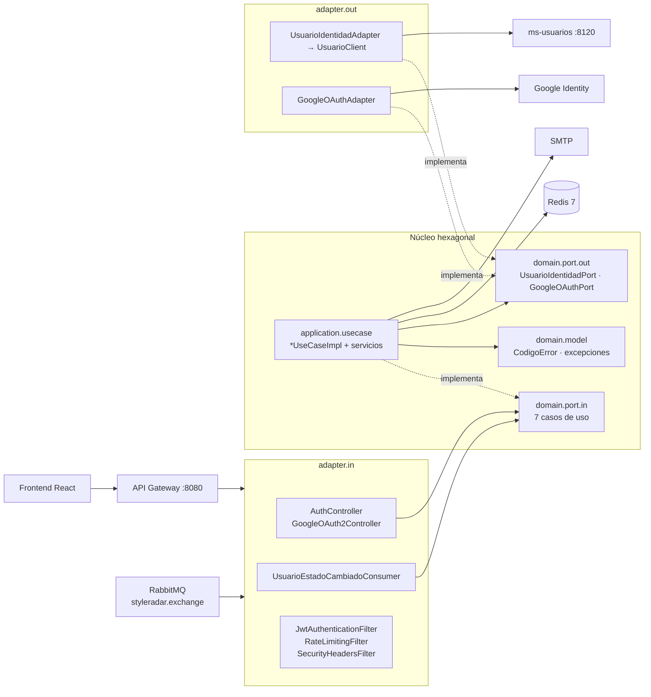
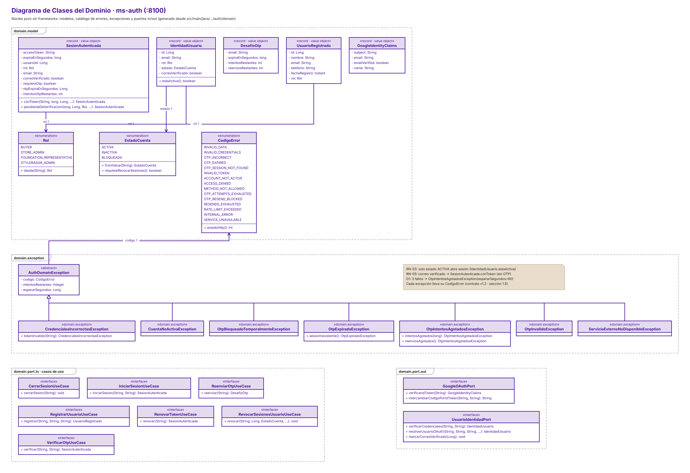
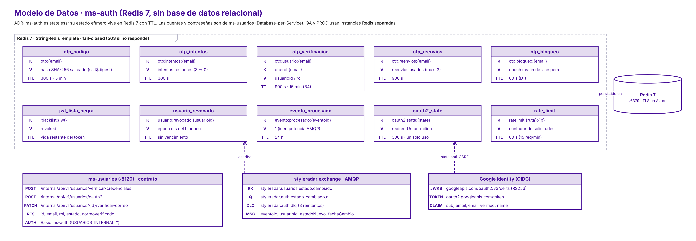
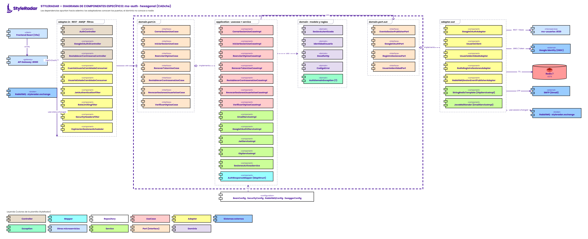
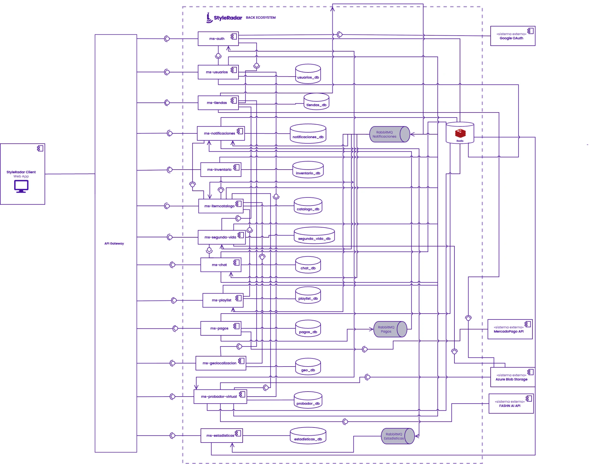
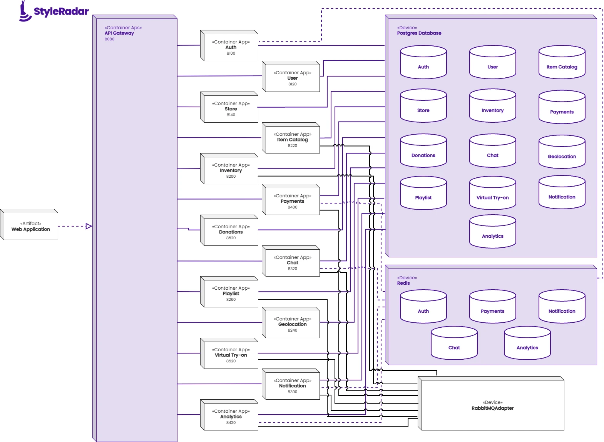
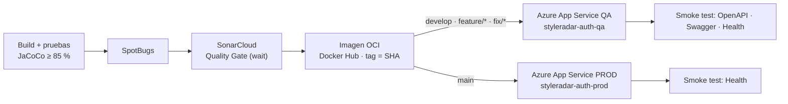

<!-- ==============================================================================
  STYLE RADAR
  Asignatura: DOSW · 2026
  Estándar obligatorio unificado para los 13 microservicios del proyecto StyleRadar.
============================================================================== -->

<div align="center">

  <a href="https://github.com/StyleRadar1">
    
  </a>

  <h1>STYLE<font color="#5600EF">RADAR</font> &nbsp;·&nbsp; <code>ms-auth</code></h1>

  <p>
    
    
    
  </p>

  <p><i>Inicio de sesión (SR-RF-02), verificación del correo con código OTP (SR-RF-92), Google OAuth2 y revocación de sesiones.</i></p>

  <p>
    <a href="https://styleradar-auth-prod.azurewebsites.net/actuator/health">
      
    </a>
    <a href="https://styleradar-auth-qa.azurewebsites.net/swagger-ui/index.html">
      
    </a>
    <a href="https://github.com/StyleRadar1/CADCHE-Authentication-Service/actions/workflows/ci.yml">
      
    </a>
    <a href="https://sonarcloud.io/project/overview?id=StyleRadar1_CADCHE-Authentication-Service">
      
    </a>
    <a href="https://sonarcloud.io/component_measures?id=StyleRadar1_CADCHE-Authentication-Service&metric=coverage">
      
    </a>
  </p>
  <p>
    
    
    
    
    
  </p>
</div>

---

##  ÍNDICE DE CONTENIDOS

1. [Nombre del servicio y su bounded context](#1-nombre-del-servicio-y-su-bounded-context)
2. [Equipo y responsables](#2-equipo-y-responsables)
3. [Arquitectura hexagonal con su diagrama](#3-arquitectura-hexagonal-con-su-diagrama)
4. [Endpoints y enlace a Swagger](#4-endpoints-y-enlace-a-swagger)
5. [Eventos que publica y consume](#5-eventos-que-publica-y-consume)
6. [Tecnologías y dependencias](#6-tecnologías-y-dependencias)
7. [Cómo ejecutar local y con Docker](#7-cómo-ejecutar-local-y-con-docker)
8. [Variables de entorno](#8-variables-de-entorno)
9. [Pruebas y cobertura](#9-pruebas-y-cobertura)
10. [CI/CD con el badge del pipeline](#10-cicd-con-el-badge-del-pipeline)
11. [Ramas y cómo contribuir](#11-ramas-y-cómo-contribuir)
12. [Enlace a la épica en Jira](#12-enlace-a-la-épica-en-jira)
13. [Análisis de tecnologías del servicio](#13-análisis-de-tecnologías-del-servicio-plantilla-sprint-1)
14. [Análisis de seguridad OWASP Top 10:2025](#14-análisis-de-seguridad-owasp-top-102025)

---

<a id="1-nombre-del-servicio-y-su-bounded-context"></a>

##  1. NOMBRE DEL SERVICIO Y SU BOUNDED CONTEXT

* **Identificador de Servicio:** `ms-auth` (`CADCHE-Authentication-Service`)
* **Paquete Arquitectónico:** `Paquete 1: Identidad` · Equipo `CADche`
* **Puerto de Escucha Oficial:** `8100` (bloque `8100` del equipo: ms-auth `8100`, ms-usuarios `8120`, ms-tiendas `8140`)
* **Almacenamiento Asignado:** `Redis 7`. **ms-auth no tiene base de datos relacional** (decisión de arquitectura, ver [§3.2](#32-diagrama-de-base-de-datos)): las cuentas, contraseñas y el estado `correoVerificado` pertenecen a `ms-usuarios` (patrón *Database-per-Service*) y todo el estado propio de ms-auth es efímero y con TTL (códigos OTP, bloqueos, lista negra de JWT, estado OAuth2 y rate limiting).
* **Bounded Context:** `Autenticación, Identidad Federada y Control de Acceso (IAM)`

### Responsabilidades del Dominio

| Qué HACE este microservicio (alcance) | Qué NO HACE (límites) |
| :--- | :--- |
| • **SR-RF-02 · Iniciar sesión:** valida correo y contraseña contra `ms-usuarios`, exige cuenta `ACTIVA` (RN-03) y, si el correo ya está verificado, entrega el JWT de una vez (RN-05). Si no, envía un código OTP de 6 dígitos (FA-13). | • NO guarda usuarios, perfiles ni hashes de contraseña (son de `ms-usuarios`). |
| • **SR-RF-92 · Verificar el correo con OTP:** el código dura `300 s`, admite `3` intentos y se pide **una sola vez por cuenta** (decisión D2). Al tercer fallo anula solo el código y bloquea pedir otro durante `60 s` (D1); la verificación en curso dura `15 min`. Al verificar, marca el correo en `ms-usuarios`. | • NO administra almacenes ni fundaciones (`ms-tiendas`). |
| • **Google OAuth2 / OIDC:** ID Token RS256 validado contra JWKS o *Authorization Code* con `state` anti-CSRF de un solo uso; no pide OTP y marca el correo como verificado (B8). | • NO publica eventos hacia otros servicios. |
| • **Sesiones:** renovación con rotación (`/refresh`), cierre con lista negra (`/logout`) y **revocación global** al recibir `UsuarioEstadoCambiadoEvent` (cuenta `INACTIVA`/`BLOQUEADA`), con idempotencia por `eventoId`. | • NO gestiona catálogo, inventario ni pagos. |
| • **Contrato de errores v1.2 (ProblemDetail RFC 9457):** cada error trae `type`/`title`/`detail`/`instance`, `codigo` del catálogo, `intentosRestantes`, `esperarSegundos` y la cabecera `Retry-After` en todos los `429`. | • NO expone el registro real (el `/register` es un stub solo para `dev`/`test`; en QA/PROD responde `503`). |

---

<a id="2-equipo-y-responsables"></a>

##  2. EQUIPO Y RESPONSABLES

Desarrollado y mantenido por el **Squad `CADche` (Estación CADche · Paquete 1: Identidad)** para la asignatura DOSW 2026.

<div align="center">

| Rol | Nombre | Usuario GitHub |
| :---: | :---: | :---: |
| **Líder del equipo** | `Juan Diego Valderrama` | [@juandivg26](https://github.com/juandivg26) |
| **Backend Developer (ms-auth, ms-tiendas)** | `Juan Diego Gaitán` | [@mamagege](https://github.com/mamagege) |
| **Backend Developer (ms-usuarios, ms-auth)** | `Julián Camilo Giral` | [@jcobos548](https://github.com/jcobos548) |

</div>

---

<a id="3-arquitectura-hexagonal-con-su-diagrama"></a>

##  3. ARQUITECTURA HEXAGONAL CON SU DIAGRAMA

Arquitectura de **Puertos y Adaptadores** según la guía oficial del curso. Las dependencias apuntan hacia adentro:

* **Dominio (`domain/`)**: Java puro, sin Spring, JPA ni Jackson. Modelos (`SesionAutenticada`, `IdentidadUsuario`, `DesafioOtp`, `Rol`, `EstadoCuenta`), el catálogo `CodigoError` y las excepciones (`AuthDomainException` y sus 7 subclases). Define los **puertos de entrada** (7 casos de uso) y de **salida** (`UsuarioIdentidadPort`, `GoogleOAuthPort`).
* **Aplicación (`application/`)**: `<Nombre>UseCaseImpl` sin anotaciones de Spring, registrados en `infrastructure/config/BeanConfig` (regla de oro 4); servicios `OtpService`, `JwtService`, `EmailService` y `GoogleOAuth2Service` (interfaz + `Impl`); DTOs y el mapper de salida `AuthResponseMapper` (**MapStruct**).
* **Infraestructura (`infrastructure/`)**: adaptadores de entrada (REST, AMQP y filtros de seguridad), adaptadores de salida (`UsuarioIdentidadAdapter` anti-corrupción sobre `UsuarioClient`, `GoogleOAuthAdapter`), configuración y `GlobalExceptionHandler`.
* **Regla del controlador:** `AuthController` solo conoce interfaces de casos de uso y el mapper; nunca un cliente HTTP ni Redis.

### Diagrama de Capas (Mermaid)



**Justificación del diagrama de capas.** Muestra en una sola vista la regla de dependencia de la arquitectura hexagonal: todo lo externo (Gateway, RabbitMQ, ms-usuarios, Google, Redis y SMTP) entra o sale por un adaptador, y el núcleo solo conoce puertos. Sirve para revisar de un vistazo que ningún controlador llame directamente a Redis o a un cliente HTTP, y que el consumidor AMQP use el mismo puerto de entrada que la API REST.

### 3.1 Diagrama de Clases

<div align="center">
  
  <sub>Figura 3.1: dominio completo de ms-auth (<a href="docs/uml/DiagramaClases.drawio">DiagramaClases.drawio</a>), generado desde el código.</sub>
</div>

* **Modelos (`record`, value objects):** `SesionAutenticada` (con las fábricas `conToken` y `pendienteDeVerificacion`), `IdentidadUsuario` (`estaActiva()` aplica RN-03), `DesafioOtp`, `UsuarioRegistrado` y `GoogleIdentityClaims`.
* **Enumeraciones:** `Rol` (`desde(String)` rechaza roles desconocidos), `EstadoCuenta` (acepta `ACTIVO`/`ACTIVA` y similares) y `CodigoError` (15 códigos del contrato con su estado HTTP).
* **Excepciones:** `AuthDomainException` transporta `codigo`, `intentosRestantes` y `esperarSegundos`; la infraestructura las traduce a HTTP sin que el dominio conozca HTTP.

**Justificación del diagrama de clases.** Se genera desde el código fuente, así que refleja las clases que realmente existen. Documenta el modelo del dominio, que es donde viven las reglas del análisis de requerimientos: el estado de la cuenta (RN-03), los roles válidos, el desafío OTP y el catálogo de errores del contrato con el front. Al no depender de Spring, el diagrama también prueba que el dominio no tiene dependencias de infraestructura.

### 3.2 Diagrama de Base de Datos

<div align="center">
  
  <sub>Figura 3.2: claves de Redis 7 con su TTL y contratos externos (<a href="docs/uml/DiagramaBaseDatos.drawio">DiagramaBaseDatos.drawio</a>).</sub>
</div>

**Justificación del diagrama de base de datos.** ms-auth no tiene tablas, por eso el modelo de datos es el de Redis: cada familia de claves con su valor y su TTL. Este diagrama responde dónde queda cada dato de la sesión, cuánto dura y quién lo borra, que es lo que exigen las reglas del OTP (5 minutos, 3 intentos, espera de 60 s y verificación de 15 minutos). También muestra los contratos con ms-usuarios, que es el dueño de las credenciales.

**Decisión (ADR):** ms-auth **no usa PostgreSQL**. El análisis de integración consolidado lo establece así ("ms-auth no guarda datos en PostgreSQL; usa Redis") y conviene por seguridad:

1. **Una sola fuente de verdad para credenciales** (`ms-usuarios`): duplicarlas sería un riesgo de integridad (OWASP A04/A08).
2. **Menos superficie de ataque** (OWASP A03): se quitaron JPA, Flyway y el driver JDBC que estaban declarados sin uso.
3. **Datos efímeros:** OTP, bloqueos y lista negra expiran solos con el TTL de Redis; una tabla relacional exigiría limpiezas programadas.

| Familia de claves | Valor | TTL |
| :--- | :--- | :--- |
| `otp:{email}` | Hash SHA-256 salteado del código (nunca en claro) | `300 s` |
| `otp:intentos:{email}` | Intentos restantes (3 → 0) | `300 s` |
| `otp:usuario:{email}` · `otp:rol:{email}` | Verificación en curso | `900 s` (15 min) |
| `otp:reenvios:{email}` | Reenvíos usados (máx. 3) | `900 s` |
| `otp:bloqueo:{email}` | Fin de la espera tras 3 fallos | `60 s` |
| `blacklist:{jwt}` | Token revocado por `/logout` o `/refresh` | Vida restante del token |
| `usuario:revocado:{usuarioId}` | Momento del bloqueo (invalida tokens anteriores) | Sin vencimiento |
| `evento:procesado:{eventoId}` | Idempotencia del consumidor AMQP | `24 h` |
| `oauth2:state:{state}` | `redirectUri` autorizada, un solo uso | `300 s` |
| `ratelimit:{ruta}:{ip}` | Contador de solicitudes (15 por minuto) | `60 s` |

Si Redis no responde, ms-auth falla cerrado con `503 SERVICIO_NO_DISPONIBLE`. El respaldo en memoria solo existe en el perfil `dev` con la propiedad explícita.

### 3.3 Diagrama de Componentes Específico

<div align="center">
  
  <sub>Figura 3.3: componentes por capa hexagonal (<a href="docs/uml/DiagramaComponentesEspecifico.drawio">DiagramaComponentesEspecifico.drawio</a>).</sub>
</div>

**Justificación del diagrama de componentes específico.** Baja un nivel respecto al diagrama de capas: muestra cada controlador, filtro, consumidor, caso de uso, servicio y adaptador real de ms-auth, y las interfaces por las que se conectan (provistas y requeridas). Se usa para ubicar dónde se implementa cada historia y para comprobar que cada puerto de salida tiene exactamente un adaptador.

### 3.4 Diagrama de Componentes General (ecosistema StyleRadar)

<div align="center">
  
  <sub>Figura 3.4: los 13 microservicios del back, sus bases de datos, los brokers RabbitMQ, Redis y los sistemas externos.</sub>
</div>

**Justificación.** Ubica a ms-auth dentro del ecosistema y deja claro con quién se comunica y con quién no:

* **Cliente → API Gateway → ms-auth.** El front nunca llama directo a un microservicio; el Gateway publica `/api/v1/auth/**`.
* **ms-auth ↔ ms-usuarios.** ms-auth requiere la interfaz de ms-usuarios para validar credenciales, crear o vincular cuentas de Google y marcar el correo verificado. Por eso ms-auth no tiene base de datos propia en el diagrama: las credenciales tienen un único dueño.
* **ms-auth → Google OAuth** (sistema externo) para el ingreso con Google, y **ms-auth → Redis** para OTP, lista negra y límite de solicitudes.
* **RabbitMQ:** ms-auth consume el cambio de estado de cuenta que publica ms-usuarios para revocar sesiones.
* El resto de microservicios valida el JWT que emite ms-auth con el mismo secreto; ninguno lo llama por cada petición.

### 3.5 Diagrama de Despliegue

<div align="center">
  
  <sub>Figura 3.5: nodos de ejecución (Container Apps), puertos, PostgreSQL, Redis y el adaptador de RabbitMQ.</sub>
</div>

**Justificación.** Muestra dónde corre cada pieza y por qué puertos se habla. Para ms-auth confirma:

* **Puerto 8100**, detrás del API Gateway (8080), que es el único punto de entrada del artefacto web.
* **Redis** como nodo de datos de ms-auth (instancia `Auth`), que es donde realmente vive su estado.
* Conexión al **RabbitMQAdapter** para los eventos de cuenta.

**Diferencias con lo implementado hoy (para corregir en el diagrama):**

1. El nodo PostgreSQL incluye una base `Auth`. ms-auth no la usa (ver el ADR de la sección 3.2); se recomienda quitarla para no reservar un recurso sin uso.
2. ms-auth hoy se despliega en **Azure App Service** (`styleradar-auth-qa` y `styleradar-auth-prod`), no en Container Apps. El diagrama representa la arquitectura objetivo.
3. `Donations` y `Virtual Try-on` aparecen con el mismo puerto `8520`; uno de los dos debe cambiar.

### Estructura de Paquetes en `src/main/java/edu/dosw/styleradar/auth/`

```text
auth/
├── domain/                                   <-- Núcleo puro (sin frameworks)
│   ├── model/        SesionAutenticada, IdentidadUsuario, DesafioOtp, UsuarioRegistrado,
│   │                 GoogleIdentityClaims, Rol, EstadoCuenta, CodigoError
│   ├── exception/    AuthDomainException + 7 excepciones con su CodigoError
│   └── port/
│       ├── in/       IniciarSesion, VerificarOtp, ReenviarOtp, RenovarToken, CerrarSesion,
│       │             RegistrarUsuario, RevocarSesionesUsuario (UseCase)
│       └── out/      UsuarioIdentidadPort, GoogleOAuthPort
├── application/
│   ├── usecase/      7 *UseCaseImpl + NotificadorCodigoOtp (compensación si falla el correo)
│   ├── service/      OtpService, JwtService, EmailService, GoogleOAuth2Service + impl/
│   ├── dto/          request/, response/, event/ (UsuarioEstadoCambiadoEventDTO)
│   └── mapper/out/   AuthResponseMapper (MapStruct)
└── infrastructure/
    ├── adapter/in/   rest/ (+ doc/ Swagger), amqp/ (UsuarioEstadoCambiadoConsumer)
    ├── adapter/out/  external/ (UsuarioClient, UsuarioIdentidadAdapter, GoogleOAuthAdapter)
    ├── config/       BeanConfig, SecurityConfig, RabbitMQConfig, SwaggerConfig
    ├── exception/    GlobalExceptionHandler (catálogo de errores + Retry-After)
    └── security/     JwtAuthenticationFilter, RateLimitingFilter, SecurityHeadersFilter, SecuritySanitizer
```

---

<a id="4-endpoints-y-enlace-a-swagger"></a>

##  4. ENDPOINTS Y ENLACE A SWAGGER

### Enlaces por Ambiente

| Ambiente | URL base | Swagger UI | Health |
| :--- | :--- | :--- | :--- |
| **PROD** | `https://styleradar-auth-prod.azurewebsites.net` | [Swagger PROD](https://styleradar-auth-prod.azurewebsites.net/swagger-ui/index.html) | [`/actuator/health`](https://styleradar-auth-prod.azurewebsites.net/actuator/health) |
| **QA** | `https://styleradar-auth-qa.azurewebsites.net` | [Swagger QA](https://styleradar-auth-qa.azurewebsites.net/swagger-ui/index.html) | [`/actuator/health`](https://styleradar-auth-qa.azurewebsites.net/actuator/health) |
| **Local** | `http://localhost:8100` | [Swagger local](http://localhost:8100/swagger-ui.html) | `http://localhost:8100/actuator/health` |

El front **siempre** llama al API Gateway (`:8080`), que enruta `/api/v1/auth/**` a este servicio.

### Convención de rutas

* Todas las rutas están **en inglés** y empiezan por **`/api/v1`**. Los nombres de los campos JSON se mantienen como los define el contrato con el front.
* El proyecto **no usa `/me`**. Cuando un recurso pertenece a un usuario, la ruta lo nombra explícitamente con `/users/{id}` y el backend comprueba que quien hace la petición tenga permiso sobre ese usuario. ms-auth no expone recursos por usuario: identifica a la persona con las credenciales o con el JWT.
* `/actuator/health` y la documentación OpenAPI (`/v3/api-docs`, `/swagger-ui`) son rutas de operación y quedan fuera de esta convención.

### Endpoints Expuestos

| Método | Ruta | Entrada | Respuesta | Acceso |
| :---: | :--- | :--- | :--- | :--- |
| `POST` | `/api/v1/auth/login` | `email`, `password` | `200 LoginResponseDTO` (token directo o `requiereOtp=true`) | Público · 15 req/min |
| `POST` | `/api/v1/auth/otp/verify` | `email`, `codigoOtp` | `200 LoginResponseDTO` con token | Público |
| `POST` | `/api/v1/auth/otp/resend` | `email` | `200 OtpMensajeResponseDTO` (`reenviosRestantes`) | Público |
| `POST` | `/api/v1/auth/refresh` | `refreshToken` (JWT vigente) | `200 LoginResponseDTO` (token rotado) | Público |
| `POST` | `/api/v1/auth/logout` | `Authorization: Bearer` | `204` | JWT |
| `POST` | `/api/v1/auth/register` | Datos de registro | `201` en `dev`/`test` · `503` en QA/PROD | Público |
| `POST` | `/api/v1/auth/oauth2/google` | `idToken` | `200 LoginResponseDTO` | Público |
| `GET` | `/api/v1/auth/oauth2/google/url` | `redirectUri` (opcional) | `200` URL de autorización + `state` | Público |
| `GET` | `/api/v1/auth/oauth2/google/callback` | `code`, `state` | `200 LoginResponseDTO` | Público |
| `POST` | `/api/v1/auth/oauth2/google/code` | `code`, `state`, `redirectUri` | `200 LoginResponseDTO` | Público |

### Ejemplos (contrato ms-auth ↔ Frontend v1.2)

Login con correo **sin verificar** (se envía el OTP):

```json
{
  "accessToken": null, "tokenType": "Bearer", "expiresIn": 86400, "usuarioId": 12,
  "roles": ["COMPRADOR"], "email": "comprador@correo.com", "correoVerificado": false,
  "requiereOtp": true, "otpExpiraEnSegundos": 300, "intentosOtpRestantes": 3,
  "verificacionPendiente": true, "mensaje": "Código de verificación OTP enviado a su correo electrónico"
}
```

`expiresIn` sale de `JWT_DURATION`. Con el correo verificado llega `accessToken` y `requiereOtp=false`.

Los errores salen en formato **ProblemDetail (RFC 9457)** con `Content-Type: application/problem+json`, el mismo formato de ms-usuarios y ms-tiendas (CADCHE-121). Además de `type`, `title`, `status`, `detail` e `instance` lleva las extensiones del contrato (`codigo`, `timestamp`, `validationErrors`, `intentosRestantes`, `esperarSegundos`). `error`, `message` y `path` se mantienen como alias de `title`, `detail` e `instance` para no romper al front. Ejemplo (tercer código incorrecto):

```json
{
  "type": "https://api.styleradar.com/errores/otp-intentos-agotados",
  "title": "Too Many Requests", "status": 429,
  "detail": "Se agotaron los intentos. Espere 60 segundos y solicite un nuevo código.",
  "instance": "/api/v1/auth/otp/verify",
  "timestamp": "2026-11-16T10:15:30", "error": "Too Many Requests",
  "codigo": "OTP_INTENTOS_AGOTADOS",
  "message": "Se agotaron los intentos. Espere 60 segundos y solicite un nuevo código.",
  "path": "/api/v1/auth/otp/verify", "validationErrors": {},
  "intentosRestantes": 0, "esperarSegundos": 60
}
```

Catálogo de `codigo`: `DATOS_INVALIDOS`, `CREDENCIALES_INCORRECTAS`, `CUENTA_NO_ACTIVA`, `OTP_INCORRECTO`, `OTP_VENCIDO`, `OTP_INTENTOS_AGOTADOS`, `OTP_REENVIO_BLOQUEADO`, `REENVIOS_AGOTADOS`, `SESION_OTP_INEXISTENTE`, `LIMITE_SOLICITUDES`, `SERVICIO_NO_DISPONIBLE`, `TOKEN_INVALIDO`, `ACCESO_DENEGADO`, `METODO_NO_PERMITIDO` y `ERROR_INTERNO`. Todos los `429` incluyen la cabecera `Retry-After`.

---

<a id="5-eventos-que-publica-y-consume"></a>

##  5. EVENTOS QUE PUBLICA Y CONSUME

| Dirección | Exchange / routing key | Cola | Origen → destino | Acción en ms-auth |
| :--- | :--- | :--- | :--- | :--- |
| **CONSUME** | `styleradar.exchange` / `styleradar.usuarios.estado.cambiado` | `styleradar.auth.estado-cambiado.q` (DLQ `styleradar.auth.dlq`) | `ms-usuarios` → `ms-auth` | `RevocarSesionesUsuarioUseCase`: si el estado nuevo es `INACTIVA` o `BLOQUEADA`, guarda `usuario:revocado:{id}` y todos los tokens emitidos antes quedan inválidos. |
| **PUBLICA** | — | — | — | ms-auth no publica eventos. |

* **Idempotencia:** un `eventoId` repetido se descarta (`evento:procesado:{eventoId}`, 24 h).
* **Resiliencia:** 3 reintentos con *backoff* exponencial y luego DLQ. Si Redis no responde, el consumidor falla para que el mensaje se reintente y nunca se pierda una revocación.
* **Formato:** se aceptan `estadoNuevo` o `nuevoEstado`, y los estados en masculino o femenino (`BLOQUEADO`/`BLOQUEADA`).

```json
{ "eventoId": "evt-123", "usuarioId": 42, "estadoAnterior": "ACTIVO", "estadoNuevo": "BLOQUEADO",
  "administradorId": 1, "motivo": "Fraude", "fechaCambio": "2026-11-13T10:15:30Z" }
```

---

<a id="6-tecnologías-y-dependencias"></a>

##  6. TECNOLOGÍAS Y DEPENDENCIAS

| Componente | Tecnología | Versión | Justificación |
| :--- | :--- | :--- | :--- |
| Lenguaje | Java LTS | `21` | Estándar del curso; *records* inmutables para el dominio. |
| Framework | Spring Boot | `3.2.12` | Web, Security, AMQP, Mail, Actuator y Validation. |
| Almacenamiento | Redis | `7` | OTP, bloqueos, lista negra de JWT, estado OAuth2 y rate limiting con TTL nativo. |
| Mensajería | RabbitMQ (Spring AMQP) | `3.13` | Consumo de `UsuarioEstadoCambiadoEvent` con DLQ. |
| Seguridad | Spring Security + JJWT + OAuth2 JOSE | `6.2 / 0.12.6` | JWT `HS256` (secreto Base64 ≥ 256 bits) y validación RS256/JWKS de Google. |
| Mapeo | MapStruct + Lombok | `1.5.5 / 1.18.42` | Mapper de salida generado en compilación. |
| Documentación | springdoc-openapi | `2.3.0` | Swagger UI y OpenAPI 3. |
| Pruebas | JUnit 5, Mockito, Testcontainers | `5.10 / 5.7 / 1.19.8` | Unitarias, WebMvc e integración con **Redis 7 real**. |
| Calidad | JaCoCo, SpotBugs, SonarCloud, CycloneDX | `0.8.12 / 4.8.6 / – / 2.9.3` | Cobertura ≥ 85 %, análisis estático y SBOM. |
| Contenedor | Eclipse Temurin JRE Alpine | `21` | Imagen OCI no-root con `HEALTHCHECK`. |

> **PostgreSQL 16** es el motor del stack para los servicios con datos relacionales (por ejemplo `ms-usuarios` y `ms-tiendas`). Este servicio no lo usa por la decisión de [§3.2](#32-diagrama-de-base-de-datos).

---

<a id="7-cómo-ejecutar-local-y-con-docker"></a>

##  7. CÓMO EJECUTAR LOCAL Y CON DOCKER

### Prerrequisitos

* JDK 21 (`java -version`), Maven 3.9+ y Docker 24+.

### Ejecución local con Maven (perfil `dev`)

```bash
git clone https://github.com/StyleRadar1/CADCHE-Authentication-Service.git
cd CADCHE-Authentication-Service
cp .env.example .env            # opcional: el perfil dev lo carga automáticamente
docker compose up -d auth-redis # Redis 7 local
mvn spring-boot:run "-Dspring-boot.run.profiles=dev"
```

### Ejecución contenerizada

El pipeline compila y prueba el JAR una sola vez y la imagen reutiliza ese JAR validado, por eso hay que empaquetar antes de construir:

```bash
mvn -B -DskipTests package
docker compose up -d --build    # ms-auth :8100 + auth-redis :6379
docker compose ps
```

### Comprobación de salud

```bash
curl http://localhost:8100/actuator/health
# Swagger: http://localhost:8100/swagger-ui.html
```

---

<a id="8-variables-de-entorno"></a>

##  8. VARIABLES DE ENTORNO

Plantilla completa en [`.env.example`](.env.example). Los secretos nunca van al repositorio: en Azure se configuran como *App Settings*.

| Variable | Descripción | Valor por defecto |
| :--- | :--- | :--- |
| `SERVER_PORT` / `PORT` | Puerto HTTP (Azure inyecta `PORT`) | `8100` |
| `SPRING_PROFILES_ACTIVE` | `dev`, `qa` o `prod` | `dev` |
| `JWT_SECRET_BASE64` (prod) · `JWT_SECRET_QA_BASE64` (qa) · `JWT_SECRET_DEV_BASE64` (dev) | Secreto HMAC Base64 de ≥ 256 bits. **Obligatorio en QA y PROD, sin valor por defecto**; se rechazan los secretos de ejemplo. Debe ser **el mismo** que usa ms-tiendas (`JWT_SECRET_BASE64`). | Solo dev tiene un valor de ejemplo |
| `JWT_DURATION` | Vigencia del token (ISO-8601); alimenta `expiresIn` | `PT24H` |
| `OTP_LOCKOUT_SECONDS` / `OTP_SESSION_TTL_SECONDS` | Espera tras 3 fallos y vida de la verificación en curso | `60` / `900` |
| `REDIS_HOST` / `REDIS_PORT` / `REDIS_PASSWORD` / `REDIS_SSL_ENABLED` | Conexión a Redis 7 | `localhost` / `6379` |
| `RABBITMQ_HOST` / `RABBITMQ_PORT` / `RABBITMQ_USER` / `RABBITMQ_PASSWORD` / `RABBITMQ_VHOST` / `RABBITMQ_SSL_ENABLED` | Broker del equipo Guatoque Jiraguas | `localhost` / `5672` |
| `USUARIOS_SERVICE_URL` (dev) · `USUARIOS_QA_SERVICE_URL` | URL de `ms-usuarios` | `http://ms-usuarios:8120` |
| `USUARIOS_INTERNAL_USERNAME` / `USUARIOS_INTERNAL_PASSWORD` | Credenciales Basic internas hacia ms-usuarios | `ms-auth` / — |
| `USUARIOS_CREDENCIALES_PATH` / `USUARIOS_OAUTH2_PATH` / `USUARIOS_CORREO_VERIFICADO_PATH` | Rutas internas de ms-usuarios para validar credenciales, cuentas Google y marcar el correo verificado. Son de ms-usuarios: cuando ese servicio publique sus rutas en inglés se cambian aquí sin tocar código | `/internal/api/v1/usuarios/verificar-credenciales` · `/internal/api/v1/usuarios/oauth2` · `/internal/api/v1/usuarios/{id}/verificar-correo` |
| `GOOGLE_CLIENT_ID` / `GOOGLE_CLIENT_SECRET` / `GOOGLE_REDIRECT_URI` / `GOOGLE_ALLOWED_REDIRECT_URIS` | Google OAuth2 (lista blanca anti Open Redirect) | — |
| `MAIL_HOST` / `MAIL_PORT` / `MAIL_USERNAME` / `MAIL_PASSWORD` | SMTP para los códigos OTP | `smtp.gmail.com` / `587` |
| `CORS_DEV_ALLOWED_ORIGINS` · `CORS_QA_ALLOWED_ORIGINS` · `CORS_ALLOWED_ORIGINS` | Orígenes permitidos (dev incluye `localhost:5173` y `:3000`) | Ver YAML |
| `RATE_LIMIT_ENABLED` / `RATE_LIMIT_MAX_REQUESTS` / `RATE_LIMIT_WINDOW_SECONDS` | Limitador de tasa en Redis | `true` / `15` / `60` |

---

<a id="9-pruebas-y-cobertura"></a>

##  9. PRUEBAS Y COBERTURA (≥ 85%)

```bash
mvn -B clean verify                                                           # pruebas + JaCoCo (umbral 85 %) + SBOM
mvn -B com.github.spotbugs:spotbugs-maven-plugin:4.8.6.6:check -Dspotbugs.excludeFilterFile=spotbugs-exclude.xml
```

| Métrica (`mvn verify`, rama `feature/arreglos`) | Resultado | Umbral |
| :--- | :---: | :---: |
| Pruebas | **197**, 0 fallos | 100 % en verde |
| Cobertura de instrucciones (JaCoCo) | **95.1 %** | ≥ 85 % (rompe el build) |
| Cobertura de ramas | **75.0 %** | — |
| SpotBugs | 0 hallazgos | 0 |

### Pirámide de pruebas (espejo de `src/main`)

| Nivel | Qué cubre | Herramientas |
| :--- | :--- | :--- |
| **Unitarias de aplicación** | Casos de uso (`CasosDeUsoSesionTest`), servicios OTP/JWT/Email/Google | JUnit 5, Mockito, AssertJ |
| **WebMvc de punta a punta** | Controladores con casos de uso reales y mocks solo en los bordes; contrato v1.2 (`codigo`, `Retry-After`) | MockMvc, Spring Security Test |
| **Integración con Redis 7 real** | `OtpRedisIntegrationTest`: 3 fallos → espera → reenvío sin nuevo login, lista negra, revocación e idempotencia | Testcontainers (`redis:7-alpine`) |
| **Seguridad** | `OwaspTop10SecurityTest` (A01–A10), filtros y cabeceras | MockMvc |
| **Requerimientos** | `RequerimientosCompletosAuditoriaAuthTest` (SR-RF-02 / SR-RF-92) | MockMvc |
| **Trazabilidad Word y contrato** | `TrazabilidadRequerimientosAuthTest`: un caso por flujo alterno y regla de negocio de SR-RF-02 y SR-RF-92, y por cada punto del contrato Front ↔ ms-auth v1.2, sobre Redis 7 real | Testcontainers, MockMvc |

> Las pruebas de Testcontainers se omiten solas si la máquina no tiene Docker. Con Docker 29+ y Testcontainers 1.19 en local, exporte `DOCKER_API_VERSION=1.44`.

---

<a id="10-cicd-con-el-badge-del-pipeline"></a>

##  10. CI/CD CON EL BADGE DEL PIPELINE

[](https://github.com/StyleRadar1/CADCHE-Authentication-Service/actions/workflows/ci.yml)

Un solo workflow, [`.github/workflows/ci.yml`](.github/workflows/ci.yml):



| Ambiente | Rama | App Service | Imagen |
| :--- | :--- | :--- | :--- |
| QA | `develop`, `feature/*`, `fix/*` | `styleradar-auth-qa` | `styleradar-auth:<sha>` (+ `qa-latest`) |
| PROD | `main` | `styleradar-auth-prod` | `styleradar-auth:<sha>` (+ `prod-latest`) |

* El JAR se compila y prueba una sola vez; la imagen reutiliza ese JAR validado (`actions/upload-artifact`).
* Los despliegues usan la etiqueta inmutable del commit (`<sha>`), no `latest`.
* **Quality Gate:** confiabilidad, seguridad y mantenibilidad en **A**, 100 % de *hotspots* revisados y cobertura del código nuevo ≥ 80 %. Si no se cumple, el pipeline se detiene antes de construir la imagen.

---

<a id="11-ramas-y-cómo-contribuir"></a>

##  11. RAMAS Y CÓMO CONTRIBUIR

```text
main        <-- Producción (despliega PROD)
└── develop <-- Integración (despliega QA)
    └── feature/<tarea>   <-- Todo cambio nace aquí y entra a develop por Pull Request
```

* Nada de commits directos a `develop` ni a `main`: todo va por `feature/*` y PR a `develop`.
* Mensajes en minúsculas y en imperativo: `tipo(alcance): descripción`. Tipos: `feat`, `fix`, `refactor`, `test`, `docs`, `build`, `ci`, `chore`. Ejemplo: `fix(auth): respetar espera de 60s en login`.

### Checklist para Pull Requests

- [ ] La rama parte del `develop` más reciente.
- [ ] `mvn -B clean verify` pasa (pruebas y JaCoCo ≥ 85 %).
- [ ] SpotBugs sin hallazgos y Sonar en A.
- [ ] Swagger actualizado si cambió un contrato (y aviso en Slack a los equipos que lo consumen).
- [ ] Sin credenciales ni secretos en el código.
- [ ] Al menos 1 revisor del equipo.

---

<a id="12-enlace-a-la-épica-en-jira"></a>

##  12. ENLACE A LA ÉPICA EN JIRA

El seguimiento de requerimientos, historias de usuario, evidencias y artefactos de entrega se centraliza en los siguientes enlaces oficiales:

### Enlaces de Gestión, Repositorios y Evidencias

* **Épica Oficial del Microservicio (Jira):** [https://mail-team-nyjtgqcj.atlassian.net/jira/software/projects/CADCHE/boards/75/backlog](https://mail-team-nyjtgqcj.atlassian.net/jira/software/projects/CADCHE/boards/75/backlog)
* **Tablero Scrum del Squad CADche (Jira):** [https://mail-team-nyjtgqcj.atlassian.net/jira/software/projects/CADCHE/boards/75/backlog](https://mail-team-nyjtgqcj.atlassian.net/jira/software/projects/CADCHE/boards/75/backlog)
* **Documento de Arquitectura Oficial (Libro interactivo StyleRadar · 17 vistas: Portada, Sumario, 01–14 y Contraportada):** [`docs/DocumentoTecnico.html`](docs/DocumentoTecnico.html)
* **Health Check en Producción (`ms-auth` PROD):** [https://styleradar-auth-prod.azurewebsites.net/actuator/health](https://styleradar-auth-prod.azurewebsites.net/actuator/health) *(Swagger UI deshabilitado en `prod`)*
* **API Swagger en Calidad (`ms-auth` QA):** [https://styleradar-auth-qa.azurewebsites.net/swagger-ui.html](https://styleradar-auth-qa.azurewebsites.net/swagger-ui.html) ([`/v3/api-docs`](https://styleradar-auth-qa.azurewebsites.net/v3/api-docs))
* **Pipelines GitHub Actions y Reportes JaCoCo:** [StyleRadar1/CADCHE-Authentication-Service/actions](https://github.com/StyleRadar1/CADCHE-Authentication-Service/actions)
* **Calidad Estática en SonarQube Cloud:** [StyleRadar1_CADCHE-Authentication-Service](https://sonarcloud.io/project/overview?id=StyleRadar1_CADCHE-Authentication-Service)

### Historia de Usuario Implementada: Autenticación Dual (OTP + Google OAuth2 / OIDC) y Swagger

> **HU · `CADCHE · ms-auth | Autenticación dual con OTP clásico y Google OAuth2 / OpenID Connect funcional en Swagger`**
>
> * **Como** usuario de StyleRadar (`COMPRADOR`, `ADMIN_ALMACEN`, `REPRESENTANTE_FUNDACION` o `ADMIN_STYLERADAR`)
> * **Quiero** poder iniciar sesión tanto con mi correo + contraseña + código OTP de 6 dígitos como con mi cuenta de Google (`Sign-In` ID Token o flujo `Authorization Code` ejecutable desde Swagger UI y Frontend)
> * **Para** obtener un token JWT Bearer oficial de StyleRadar de forma segura, auditable y compatible con los controles OWASP Top 10:2025.

| ID | Criterio de Aceptación (Verificado en Código y Pruebas) | Evidencia Automática |
| :---: | :--- | :--- |
| **CA-01** | El acceso tradicional (`POST /api/v1/auth/login`) delega la validación en `ms-usuarios`, almacena el OTP salteado en SHA-256 (`300 s`, máx `3` intentos/reenvíos), aplica rollback si falla SMTP y emite JWT `HS256` en `/otp/verify` (`401` si inválido/expirado, `429` si agotado). | `AuthControllerTest`, `OtpServiceTest`, `EmailServiceTest` |
| **CA-02** | El acceso directo (`POST /api/v1/auth/oauth2/google`) verifica firma `RS256` contra Google JWKS (`NimbusJwtDecoder`), emisor Google, audiencia `GOOGLE_CLIENT_ID`, vigencia y `email_verified=true`; resuelve/aprovisiona en `ms-usuarios` (`/internal/api/v1/usuarios/oauth2`), valida `ACTIVA` y emite JWT sin desafío OTP adicional. | `GoogleOAuthAdapterTest`, `GoogleOAuth2ServiceTest` |
| **CA-03** | El flujo navegable desde Swagger UI (`GET /oauth2/google/url` &rarr; Consentimiento Google &rarr; `GET /callback` o `POST /code`) protege contra CSRF con `oauth2:state:{state}` de un solo uso (`getAndDelete`, TTL `300 s`) y restringe redirecciones con `GOOGLE_ALLOWED_REDIRECT_URIS` (anti-Open Redirect). | `GoogleOAuth2ControllerTest`, `GoogleOAuth2SwaggerIntegrationTest` |
| **CA-04** | Ambos métodos comparten un único ciclo JWT: rotación en `/refresh`, revocación en `/logout` (`blacklist:*`), revocación administrativa desde RabbitMQ (`auth.usuario.estado.cambiado` -> `usuario:revocado:*`), rate limiting (`429`) y respuestas homogéneas `ErrorResponseDTO` (`503` fail-closed en `qa`/`prod`). | `JwtAuthenticationFilterTest`, `RateLimitingFilterTest`, `OwaspTop10SecurityTest`, `UsuarioEstadoCambiadoConsumerTest` |

### Requerimientos Funcionales y No Funcionales Asignados

| Código RF | Nombre del Requerimiento | Actor Principal | Criterio de Aceptación Clave Verificado |
| :---: | :--- | :--- | :--- |
| `SR-RF-01` | Contrato de registro inicial de comprador | `COMPRADOR` | Valida Bean Validation (`nombre`, `email`, password fuerte, `aceptaHabeasData`); opera como stub (`id=12L`, `201`) en `dev`/`test` y bloquea *fail-closed* (`503`) en `qa`/`prod` mientras la entidad reside en `ms-usuarios`. |
| `SR-RF-02` | Inicio de sesión multi-rol con 2FA OTP y renovación JWT | `COMPRADOR`, `ADMIN_ALMACEN`, `REPRESENTANTE_FUNDACION`, `ADMIN_STYLERADAR` | Valida credenciales contra `ms-usuarios`, exige segundo factor OTP (`300 s`) y emite `LoginResponseDTO` con JWT `HS256` (`PT24H`/`12H`/`8H`), soportando rotación en `/refresh`. |
| `SR-RF-03` | Autenticación federada con Google OAuth2 / OpenID Connect | `COMPRADOR`, `ADMIN_ALMACEN`, `REPRESENTANTE_FUNDACION`, `ADMIN_STYLERADAR` | Soporta ID Token `RS256`/JWKS (`POST /oauth2/google`) y Authorization Code con `state` anti-CSRF (`GET /url`, `GET /callback`, `POST /code`), exigiendo `email_verified=true` y cuenta `ACTIVA` en `ms-usuarios`. |
| `SR-RF-92` | Verificación y reenvío seguro de código OTP de 6 dígitos | `COMPRADOR`, `ADMIN_ALMACEN`, `REPRESENTANTE_FUNDACION`, `ADMIN_STYLERADAR` | Almacena hash SHA-256 salteado con `TTL 300 s`, bloquea tras `3` intentos fallidos o `3` reenvíos (`429 Too Many Requests`) y limpia OTP si falla SMTP. |
| `SR-RNF-01` | RBAC, revocación en logout, AMQP y rate limiting | Usuario Autenticado | Protege `/logout` con `Bearer JWT`, registra token en `blacklist:*`, revoca sesiones por evento RabbitMQ (`usuario:revocado:*`) y aplica `RateLimitingFilter` (`15/10` req/min). |
| `SR-RNF-02` | Habeas Data, OpenAPI 3 y endurecimiento OWASP Top 10:2025 | Auditoría / Sistema | Valida `aceptaHabeasData`, publica contratos en Swagger (`dev`/`qa`, off en `prod`), inyecta cabeceras defensivas (`CSP`/`HSTS`/`DENY`) y garantiza modo *fail-closed* (`503`). |

---

<a id="13-análisis-de-tecnologías-del-servicio"></a>

##  13. ANÁLISIS DE TECNOLOGÍAS DEL SERVICIO (PLANTILLA MAESTRA OFICIAL)

Este apartado constituye la transcripción y aplicación integral de la **Plantilla Maestra Oficial de Análisis de Tecnologías** de StyleRadar para el microservicio `ms-auth` (`CADCHE-Authentication-Service`), desarrollada conforme al estándar de entrega de arquitectura de software para DOSW 2026.

### Ficha Técnica del Documento

* **Proyecto / Asignatura:** StyleRadar · DOSW 2026
* **Microservicio:** `CADCHE-Authentication-Service` (`ms-auth`, Puerto `8100`)
* **Paquete Arquitectónico:** Paquete 1: Identidad
* **Alcance Arquitectónico:** Evaluación multicriterio de 13 Microservicios, API Gateway, OAuth2/OIDC y Arquitectura Orientada a Eventos
* **Equipo Responsable (CADche):** Julian Camilo Giral (`@jcobos548`), Juan Diego Gaitan (`@mamagege`), Juan Nicolás Álvarez, Camilo Ortiz, Daniel Valero, Juan Diego Valderrama, Paula Alejandra Díaz
* **Versión y Fecha:** v2.0 · Noviembre 2026 *(actualizada tras Google OAuth2/OIDC, Java 21 LTS y OWASP Top 10:2025)*

---

### 00. Resumen Ejecutivo y Estructura del Documento

El presente documento define el marco formal para evaluar, justificar y documentar la selección del stack tecnológico del microservicio `ms-auth`, garantizando alineación entre los atributos de calidad definidos en la norma ISO/IEC 25010 y las restricciones presupuestales y operativas del proyecto StyleRadar.

* **Servicios del Ecosistema:** 13 Microservicios + 1 API Gateway Perimetral
* **Capas Evaluadas:** 8 capas tecnológicas de extremo a extremo
* **Estándar de Empaquetado:** 100% Contenedores compatibles con OCI (Docker)
* **Latencia Meta del Sistema:** Percentil P95 inferior a 200 ms en consultas operativas

---

### 01. Contexto y Drivers Arquitectónicos (ISO/IEC 25010)

#### 1.1 Declaración del Problema y Justificación de Microservicios

El sistema StyleRadar requiere desacoplar el procesamiento intensivo de inteligencia artificial (inferencia del probador virtual) del catálogo de alta concurrencia de lectura y de las operaciones críticas de identidad. Específicamente, `ms-auth` debe aislar las funciones de autenticación, emisión y validación de tokens criptográficos JWT, control de acceso basado en roles (RBAC) y verificación de segundo factor OTP. Si se mantuviera una arquitectura monolítica, una saturación por intentos masivos de inicio de sesión o ataques de fuerza bruta degradaría la búsqueda de prendas o el checkout de clientes. Por tanto, se adopta una arquitectura de microservicios con límites de contexto basados en Domain-Driven Design (DDD), donde `ms-auth` opera de forma autónoma con su propia base de datos.

#### 1.2 Atributos de Calidad Clave (ISO/IEC 25010)

| Atributo de Calidad | Métrica / Escenario Objetivo | Impacto en la Selección Tecnológica |
| :--- | :--- | :--- |
| **Rendimiento y Latencia** | P95 < 200 ms en consultas de catálogo; P99 < 500 ms | Exige motores de persistencia con índices B-Tree, caching distribuido L2 y frameworks con bajo overhead. |
| **Escalabilidad Horizontal** | Soporte de 0 a 1,000 req/s en eventos de ferias de moda | Microservicios stateless en contenedores OCI; escalado elástico independiente por réplicas. |
| **Consistencia de Datos** | ACID estricto en pagos, credenciales y stock; eventual en métricas | PostgreSQL para transaccionalidad relacional estricta; RabbitMQ para propagación de eventos asíncronos. |
| **Disponibilidad y Resiliencia** | SLA 99.9%; tolerancia al fallo de servicios downstream | Circuit Breakers (Resilience4j), degradación elegante si la API externa de notificación o IA no responde. |
| **Seguridad y Privacidad** | Zero Trust; JWT RS256/HS512; RBAC granular; HTTPS TLS 1.3 | Spring Cloud Gateway y Spring Security validan firmas criptográficas antes de enrutar a la red interna. |
| **Eficiencia de Costos (FinOps)** | Costo mensual < $35 USD en fase MVP / académica | Aprovechamiento de Free Tiers y serverless (Container Apps con escala a cero y databases B-series). |
| **Mantenibilidad & Equipo** | Time-to-market de 8 semanas para el core MVP | Uso de tecnologías ampliamente dominadas por el equipo (Java 21 / Spring Boot) para mitigar riesgo de entrega. |

#### 1.3 Restricciones Técnicas y Organizacionales

El sistema debe empaquetarse en imágenes Docker compatibles con estándares OCI; las pruebas unitarias e integración deben alcanzar una cobertura mínima de JaCoCo igual o superior al 85% y superar el Quality Gate estricto de SonarQube con cero vulnerabilidades y cero code smells graves. La evaluación de tecnologías en esta plantilla sigue el método ATAM (Architecture Tradeoff Analysis Method), priorizando los drivers que generan mayor impacto en los riesgos del negocio y la viabilidad técnica del sistema.

---

### 02. Metodología de Evaluación Multicriterio (MCDM / Matriz de Pugh)

Para evitar decisiones basadas en preferencias subjetivas, se utiliza una matriz de decisión cuantitativa multicriterio (MCDM / Matriz de Pugh), asignando ponderaciones porcentuales basadas en los drivers arquitectónicos de StyleRadar.

#### 2.1 Criterios de Selección y Ponderaciones

| Criterio | Peso (%) | Definición y Justificación | Métrica Objetiva de Medición |
| :---: | :---: | :--- | :--- |
| **C1: Rendimiento** | 25 % | Capacidad de atender alto throughput con latencia mínima P95 y bajo consumo de memoria RAM y CPU. | Benchmarks oficiales, tiempo de respuesta bajo carga (JMeter/k6), consumo de memoria por contenedor. |
| **C2: Madurez & LTS** | 20 % | Estabilidad de APIs, soporte extendido (LTS), documentación oficial y tamaño del ecosistema. | Años en el mercado, frecuencia de parches CVE, comunidad activa en GitHub y respaldo de fundaciones. |
| **C3: Velocidad Dev** | 20 % | Curva de aprendizaje del equipo, disponibilidad de librerías listas para producción y velocidad de prototipado. | Horas requeridas para implementar un CRUD reactivo con seguridad JWT y persistencia relacional. |
| **C4: Operabilidad** | 15 % | Facilidad de contenedorización con Docker, compatibilidad CI/CD y observabilidad con métricas y logs. | Tamaño de la imagen Docker final, soporte nativo de métricas de salud (Actuator / Healthchecks). |
| **C5: Costo & TCO** | 20 % | Costo total de propiedad en nubes públicas, tipo de licenciamiento open-source y ausencia de vendor lock-in. | Licencia OSI (Apache 2.0 / MIT / PostgreSQL), costo de instancias administradas en Azure Calculator. |

#### 2.2 Escala de Calificación Objetiva (Rúbrica 1 a 5)

* **1 - 2 (Deficiente):** No cumple el driver. Curva prohibitiva, consumo desmedido de RAM o licenciamiento restrictivo.
* **3 (Aceptable):** Cumple parcialmente con trade-offs significativos que requieren mitigación técnica adicional.
* **4 - 5 (Sobresaliente):** Excelente desempeño, soporte LTS probado en la industria y alta productividad para el equipo.

#### 2.3 Estándar de Architectural Decision Records (ADR)

Cada decisión se documenta bajo el formato formal de ADR (Michael Nygard), sintetizando el contexto, las opciones evaluadas, la decisión final justificada y las consecuencias derivadas. La puntuación total ponderada se calcula mediante la fórmula oficial:

$$\text{Puntaje Total} = \sum_{i=1}^{5} (\text{Calificación}_{i} \times \text{Peso}_{i})$$

---

### 03. Matrices de Decisión Técnicas Detalladas (ADRs de Capa)

#### 3.1 Lenguaje & Runtime de Ejecución Backend (ADR-001)

| Criterio (Peso) | Java 21 LTS (OpenJDK) | Node.js (TypeScript) | Go (Golang 1.22) | Python 3.12 (FastAPI) |
| :--- | :---: | :---: | :---: | :---: |
| C1: Rendimiento (25 %) | 5 | 4 | 5 | 3 |
| C2: Madurez & LTS (20 %) | 5 | 4 | 4 | 4 |
| C3: Velocidad Dev (20 %) | 4 | 4 | 3 | 5 |
| C4: Operabilidad (15 %) | 5 | 4 | 5 | 3 |
| C5: Costo & TCO (20 %) | 4 | 4 | 4 | 3 |
| **Total Ponderado** | **4.65 / 5.00 (Seleccionado)** | **3.95 / 5.00** | **4.30 / 5.00** | **3.55 / 5.00** |

* **Decisión ADR-001:** Se adopta Java 21 LTS como lenguaje estándar transversal para todos los microservicios backend de StyleRadar.
* **Por qué Java 21:** Soporte de hilos virtuales (Project Loom) para alta concurrencia de entrada/salida sin complejidad reactiva asíncrona; Records inmutables y tipado estricto ideal para modelos de dominio DDD y arquitectura hexagonal.
* **Por qué no los otros:** Node.js bloquea el Event Loop ante operaciones CPU intensivas (hashing criptográfico BCrypt); Python presenta alto consumo de RAM y debilidad en concurrencia por el Global Interpreter Lock (GIL); Go carece de un ecosistema empresarial tan integrado para seguridad y persistencia relacional como Spring.

#### 3.2 Framework Backend & Microservicios (ADR-002)

| Criterio (Peso) | Spring Boot 3.2.x | Quarkus 3.x | Micronaut 4.x | NestJS (Node/TS) |
| :--- | :---: | :---: | :---: | :---: |
| C1: Rendimiento (25 %) | 5 | 5 | 4 | 4 |
| C2: Madurez & LTS (20 %) | 5 | 4 | 3 | 4 |
| C3: Velocidad Dev (20 %) | 5 | 3 | 3 | 4 |
| C4: Operabilidad (15 %) | 5 | 5 | 4 | 4 |
| C5: Costo & TCO (20 %) | 4 | 5 | 5 | 4 |
| **Total Ponderado** | **4.80 / 5.00 (Seleccionado)** | **4.40 / 5.00** | **3.80 / 5.00** | **3.95 / 5.00** |

* **Decisión ADR-002:** Se adopta Spring Boot 3.2.x como framework base para la construcción de microservicios.
* **Por qué Spring Boot:** Integración completa y nativa con Spring Data JPA, Spring Security con soporte JWT, Spring Cloud Gateway y Spring Boot Actuator para telemetría y healthchecks. Dominio técnico previo total por parte del equipo CADche.
* **Por qué no los otros:** Quarkus y Micronaut ofrecen ventajas en arranque en frío para entornos Serverless puros mediante compilación nativa GraalVM, pero agregan fricción y complejidad en tiempo de compilación innecesaria para el ciclo de desarrollo ágil del equipo.

#### 3.3 Persistencia Relacional y Transaccional ACID (ADR-003)

| Criterio (Peso) | PostgreSQL 16 | MySQL 8.0 | MongoDB 7.0 (NoSQL) | Amazon Aurora / Cloud DB |
| :--- | :---: | :---: | :---: | :---: |
| C1: Rendimiento (25 %) | 5 | 4 | 4 | 5 |
| C2: Madurez & LTS (20 %) | 5 | 5 | 4 | 5 |
| C3: Velocidad Dev (20 %) | 5 | 4 | 4 | 4 |
| C4: Operabilidad (15 %) | 5 | 4 | 4 | 5 |
| C5: Costo & TCO (20 %) | 5 | 4 | 3 | 2 |
| **Total Ponderado** | **4.95 / 5.00 (Seleccionado)** | **4.15 / 5.00** | **3.75 / 5.00** | **4.10 / 5.00** |

* **Decisión ADR-003 (revisada en el Sprint 2):** PostgreSQL 16 es el motor relacional del stack, pero `ms-auth` **no** lo usa: su estado es efímero y vive en Redis 7, y las cuentas son de `ms-usuarios` (Database-per-Service). Ver §3.2.
* **Por qué PostgreSQL (en los servicios con datos relacionales, como ms-usuarios):** Garantiza transacciones ACID estrictas para el registro de usuarios, almacenamiento de contraseñas hasheadas, roles y auditoría de accesos; excelente control de concurrencia multiversión (MVCC) y cumplimiento de estándares SQL sin riesgo de vendor lock-in.
* **Por qué no los otros:** MySQL tiene capacidades analíticas y de indexación inferiores; MongoDB no garantiza atomicidad transaccional estricta ni integridad referencial requerida para identidades y permisos; Aurora genera vendor lock-in y costos incompatibles con el presupuesto académico.

#### 3.4 In-Memory Caching, TTL de Sesiones y Blacklist JWT (ADR-004)

| Criterio (Peso) | Redis 7.x | Memcached | Hazelcast IMDG | Ehcache (Local JVM) |
| :--- | :---: | :---: | :---: | :---: |
| C1: Rendimiento (25 %) | 5 | 5 | 4 | 5 |
| C2: Madurez & LTS (20 %) | 5 | 5 | 4 | 4 |
| C3: Velocidad Dev (20 %) | 5 | 3 | 3 | 4 |
| C4: Operabilidad (15 %) | 5 | 4 | 3 | 5 |
| C5: Costo & TCO (20 %) | 4 | 5 | 3 | 5 |
| **Total Ponderado** | **4.80 / 5.00 (Seleccionado)** | **4.30 / 5.00** | **3.40 / 5.00** | **4.40 / 5.00** |

* **Decisión ADR-004:** Se adopta Redis 7.x como capa de caché distribuido en memoria, gestión de sesiones OTP y lista negra de tokens revocados.
* **Por qué Redis:** Provee latencia sub-milisegundo, soporte nativo de expiración automática de claves por Time-To-Live (TTL de 300 segundos para códigos OTP y TTL dinámico para JWT revocados) y coordinación distribuida sin recargar PostgreSQL.
* **Por qué no los otros:** Memcached no soporta estructuras complejas ni persistencia ligera; Ehcache es local por instancia y generaría inconsistencia de revocación entre réplicas de `ms-auth`; Hazelcast introduce sobrecarga de clustering innecesaria.

#### 3.5 Mensajería Asíncrona & Event-Driven Architecture (ADR-005)

| Criterio (Peso) | RabbitMQ 3.12+ (AMQP 0-9-1) | Apache Kafka 3.6 | AWS SQS / SNS | Redis Streams |
| :--- | :---: | :---: | :---: | :---: |
| C1: Rendimiento (25 %) | 5 | 5 | 4 | 4 |
| C2: Madurez & LTS (20 %) | 5 | 5 | 5 | 3 |
| C3: Velocidad Dev (20 %) | 5 | 3 | 4 | 4 |
| C4: Operabilidad (15 %) | 5 | 2 | 5 | 4 |
| C5: Costo & TCO (20 %) | 5 | 2 | 3 | 5 |
| **Total Ponderado** | **4.95 / 5.00 (Seleccionado)** | **3.40 / 5.00** | **4.15 / 5.00** | **3.95 / 5.00** |

* **Decisión ADR-005:** Se adopta RabbitMQ 3.12+ (AMQP 0-9-1) para la arquitectura orientada a eventos; en `ms-auth`, `RabbitMQConfig` implementa `DirectExchange("styleradar.usuarios", true, false)` con cola durable `auth.usuario.estado.cambiado`.
* **Por qué RabbitMQ:** Bajo consumo de memoria (<150 MB por instancia), enrutamiento flexible por patrones de clave (`routing key`), soporte nativo del estándar AMQP 0-9-1, confirmaciones de entrega y facilidad de despliegue tanto en Docker local como en la nube mediante CloudAMQP.
* **Por qué no los otros:** Apache Kafka está sobredimensionado para el volumen de 13 microservicios y requiere clústeres pesados de RAM (mínimo 4 GB por broker); AWS SQS no permite ejecución 100% offline sin emuladores propietarios.

---

### 04. Análisis de Costos en la Nube (TCO Azure & FinOps)

Para garantizar la viabilidad financiera del proyecto se proyecta el Costo Total de Propiedad (TCO) comparando el escenario de desarrollo/MVP contra el escenario de producción comercial escalada en Microsoft Azure.

#### 4.1 Topología Cloud y Supuestos de Dimensionamiento

Los microservicios se ejecutan como contenedores en Azure App Service, con aplicaciones separadas para QA y PROD. La base de datos corre en Azure Database for PostgreSQL Flexible Server. El almacenamiento estático se hospeda en Azure Blob Storage (Hot LRS) y el broker de mensajería en CloudAMQP.

#### 4.2 Desglose Mensual Estimado de Costos (Azure Cloud Provider)

| Capa de Servicio | SKU / Tier Fase MVP | SKU / Tier Fase Producción | Costo MVP ($) | Costo Prod ($) |
| :--- | :--- | :--- | :---: | :---: |
| **Cómputo (13 MS + GW)** | Azure Container Apps (Consumo < 180k vCPU-s) | Container Apps Dedicado (4 réplicas activas) | $0.00 (Free) | $58.00 / mes |
| **Base de Datos Relacional** | PostgreSQL Flexible Server B1ms (1 vCPU, 2GB) | PostgreSQL Flexible Server B2s (2 vCPU, 4GB, HA) | $15.50 / mes | $42.00 / mes |
| **Caché Distribuido** | Azure Cache for Redis Basic C0 (250 MB) | Azure Cache for Redis Standard C1 (1 GB Replicado) | $16.00 / mes | $38.00 / mes |
| **Broker de Mensajería** | CloudAMQP Little Lemur (Plan Gratuito Compartido) | CloudAMQP Lemur (Dedicado 1 vCPU, 1GB) | $0.00 (Free) | $19.00 / mes |
| **Storage & CDN** | Azure Blob Storage Hot (10 GB) | Azure Blob Storage (100 GB) + Azure Front Door | $1.50 / mes | $12.00 / mes |
| **IA Probador Virtual** | FASHN AI API Free Tier (50 transformaciones) | FASHN AI Pro (500 transformaciones mensuales) | $0.00 (Free) | $45.00 / mes |
| **Logs y Monitoreo** | Log Analytics / App Insights (5 GB gratis/mes) | Application Insights Pay-as-you-go | $0.00 (Free) | $12.00 / mes |
| **TOTAL MENSUAL ESTIMADO (USD)** | | | **$33.00 / mes** | **$226.00 / mes** |

#### 4.3 Directrices FinOps para Optimización de Costos

1. **Escala a cero en valle:** Configurar reglas KEDA en Azure Container Apps para apagar réplicas inactivas entre 12:00 AM y 6:00 AM en entornos de desarrollo y staging.
2. **Caché agresivo con Redis:** Almacenar tokens JWT validados y sesiones activas en Redis para evitar consultas redundantes a la base de datos relacional.
3. **Connection Pooling controlado:** HikariCP configurado a un máximo de 5 conexiones por pod en staging para evitar sobrepasar los límites de memoria RAM de la instancia PostgreSQL B1ms.

---

### 05. Radar Tecnológico (Tech Radar)

El Technology Radar de StyleRadar categoriza las tecnologías según su nivel de adopción institucional, mitigando el riesgo de obsolescencia o dispersión técnica:

#### Cuadrante 1: Lenguajes & Frameworks
* **ADOPT:** Java 21 LTS, Spring Boot 3.2.x, React 18, Tailwind CSS, Vite.
* **TRIAL:** Spring Cloud Gateway Reactive, Spring Data Specifications.
* **ASSESS:** Virtual Threads en producción masiva, Keycloak OpenID Connect.
* **HOLD:** Monolito no modular, Node.js sin TypeScript, frameworks sin tipado.

#### Cuadrante 2: Almacenamiento & Datos
* **ADOPT:** PostgreSQL 16, PostGIS, Redis 7 (Cache L2 & Locks), Azure Blob Storage.
* **TRIAL:** Índices GIN Full-Text Search en PostgreSQL para búsqueda textil.
* **ASSESS:** pgvector para búsqueda por similitud semántica de prendas.
* **HOLD:** MongoDB para transacciones de stock, MySQL sin soporte geoespacial.

#### Cuadrante 3: Plataforma & DevOps
* **ADOPT:** Docker, Docker Compose, Azure Container Apps, GitHub Actions.
* **TRIAL:** CloudAMQP RabbitMQ gestionado, Azure Front Door CDN.
* **ASSESS:** Kubernetes (AKS) bare-metal, Istio Service Mesh, OpenTelemetry.
* **HOLD:** Instancias GPU dedicadas sin auto-escalado, despliegues manuales SSH.

#### Cuadrante 4: Herramientas & Calidad
* **ADOPT:** JUnit 5, Mockito, Testcontainers, SonarQube, JaCoCo, Flyway.
* **TRIAL:** FASHN AI VTON API, SpringDoc OpenAPI (Swagger 3 UI).
* **ASSESS:** Playwright para pruebas E2E automatizadas en web móvil.
* **HOLD:** Apache Kafka para comunicación simple entre 13 microservicios.

*Criterio de transición:* Una tecnología pasa de TRIAL a ADOPT únicamente tras validar su desempeño en un sprint productivo, haber alcanzado cobertura de pruebas igual o superior al 85% y contar con documentación de arquitectura aprobada.

---

### 06. Matriz de Riesgos Técnicos y Estrategias de Mitigación

| ID | Riesgo Técnico Identificado | Prob. / Imp. | Impacto Potencial | Estrategia de Mitigación Diseñada |
| :---: | :--- | :---: | :--- | :--- |
| **R1** | Vendor Lock-In de Servicios Cloud | Baja / Medio | Dificultad de migrar la infraestructura si los costos de Azure aumentan imprevistamente. | Empaquetado OCI estándar (Docker), uso de APIs abiertas (PostgreSQL, AMQP 0-9-1) y repositorios agnósticos de almacenamiento. |
| **R2** | Latencia Elevada en Inferencia IA | Alta / Alto | Tiempos de espera de 8 a 15 segundos en el probador virtual degradando la UX del usuario. | Procesamiento asíncrono con colas RabbitMQ; polling o WebSockets en frontend; compresión previa de fotos a 720p. |
| **R3** | Agotamiento de Pool de Conexiones DB | Media / Crítico | 13 microservicios x N réplicas saturando el límite de conexiones de PostgreSQL Flexible Server. | Configuración restrictiva de HikariCP (`maximum-pool-size: 5`) por pod; uso de PgBouncer en capas de persistencia compartidas. |
| **R4** | Inconsistencia Distribuida en Inventario | Media / Crítico | Sobreventa de prendas de talla única en eventos de alta concurrencia de compras. | Bloqueos distribuidos en Redis (`Redlock`) con TTL de 5 minutos durante checkout y patrón Transaccional Outbox. |
| **R5** | Deuda Técnica por Curva de Aprendizaje | Baja / Medio | Errores de configuración o lentitud de entrega por adopción de stacks desconocidos. | Unificación del stack core en Java 21 / Spring Boot dominado por el equipo; Quality Gate obligatorio en CI/CD con SonarQube. |

#### Riesgo Crítico Específico de `ms-auth`: Ataques de Fuerza Bruta y Saturación OTP
* **Riesgo:** Intentos masivos automatizados de adivinación de contraseñas o solicitudes continuas de códigos OTP para agotar saldo del proveedor SMTP.
* **Mitigación:** Filtro de limitación de tasa por IP en Spring Cloud Gateway y Redis; bloqueo temporal automático de la cuenta tras 3 intentos fallidos de OTP o 5 intentos fallidos de login; expiración estricta por TTL de 300 segundos administrada directamente en memoria por Redis.

---

### 07. Matriz de Asignación Tecnológica por Microservicio (13 Servicios + GW)

Consolidación técnica oficial del ecosistema StyleRadar:

| Servicio | Puerto | Paquete · Equipo |
| :--- | :---: | :--- |
| `api-gateway` | `8080` | Paquete 5 · Estación Portal 8080 (por convención) |
| **`ms-auth`** | **`8100`** | **Paquete 1: Identidad · Estación CADche** |
| `ms-usuarios` | `8120` | Paquete 1: Identidad · Estación CADche |
| `ms-tiendas` | `8140` | Paquete 1: Identidad · Estación CADche |
| `ms-inventario` | `8200` | Paquete 2: Catálogo · Estación RESTrepo |
| `ms-item-catalogo` | `8220` | Paquete 2: Catálogo · Estación RESTrepo |
| `ms-geolocalizacion` | `8240` | Paquete 2: Catálogo · Estación RESTrepo |
| `ms-playlist` | `8260` | Paquete 2: Catálogo · Estación RESTrepo |
| `ms-notificaciones` | `8300` | Paquete 3: Notificaciones, Chat y Broker · Guatoque Jiraguas |
| `ms-chat` | `8320` | Paquete 3 · Guatoque Jiraguas |
| `event-broker` (RabbitMQ) | `5672` | Paquete 3 · Guatoque Jiraguas (por convención) |
| `ms-pagos-suscripciones` | `8400` | Paquete 4: Pagos y Estadísticas · NQS |
| `ms-estadisticas` | `8420` | Paquete 4 · NQS |
| `ms-probador-virtual` | `8500` | Paquete 5: Probador, Donaciones y Gateway · Portal 8080 |
| `ms-segunda-vida-donaciones` | `8520` | Paquete 5 · Portal 8080 |

Cada equipo tiene un bloque exclusivo por centena con saltos de 20 entre microservicios, para evitar conflictos de puertos en local y en Docker.

*Aislamiento por base de datos (Database-per-Service):* Cada microservicio posee su propio esquema o base de datos aislada en PostgreSQL para garantizar bajo acoplamiento e independencia total de despliegue.

#### Justificación de las Cuatro Preguntas Clave para `ms-auth`:

1. **¿Requiere Base de Datos o no?**
   **Sí requiere almacenamiento operativo de estado (actualmente Redis 7; PostgreSQL 16 parametrizado/diferido).** Aunque el protocolo HTTP es *stateless* mediante JWT Bearer, `ms-auth` requiere persistir en memoria compartida (`Redis 7`) los hashes SHA-256 OTP (`300 s`), contadores de intentos/reenvíos, estados anti-CSRF Google (`oauth2:state`), ventanas de *rate limiting*, tokens revocados (`blacklist:*`) y sellos de revocación por cuenta (`usuario:revocado:*`). Los perfiles maestros y contraseñas residen hoy en `ms-usuarios`, quedando PostgreSQL 16 parametrizado para futuras entidades locales/auditoría.

2. **Tipo de Base de Datos y Motor Seleccionado:**
   **Arquitectura políglota: Clave-Valor activo en `Redis 7` + Relacional `PostgreSQL 16` parametrizado.** `Redis 7` provee expiración automática por TTL (`300 s` para OTP y `oauth2:state`, `60 s` para rate limiting, TTL restante para JWT blacklist) y validación sub-milisegundo en filtros de seguridad (`JwtAuthenticationFilter`, `RateLimitingFilter`). `PostgreSQL 16` + `Flyway 10.20.1` (`FLYWAY_ENABLED=false`, excluido en `dev`/`test`) permanece listo para cuando `ms-auth` active persistencia SQL propia.

3. **Frameworks, Lenguaje y Herramientas:**
   **Java 21 LTS, Spring Boot 3.2.12, Spring Security 6, JJWT `0.12.6` (`HS256`), Spring Security OAuth2 JOSE (`NimbusJwtDecoder RS256/JWKS`), SpringDoc OpenAPI `2.3.0`, JaCoCo `0.8.12`, SpotBugs `4.8.6.6` y CycloneDX.** `Java 21` aporta `Records` inmutables; `JJWT` firma tokens internos con clave Base64 >= 256 bits, `NimbusJwtDecoder` valida tokens OIDC de Google contra sus claves JWKS públicas y la arquitectura hexagonal minimalista desacopla el puerto `GoogleOAuthPort` de los adaptadores externos (`GoogleOAuthAdapter`, `UsuarioClient`).

4. **Broker de Mensajería:**
   **RabbitMQ 3.12+ con protocolo AMQP 0-9-1 (`DirectExchange("styleradar.usuarios")`).** En el corte actual, `ms-auth` actúa exclusivamente como **consumidor** sobre la cola durable `auth.usuario.estado.cambiado` (`routing key`: `usuario.estado.cambiado`) mediante `UsuarioEstadoCambiadoConsumer`, registrando `usuario:revocado:{id}` en Redis cuando `ms-usuarios` bloquea o inactiva una cuenta (y propagando `DataAccessException` para no perder eventos). El envío OTP se realiza síncronamente vía SMTP (`EmailServiceImpl`) sin productores AMQP activos.

---

### 08. Conclusiones Arquitectónicas y Validación Formal

#### 8.1 Resumen de Decisiones y Factores de Éxito

La adopción de Java 21 LTS y Spring Boot 3.2.x garantiza un ecosistema robusto, tipado y altamente mantenible. La persistencia híbrida con PostgreSQL 16 y Redis 7 resuelve con máxima eficiencia la integridad ACID de las credenciales de identidad y la latencia sub-milisegundo en la validación de sesiones. El uso de RabbitMQ 3.12+ desacopla los microservicios sin la sobrecarga operativa ni los costos de memoria de Kafka, asegurando una solución viable técnica y financieramente para StyleRadar.

#### 8.2 Roadmap de Evolución Tecnológica

| Fase / Sprint | Objetivo Tecnológico Clave | Criterio de Aceptación |
| :--- | :--- | :--- |
| **Sprint 1 (Semanas 1-2)** | Core arquitectónico: Gateway, Autenticación JWT y DB schemas. | Tokens validados en Gateway; Flyway migraciones ejecutadas. |
| **Sprint 2 (Semanas 3-4)** | Catálogo, geolocalización PostGIS y stock con Redis Redlock. | Búsquedas geoespaciales < 200 ms; prevención de sobreventa. |
| **Sprint 3 (Semanas 5-6)** | Integración de pagos (Wompi) y probador virtual (FASHN AI). | Webhooks procesados con idempotencia; inferencia asíncrona. |
| **Sprint 4 (Semanas 7-8)** | Pruebas E2E, Quality Gate SonarQube ≥ 85 % y despliegue cloud. | 0 vulnerabilidades; pipeline CI/CD en Azure automatizado. |

#### 8.3 Acta de Validación y Firmas del Equipo de Arquitectura

| Rol en el Proyecto | Nombre del Ingeniero | Decisión / Estado | Firma / Aprobación |
| :--- | :--- | :---: | :---: |
| **Líder de Proyecto / Product Owner** | Juan Nicolás Álvarez | APROBADO | `J. Nicolás Álvarez` |
| **Arquitecto de Software / Tech Lead** | Camilo Ortiz | APROBADO | `Camilo Ortiz` |
| **Scrum Master / Backend Developer** | Daniel Valero | APROBADO | `Daniel Valero` |
| **Fullstack / Integración Pagos** | Juan Diego Valderrama | APROBADO | `J. D. Valderrama` |
| **QA Lead & DevOps Engineer** | Paula Alejandra Díaz | APROBADO | `Paula A. Díaz` |

*Aprobación para el Desarrollo:* El presente documento constituye la línea base técnica (Technical Baseline) autorizada por el equipo CADche para el desarrollo de los microservicios de StyleRadar.

---

<a id="14-análisis-de-seguridad-owasp-top-102025"></a>

##  14. ANÁLISIS DE SEGURIDAD OWASP TOP 10:2025

Evaluación técnica y verificación automatizada de **`CADCHE-Authentication-Service` (`ms-auth`)** frente a las **10 categorías oficiales del estándar OWASP Top 10:2025** (`A01:2025` – `A10:2025`), contrastada directamente contra el código endurecido, la configuración por perfiles (`dev`, `test`, `qa`, `prod`), el contenedor `Dockerfile` y el pipeline `.github/workflows/ci.yml`.

> [!NOTE]
> **Verificación automatizada post-remediación y Google OAuth2 / OIDC:** Suite ejecutada sobre **Java 21 LTS** y **Spring Boot 3.2.12** mediante `mvn -B clean verify com.github.spotbugs:spotbugs-maven-plugin:4.8.6.6:check --no-transfer-progress`: **23 clases de prueba (`src/test/java`)**, **197 pruebas ejecutadas (0 fallos, 0 errores, 0 omitidas)** incluyendo [`OwaspTop10SecurityTest`](src/test/java/edu/dosw/styleradar/auth/infrastructure/security/OwaspTop10SecurityTest.java), [`GoogleOAuth2ServiceTest`](src/test/java/edu/dosw/styleradar/auth/application/service/GoogleOAuth2ServiceTest.java), [`GoogleOAuthAdapterTest`](src/test/java/edu/dosw/styleradar/auth/infrastructure/adapter/out/external/GoogleOAuthAdapterTest.java), [`GoogleOAuth2ControllerTest`](src/test/java/edu/dosw/styleradar/auth/infrastructure/adapter/in/rest/GoogleOAuth2ControllerTest.java) y [`GoogleOAuth2SwaggerIntegrationTest`](src/test/java/edu/dosw/styleradar/auth/infrastructure/GoogleOAuth2SwaggerIntegrationTest.java); cobertura **JaCoCo `0.8.12`** de **95.1 % en instrucciones (`6268 / 6594`, mínimo 85 %)**, **SpotBugs `0` bugs / `0` errores** y generación de **SBOM CycloneDX 1.6 (`target/bom.json` / `target/bom.xml`, 99 componentes)**. *(ms-auth no usa base SQL: el estado vive en Redis 7 y las credenciales en ms-usuarios).*

### 14.1 Matriz Consolidada OWASP Top 10:2025

| Identificador | Categoría Oficial (OWASP Top 10:2025) | Riesgo | ¿Aplica? | Estado | Controles Técnicos Verificados en `ms-auth` |
| :--- | :--- | :---: | :---: | :---: | :--- |
| **A01:2025** | **Broken Access Control** *(incluye SSRF y Open Redirect)* | Crítico | **SÍ** | 🟢 **PASS *(Mitigado)*** | `/api/v1/auth/logout` exige JWT autenticado; `JwtAuthenticationFilter` verifica `blacklist:<token>` y `usuario:revocado:<id>`; `SecuritySanitizer.validateExternalServiceUrl()` bloquea esquemas no HTTP(S), credenciales embebidas y metadata SSRF en `USUARIOS_SERVICE_URL` y URLs Google OAuth2; `GoogleOAuth2ServiceImpl` valida lista blanca `allowed-redirect-uris` contra Open Redirect. |
| **A02:2025** | **Security Misconfiguration** | Alto | **SÍ** | 🟢 **PASS *(Mitigado)*** | `SecurityHeadersFilter` (`nosniff`, `DENY`, `HSTS`, `CSP`, `Referrer-Policy`, `Permissions-Policy`, `no-store` en `/api/**`); CORS inyectado desde `${styleradar.cors.allowed-origins}` rechazando `*`; perfiles `qa`/`prod` con `show-sql: false`, SSL en PostgreSQL/Redis/RabbitMQ, Swagger deshabilitado en `prod` y `UserDetailsServiceAutoConfiguration` excluida. |
| **A03:2025** | **Software Supply Chain Failures** | Alto | **SÍ** | 🟢 **PASS *(Mitigado)*** | Actualizado a **Java 21 LTS** en `pom.xml`, `Dockerfile` y CI; `Dockerfile` multi-stage con usuario no-root `appuser:appgroup`, etiquetas OCI y `HEALTHCHECK`; `cyclonedx-maven-plugin:2.9.3` genera SBOM CycloneDX 1.6 subido en CI; Actions fijadas por SHA, Buildx `provenance: true`/`sbom: true`, `SpotBugs` (`0` bugs) y SonarCloud Quality Gate. |
| **A04:2025** | **Cryptographic Failures** | Crítico | **SÍ** | 🟢 **PASS *(Mitigado)*** | `JwtServiceImpl` firma `HS256` exigiendo clave Base64 `>= 256` bits y rechaza el secreto de ejemplo en `qa`/`prod`; `GoogleOAuthAdapter` valida firma RS256 de ID Tokens Google contra JWKS (`NimbusJwtDecoder`); `OtpServiceImpl` genera OTP con `SecureRandom` y almacena hash SHA-256 salteado de 16 bytes (`MessageDigest.isEqual`); `GoogleOAuth2ServiceImpl` genera `state` de 32 bytes con `SecureRandom`; TLS en SMTP, DB, Redis y RabbitMQ. |
| **A05:2025** | **Injection** | Alto | **SÍ** | 🟢 **PASS *(Mitigado)*** | `@Valid` con regex de nombre seguro, contraseña fuerte (`8–72` chars con mayúscula, minúscula, dígito y símbolo), longitud de correo/token y `^\d{6}$`; `SecuritySanitizer.normalizeEmail()` rechaza `\r\n\t`; `sanitizeForLog()` evita CRLF Injection; `RabbitMQConfig` restringe `setTrustedPackages`. |
| **A06:2025** | **Insecure Design** | Crítico | **SÍ** | 🟢 **PASS *(Mitigado)*** | `RateLimitingFilter` distribuido en Redis con `429` + `Retry-After` en OTP y `/oauth2/google/**`; tope `maxResends = 3`; tokens `oauth2:state:{state}` consumidos atómicamente de un solo uso (`getAndDelete`) y vinculados al `redirectUri`; rotación en `/refresh`; fallback aislado a `dev` puro; stub `/register` bloqueado (`503`) fuera de `dev`/`test`. |
| **A07:2025** | **Authentication Failures** | Crítico | **SÍ** | 🟢 **PASS *(Mitigado)*** | Doble modalidad autenticada: 2FA clásico (`ms-users` -> OTP hash SHA-256 -> JWT `HS256`) y Google OAuth2 / OIDC (`iss` Google, `aud` StyleRadar, `exp`, `email_verified=true` -> `UsuarioClient.resolverUsuarioOAuth` -> estado `ACTIVA`); `/logout` autenticado con revocación en Redis y eventos RabbitMQ. |
| **A08:2025** | **Software or Data Integrity Failures** | Alto | **SÍ** | 🟢 **PASS *(Mitigado)*** | Firma `HS256` verificada contra alteraciones; caché local RAM deshabilitada en `qa`/`prod` (`fail-closed`); `UsuarioEstadoCambiadoConsumer` filtra `BLOQUEADA`/`INACTIVA`, valida campos nulos y relanza `DataAccessException`; `DefaultJackson2JavaTypeMapper` acotado y `provenance`/`sbom` en Buildx. |
| **A09:2025** | **Security Logging and Alerting Failures** | Medio-Alto | **SÍ** | 🟢 **PASS *(Mitigado)*** | `SecuritySanitizer.maskEmail()` oculta PII en logs; `EmailServiceImpl` suprime códigos OTP fuera de `dev` puro; trazas de auditoría SLF4J en bloqueos `401`/`403`/`429`, rotaciones, revocaciones globales y fallos externos `503` con sanitización anti-CRLF. |
| **A10:2025** | **Mishandling of Exceptional Conditions** | Alto | **SÍ** | 🟢 **PASS *(Mitigado)*** | Modo estricto **fail-closed (`503`)** vía `ServicioExternoNoDisponibleException` ante indisponibilidad de `ms-users`, Redis o SMTP fuera de `dev`; rollback de OTP en fallos SMTP; `GlobalExceptionHandler` sin stack traces en `500` ni detalles internos en `503`, cubierto por `GlobalExceptionHandlerTest`. |

---

### 14.2 Evaluación Detallada por Categoría

#### A01:2025 – Broken Access Control *(incluye SSRF y Open Redirect)*

* **¿Aplica?:** **SÍ (Crítico).** Valida tokens JWT con roles en peticiones entrantes, realiza llamadas HTTP salientes hacia `ms-users` y Google OIDC, y valida URIs de callback.
* **Estado:** 🟢 **PASS *(Mitigado)***
* **Controles verificados en código:**
  1. `SecurityConfig` opera en modo `STATELESS`, habilita `@EnableMethodSecurity`, protege `anyRequest().authenticated()` y excluye `POST /api/v1/auth/logout` de `permitAll()`, exigiendo portador JWT válido.
  2. `JwtAuthenticationFilter` valida firma y expiración, exige `subject` e `issuedAt`, consulta `otpService.esTokenInvalido(token)` (`blacklist:<token>`) y `usuario:revocado:<usuarioId>`, ignora roles desconocidos al construir autoridades `ROLE_*` y devuelve `401` JSON vía `SecurityErrorResponseWriter`.
  3. **Mitigación SSRF & Open Redirect:** `SecuritySanitizer.validateExternalServiceUrl()` (usado por `UsuarioClient`, `GoogleOAuthAdapter` y `GoogleOAuth2ServiceImpl`) valida sintácticamente `USUARIOS_SERVICE_URL` y URIs de Google (`TOKEN_URI`, `JWK_SET_URI`, `AUTHORIZATION_URI`), restringe esquemas a `http`/`https`, bloquea `userInfo`, hosts vacíos o metadata cloud (`169.254.*`, `metadata.google.internal`) y exige `https` en perfil `prod`; adicionalmente `GoogleOAuth2ServiceImpl` valida `allowedRedirectUris` antes de generar el `state`.

#### A02:2025 – Security Misconfiguration

* **¿Aplica?:** **SÍ (Alto).** Afecta cabeceras HTTP, política CORS, Actuator, Swagger, perfiles Spring y contenedor Docker.
* **Estado:** 🟢 **PASS *(Mitigado)***
* **Controles verificados en código:**
  1. `SecurityHeadersFilter` (`@Order(Ordered.HIGHEST_PRECEDENCE)`) añade `X-Content-Type-Options: nosniff`, `X-Frame-Options: DENY`, `X-XSS-Protection: 1; mode=block`, `Strict-Transport-Security: max-age=31536000; includeSubDomains; preload`, `Content-Security-Policy`, `Referrer-Policy: strict-origin-when-cross-origin`, `Permissions-Policy` y `Cache-Control: no-store, no-cache, must-revalidate` / `Pragma: no-cache` en rutas `/api/**`.
  2. `SecurityConfig` lee orígenes desde `${styleradar.cors.allowed-origins}`, rechaza configuraciones vacías o con comodín `'*'` y limita métodos y cabeceras HTTP permitidas.
  3. `application.yml` desactiva `show-sql`, oculta detalles en `server.error.*` y establece en `false` todas las banderas de fallback local y stub; `application-qa.yml` y `application-prod.yml` fuerzan TLS en Redis y RabbitMQ, deshabilitan `springdoc` en `prod` y limitan Actuator (`health`); `AuthApplication` excluye `UserDetailsServiceAutoConfiguration`.

#### A03:2025 – Software Supply Chain Failures

* **¿Aplica?:** **SÍ (Alto).** Depende de versión de JVM, dependencias Maven, imagen Docker y flujo de CI/CD.
* **Estado:** 🟢 **PASS *(Mitigado)***
* **Controles verificados en código:**
  1. Runtime y compilación unificados a **Java 21 LTS** en `pom.xml`, `Dockerfile` y `.github/workflows/ci.yml`, junto con dependencias fijadas (`Spring Boot 3.2.12`, `jjwt 0.12.6`, `postgresql 42.7.4`, `flyway 10.20.1`).
  2. `Dockerfile` multi-stage construye con `maven:3.9.9-eclipse-temurin-21-alpine` y ejecuta sobre `eclipse-temurin:21-jre-alpine` con usuario sin privilegios `appuser:appgroup`, etiquetas OCI, flags JVM conscientes de contenedor y `HEALTHCHECK` contra `/actuator/health`.
  3. `cyclonedx-maven-plugin:2.9.3` genera en fase `package` el SBOM CycloneDX 1.6 (`target/bom.xml` y `target/bom.json`, `99` componentes), publicado en CI (`sbom-cyclone-dx-auth`), junto a Actions fijadas por hash SHA, `SpotBugs` (`0` bugs), `JaCoCo` (`95.1 % >= 85 %`), SonarCloud Quality Gate y `provenance: true` / `sbom: true` en Docker Buildx.

#### A04:2025 – Cryptographic Failures

* **¿Aplica?:** **SÍ (Crítico).** Firma tokens JWT de sesión, genera/verifica OTP y protege secretos y transporte.
* **Estado:** 🟢 **PASS *(Mitigado)***
* **Controles verificados en código:**
  1. `JwtServiceImpl` valida en arranque que `JWT_SECRET_BASE64` sea Base64 válido con mínimo `32` bytes (`256` bits para `HS256`) y prohíbe el uso de la clave de ejemplo de desarrollo (verificada por huella SHA-256 `DISALLOWED_EXAMPLE_FINGERPRINTS`, que incluye los dos secretos de ejemplo publicados, sin literales secretos en código) en perfiles `qa` y `prod`.
  2. `OtpServiceImpl` genera OTPs de 6 dígitos con `java.security.SecureRandom` y persiste únicamente un **hash SHA-256 salteado** (`<saltB64>$<hashB64>`, sal aleatoria de 16 bytes) verificado en tiempo constante con `MessageDigest.isEqual()`, mientras `GoogleOAuth2ServiceImpl` genera `state` criptográfico de 32 bytes con `SecureRandom` y `GoogleOAuthAdapter` verifica firma `RS256` JWKS de Google.
  3. `.env.example` y perfiles `qa`/`prod` parametrizan `JWT_SECRET_BASE64`, `GOOGLE_CLIENT_ID`/`SECRET`, `REDIS_PASSWORD`, `RABBITMQ_PASSWORD`, `sslmode=require`, Redis SSL, RabbitMQ SSL y SMTP con `starttls.required: true`.

#### A05:2025 – Injection

* **¿Aplica?:** **SÍ (Alto).** Procesa entradas REST, construye claves Redis, redacta correos y emite logs.
* **Estado:** 🟢 **PASS *(Mitigado)***
* **Controles verificados en código:**
  1. Bean Validation (`@Valid`) estricta en los `9` DTOs de petición: `@Email` con `@Size(max=254)`, `@Size(max=2048)` en `refreshToken`, `@NotBlank` en `idToken`/`code`/`state` de Google OAuth2, regex segura en `nombre`, contraseña robusta en `RegistroAuthRequestDTO` (`^(?=.*[a-z])(?=.*[A-Z])(?=.*\d)(?=.*[^A-Za-z0-9]).{8,72}$`) y `^\d{6}$` en `codigoOtp`.
  2. `SecuritySanitizer.normalizeEmail()` rechaza caracteres de control (`\r`, `\n`, `\t`, `Cntrl`) antes de indexar Redis o enviar SMTP; `SecuritySanitizer.sanitizeForLog()` sanea URIs y mensajes en filtros, consumidores y `GlobalExceptionHandler`.
  3. `RabbitMQConfig` configura `DefaultJackson2JavaTypeMapper` restringiendo deserialización a paquetes confiables (`edu.dosw.styleradar.auth.*`, `java.util`, `java.time`).

#### A06:2025 – Insecure Design

* **¿Aplica?:** **SÍ (Crítico).** Cubre fuerza bruta sobre login/OTP, reenvíos, Open Redirect OAuth2, rotación de sesiones y stubs.
* **Estado:** 🟢 **PASS *(Mitigado)***
* **Controles verificados en código:**
  1. `RateLimitingFilter` (`@Order(Ordered.HIGHEST_PRECEDENCE + 5)`) aplica limitación distribuida por IP/ruta en Redis sobre `/login`, `/otp/verify`, `/otp/resend`, `/refresh`, `/register`, `/oauth2/google`, `/oauth2/google/url`, `/oauth2/google/callback` y `/oauth2/google/code`, devolviendo `429` con cabecera `Retry-After`.
  2. `OtpServiceImpl` impone TTL de `300 s`, máx. `3` intentos fallidos y límite de reenvíos (`maxResends = 3` en `otp:reenvios:<email>`) lanzando `OtpIntentosAgotadosException` (`429`) con limpieza de sesión al excederse; `GoogleOAuth2ServiceImpl` valida `allowed-redirect-uris` contra Open Redirect y consume `oauth2:state:{state}` de un solo uso (`getAndDelete`).
  3. `AuthController.refresh()` revoca el token previo al rotar uno nuevo (`invalidarToken`), valida `estaUsuarioRevocado()`, y `AuthController.registrar()` bloquea el stub (`503`) cuando `registration.stub-enabled=false` (activo en `application.yml`, `qa` y `prod`).

#### A07:2025 – Authentication Failures

* **¿Aplica?:** **SÍ (Crítico).** Es la responsabilidad central del microservicio de identidad (`ms-auth`).
* **Estado:** 🟢 **PASS *(Mitigado)***
* **Controles verificados en código:**
  1. Doble flujo autenticado: verificación en dos factores (`UsuarioClient` + OTP SHA-256 + JWT `HS256`) y autenticación federada **Google OAuth2 / OIDC** (`RS256`/JWKS + `iss` + `aud` + `exp` + `email_verified=true` + verificación de estado `ACTIVA` en `ms-usuarios`). Cierre de sesión autenticado en `/logout` con bloqueo inmediato en `JwtAuthenticationFilter` (`blacklist:<token>`) y revocación global por cuenta (`usuario:revocado:<usuarioId>`).
  2. Respaldo simulado de `UsuarioClient` restringido exclusivamente a `dev` puro (`SecuritySanitizer.isDevProfileOnly`) con bandera `dev-fallback-enabled=false` por defecto.
  3. Validado mediante `JwtAuthenticationFilterTest`, `AuthControllerTest`, `OtpServiceTest`, `JwtServiceTest`, `GoogleOAuth2ServiceTest`, `GoogleOAuthAdapterTest`, `GoogleOAuth2ControllerTest` y `OwaspTop10SecurityTest`.

#### A08:2025 – Software or Data Integrity Failures

* **¿Aplica?:** **SÍ (Alto).** Abarca tokens JWT, estado compartido en Redis, mensajería RabbitMQ y artefactos CI.
* **Estado:** 🟢 **PASS *(Mitigado)***
* **Controles verificados en código:**
  1. Verificación estricta de firma HMAC-SHA256 en `JwtServiceImpl` y desactivación del fallback local en RAM fuera de `dev` para evitar divergencia de blacklists entre réplicas.
  2. `UsuarioEstadoCambiadoConsumer` valida eventos/campos nulos, aplica revocación únicamente ante estados `BLOQUEADA` o `INACTIVA` y relanza `DataAccessException` para no perder revocaciones ante errores de Redis; `RabbitMQConfig` fija `defaultRequeueRejected(false)` y paquetes confiables.
  3. `.github/workflows/ci.yml` habilita `provenance: true` y `sbom: true` en Buildx al construir la imagen Docker.

#### A09:2025 – Security Logging and Alerting Failures

* **¿Aplica?:** **SÍ (Medio-Alto).** Registra eventos de seguridad protegiendo PII y secretos temporales (OTP).
* **Estado:** 🟢 **PASS *(Mitigado)***
* **Controles verificados en código:**
  1. Enmascaramiento de direcciones electrónicas mediante `SecuritySanitizer.maskEmail()` en `AuthController`, `OtpServiceImpl`, `EmailServiceImpl` y `UsuarioClient`, junto con saneamiento anti-CRLF (`sanitizeForLog`).
  2. `EmailServiceImpl` elimina cualquier impresión de OTP fuera de perfil `dev` explícito.
  3. Trazas de seguridad (`warn`/`error`) en rechazos `401`/`403` (`JwtAuthenticationFilter`, `SecurityConfig`), bloqueos `429` (`RateLimitingFilter`, `OtpServiceImpl`), revocaciones globales (`UsuarioEstadoCambiadoConsumer`) y errores `503`/`500` (`GlobalExceptionHandler`).

#### A10:2025 – Mishandling of Exceptional Conditions

* **¿Aplica?:** **SÍ (Alto).** Garantiza comportamiento seguro *fail-closed* sin fuga de trazas ni estados inconsistentes.
* **Estado:** 🟢 **PASS *(Mitigado)***
* **Controles verificados en código:**
  1. Comportamiento **fail-closed (`503 Service Unavailable`)** mediante `ServicioExternoNoDisponibleException` cuando `ms-users`, Redis o SMTP fallan fuera de `dev` puro (`UsuarioClient`, `OtpServiceImpl`, `EmailServiceImpl`, `JwtAuthenticationFilter`, `RateLimitingFilter`).
  2. Compensación automática en `AuthController.enviarOtpConRollback()` eliminando el OTP de Redis si falla el envío SMTP.
  3. `GlobalExceptionHandler` mapea todas las excepciones de dominio, validación, seguridad (`AuthenticationException`, `AccessDeniedException`) y fallos externos (`503`) manteniendo respuestas opacas en `500` y `503`, verificado por `GlobalExceptionHandlerTest` y `OwaspTop10SecurityTest`.

---

### 14.3 Resumen de Endurecimiento y Evidencia de Pruebas

| Eje de Remediación | Implementación y Cobertura Verificada | Evidencia en Código / Pruebas |
| :--- | :--- | :--- |
| **Control de Acceso, Blacklist, SSRF y Google OAuth2 (`A01`, `A07`)** | Validación de `blacklist:<token>` en filtro, `/logout` protegido, SSRF en URLs externas, lista blanca `redirectUri` y validación RS256/JWKS + `state` de un solo uso para Google OAuth2 / OIDC. | `JwtAuthenticationFilter.java`, `SecurityConfig.java`, `GoogleOAuth2Controller.java`, `GoogleOAuth2ServiceImpl.java`, `GoogleOAuthAdapter.java`, `UsuarioClient.java`, `GoogleOAuthAdapterTest.java` |
| **Criptografía y Diseño Resistente (`A04`, `A05`, `A06`)** | OTP con hash SHA-256 salteado + `MessageDigest.isEqual`, entropía JWT `>= 256` bits, `RateLimitingFilter` Redis (`429`) en OTP y Google OAuth2, tope de reenvíos y rotación en `/refresh`. | `OtpServiceImpl.java`, `JwtServiceImpl.java`, `RateLimitingFilter.java`, `SecuritySanitizer.java`, DTOs, `RateLimitingFilterTest.java`, `GoogleOAuth2ServiceTest.java` |
| **Fail-Closed, Auditoría y Mensajería (`A08`, `A09`, `A10`)** | Excepción `503` unificada fuera de `dev`, rollback OTP en fallo SMTP, máscara PII, filtro `BLOQUEADA`/`INACTIVA` y paquetes confiables RabbitMQ. | `ServicioExternoNoDisponibleException.java`, `EmailServiceImpl.java`, `UsuarioEstadoCambiadoConsumer.java`, `RabbitMQConfig.java`, `GlobalExceptionHandlerTest.java` |
| **Endurecimiento de Infraestructura y Supply Chain (`A02`, `A03`)** | Cabeceras defensivas, perfiles `qa`/`prod`, Java 21 LTS, `Dockerfile` no-root con `HEALTHCHECK`, SBOM CycloneDX 1.6 y `SpotBugs` `0` bugs. | `SecurityHeadersFilter.java`, `application*.yml`, `pom.xml`, `Dockerfile`, `.github/workflows/ci.yml`, `OwaspTop10SecurityTest.java`, `GoogleOAuth2SwaggerIntegrationTest.java` |

*Última actualización del análisis: Remediación integral y autenticación Google OAuth2 / OIDC sobre la rama `feature/arreglos` (`197` pruebas PASS, JaCoCo `95.1 %`, SpotBugs `0` bugs, SBOM CycloneDX `99` componentes).*
