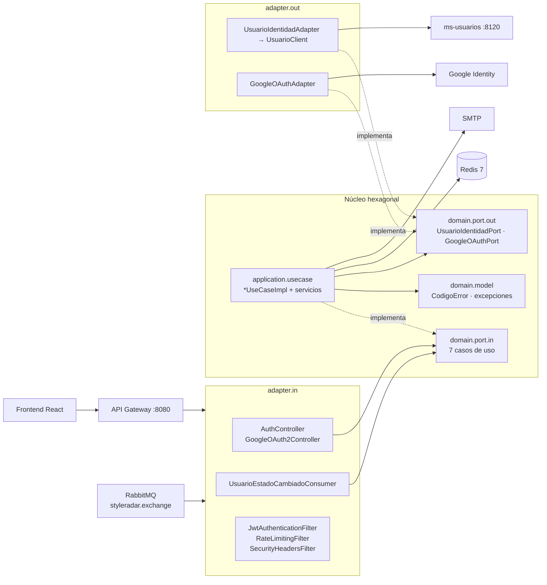
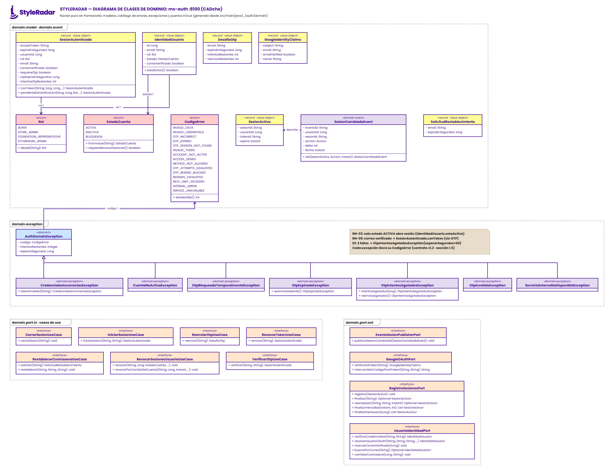
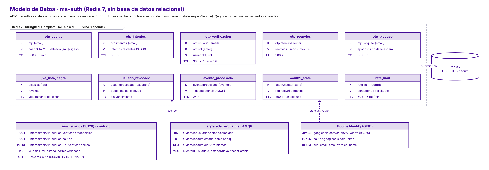
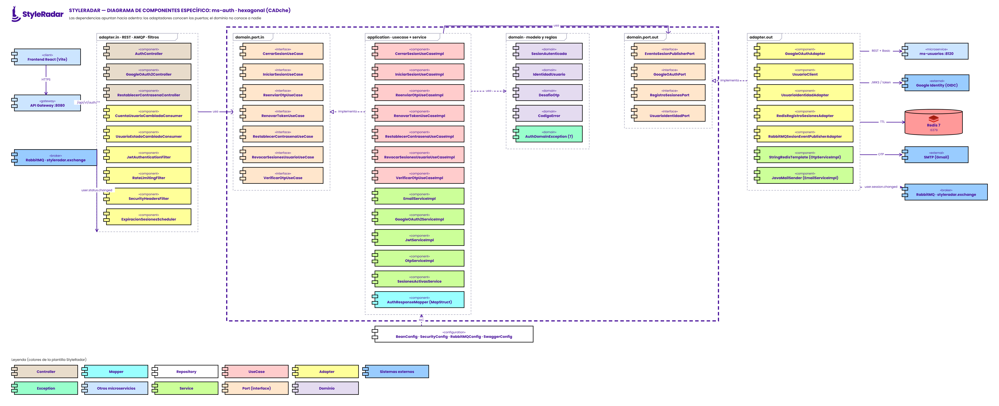
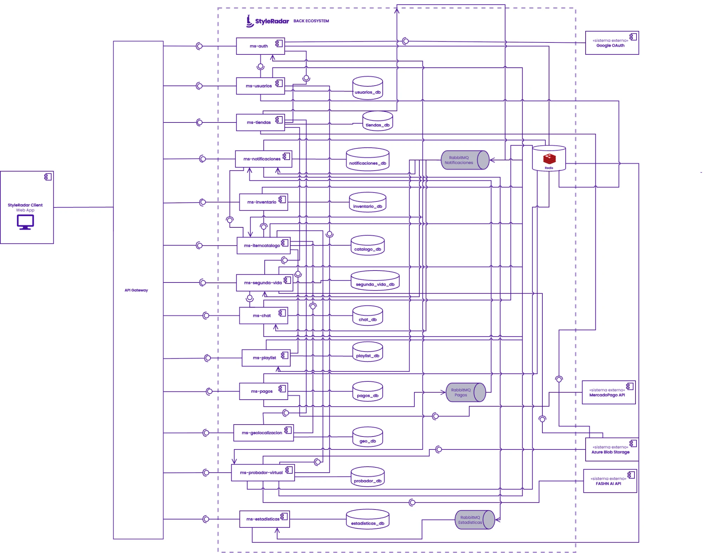
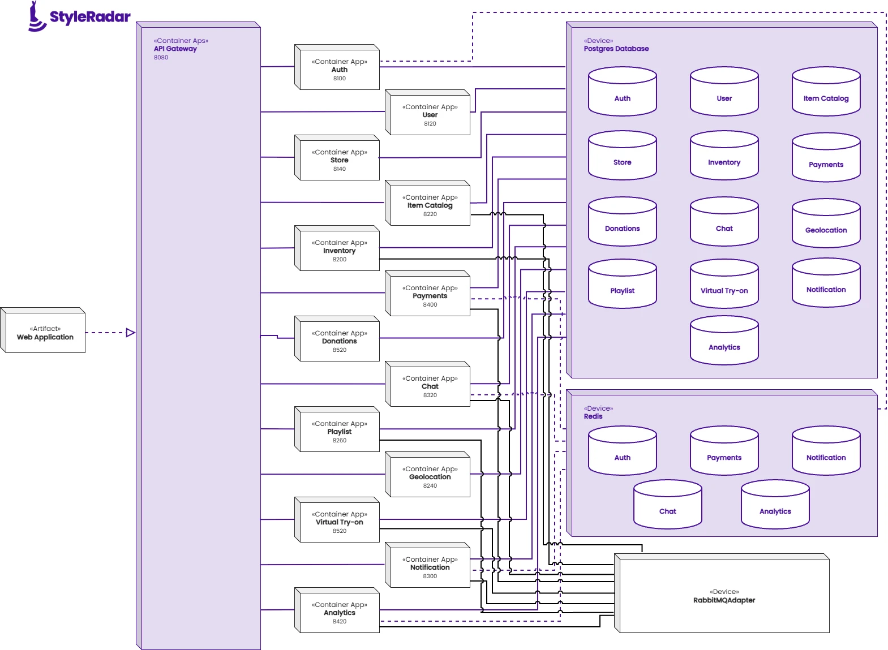
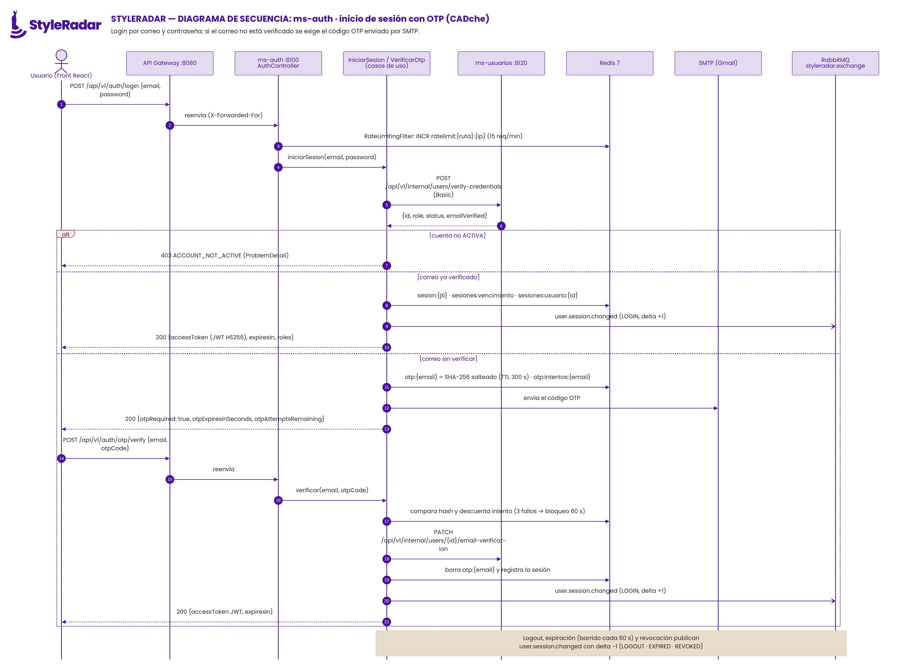

[⬅ Volver al README Principal](../../README.md)

---

## 2. ARQUITECTURA HEXAGONAL CON SUS DIAGRAMAS

Arquitectura de **Puertos y Adaptadores** según la guía oficial del curso. Las dependencias apuntan hacia adentro:

* **Dominio (`domain/`)**: Java puro, sin Spring, JPA ni Jackson. Modelos (`SesionAutenticada`, `IdentidadUsuario`, `DesafioOtp`, `Rol`, `EstadoCuenta`), el catálogo `CodigoError` y las excepciones (`AuthDomainException` y sus 7 subclases). Define los **puertos de entrada** (7 casos de uso) y de **salida** (`UsuarioIdentidadPort`, `GoogleOAuthPort`).
* **Aplicación (`application/`)**: `<Nombre>UseCaseImpl` sin anotaciones de Spring, registrados en `infrastructure/config/BeanConfig` (regla de oro 4); servicios `OtpService`, `JwtService`, `EmailService` y `GoogleOAuth2Service` (interfaz + `Impl`); DTOs y el mapper de salida `AuthResponseMapper` (**MapStruct**).
* **Infraestructura (`infrastructure/`)**: adaptadores de entrada (REST, AMQP y filtros de seguridad), adaptadores de salida (`UsuarioIdentidadAdapter` anti-corrupción sobre `UsuarioClient`, `GoogleOAuthAdapter`), configuración y `GlobalExceptionHandler`.
* **Regla del controlador:** `AuthController` solo conoce interfaces de casos de uso y el mapper; nunca un cliente HTTP ni Redis.

### Diagrama de Capas (Mermaid)



**Justificación del diagrama de capas.** Muestra en una sola vista la regla de dependencia de la arquitectura hexagonal: todo lo externo (Gateway, RabbitMQ, ms-usuarios, Google, Redis y SMTP) entra o sale por un adaptador, y el núcleo solo conoce puertos. Sirve para revisar de un vistazo que ningún controlador llame directamente a Redis o a un cliente HTTP, y que el consumidor AMQP use el mismo puerto de entrada que la API REST.

### 2.1 Diagrama de Clases

<div align="center">
  
  <sub>Figura 2.1: dominio completo de ms-auth (<a href="../uml/DiagramaClases.drawio">DiagramaClases.drawio</a>), generado desde el código.</sub>
</div>

* **Modelos (`record`, value objects):** `SesionAutenticada` (con las fábricas `conToken` y `pendienteDeVerificacion`), `IdentidadUsuario` (`estaActiva()` aplica RN-03), `DesafioOtp`, `SolicitudRestablecimiento` y `GoogleIdentityClaims`.
* **Enumeraciones:** `Rol` (`desde(String)` rechaza roles desconocidos), `EstadoCuenta` (acepta `ACTIVO`/`ACTIVA` y similares) y `CodigoError` (15 códigos del contrato con su estado HTTP).
* **Excepciones:** `AuthDomainException` transporta el código de error, los intentos restantes y la espera (`code`, `attemptsRemaining` y `retryAfterSeconds` en el JSON); la infraestructura las traduce a HTTP sin que el dominio conozca HTTP.

**Justificación del diagrama de clases.** Se genera desde el código fuente, así que refleja las clases que realmente existen. Documenta el modelo del dominio, que es donde viven las reglas del análisis de requerimientos: el estado de la cuenta (RN-03), los roles válidos, el desafío OTP y el catálogo de errores del contrato con el front. Al no depender de Spring, el diagrama también prueba que el dominio no tiene dependencias de infraestructura.

### 2.2 Diagrama de Base de Datos

<div align="center">
  
  <sub>Figura 2.2: claves de Redis 7 con su TTL y contratos externos (<a href="../uml/DiagramaBaseDatos.drawio">DiagramaBaseDatos.drawio</a>).</sub>
</div>

**Justificación del diagrama de base de datos.** ms-auth no tiene tablas, por eso el modelo de datos es el de Redis: cada familia de claves con su valor y su TTL. Este diagrama responde dónde queda cada dato de la sesión, cuánto dura y quién lo borra, que es lo que exigen las reglas del OTP (5 minutos, 3 intentos, espera de 60 s y verificación de 15 minutos). También muestra los contratos con ms-usuarios, que es el dueño de las credenciales.

**Decisión (ADR):** ms-auth **no usa PostgreSQL**. El análisis de integración consolidado lo establece así ("ms-auth no guarda datos en PostgreSQL; usa Redis") y conviene por seguridad:

1. **Una sola fuente de verdad para credenciales** (`ms-usuarios`): duplicarlas sería un riesgo de integridad (OWASP A04/A08).
2. **Menos superficie de ataque** (OWASP A03): se quitaron JPA, Flyway y el driver JDBC que estaban declarados sin uso.
3. **Datos efímeros:** OTP, bloqueos y lista negra expiran solos con el TTL de Redis; una tabla relacional exigiría limpiezas programadas.

| Familia de claves | Valor | TTL |
| :--- | :--- | :--- |
| `otp:{email}` | Hash SHA-256 salteado del código (nunca en claro) | `300 s` |
| `otp:intentos:{email}` | Intentos restantes (3 → 0) | `300 s` |
| `otp:usuario:{email}` · `otp:rol:{email}` | Verificación en curso | `900 s` (15 min) |
| `otp:reenvios:{email}` | Reenvíos usados (máx. 3) | `900 s` |
| `otp:bloqueo:{email}` | Fin de la espera tras 3 fallos | `60 s` |
| `blacklist:{jwt}` | Token revocado por `/logout` o `/refresh` | Vida restante del token |
| `usuario:revocado:{usuarioId}` | Momento del bloqueo (invalida tokens anteriores) | Sin vencimiento |
| `evento:procesado:{eventoId}` | Idempotencia del consumidor AMQP | `24 h` |
| `oauth2:state:{state}` | `redirectUri` autorizada, un solo uso | `300 s` |
| `ratelimit:{ruta}:{ip}` | Contador de solicitudes (15 por minuto) | `60 s` |

Si Redis no responde, ms-auth falla cerrado con `503 SERVICE_UNAVAILABLE`. El respaldo en memoria solo existe en el perfil `dev` con la propiedad explícita.

### 2.3 Diagrama de Componentes Específico

<div align="center">
  
  <sub>Figura 2.3: componentes por capa hexagonal (<a href="../uml/DiagramaComponentesEspecifico.drawio">DiagramaComponentesEspecifico.drawio</a>).</sub>
</div>

**Justificación del diagrama de componentes específico.** Baja un nivel respecto al diagrama de capas: muestra cada controlador, filtro, consumidor, caso de uso, servicio y adaptador real de ms-auth, y las interfaces por las que se conectan (provistas y requeridas). Se usa para ubicar dónde se implementa cada historia y para comprobar que cada puerto de salida tiene exactamente un adaptador.

### 2.4 Diagrama de Componentes General (ecosistema StyleRadar)

<div align="center">
  
  <sub>Figura 2.4: los 13 microservicios del back, sus bases de datos, los brokers RabbitMQ, Redis y los sistemas externos.</sub>
</div>

**Justificación.** Ubica a ms-auth dentro del ecosistema y deja claro con quién se comunica y con quién no:

* **Cliente → API Gateway → ms-auth.** El front nunca llama directo a un microservicio; el Gateway publica `/api/v1/auth/**`.
* **ms-auth ↔ ms-usuarios.** ms-auth requiere la interfaz de ms-usuarios para validar credenciales, crear o vincular cuentas de Google y marcar el correo verificado. Por eso ms-auth no tiene base de datos propia en el diagrama: las credenciales tienen un único dueño.
* **ms-auth → Google OAuth** (sistema externo) para el ingreso con Google, y **ms-auth → Redis** para OTP, lista negra y límite de solicitudes.
* **RabbitMQ:** ms-auth consume el cambio de estado de cuenta que publica ms-usuarios para revocar sesiones.
* El resto de microservicios valida el JWT que emite ms-auth con el mismo secreto; ninguno lo llama por cada petición.

### 2.5 Diagrama de Despliegue

<div align="center">
  
  <sub>Figura 2.5: nodos de ejecución (Container Apps), puertos, PostgreSQL, Redis y el adaptador de RabbitMQ.</sub>
</div>

**Justificación.** Muestra dónde corre cada pieza y por qué puertos se habla. Para ms-auth confirma:

* **Puerto 8100**, detrás del API Gateway (8080), que es el único punto de entrada del artefacto web.
* **Redis** como nodo de datos de ms-auth (instancia `Auth`), que es donde realmente vive su estado.
* Conexión al **RabbitMQAdapter** para los eventos de cuenta.

**Diferencias con lo implementado hoy (para corregir en el diagrama):**

1. El nodo PostgreSQL incluye una base `Auth`. ms-auth no la usa (ver el ADR de la sección 3.2); se recomienda quitarla para no reservar un recurso sin uso.
2. ms-auth hoy se despliega en **Azure App Service** (`styleradar-auth-qa` y `styleradar-auth-prod`), no en Container Apps. El diagrama representa la arquitectura objetivo.
3. `Donations` y `Virtual Try-on` aparecen con el mismo puerto `8520`; uno de los dos debe cambiar.

### 2.6 Diagrama de Secuencia

Flujo principal de `ms-auth`: inicio de sesión con OTP: login, verificación del código, aviso a ms-usuarios, registro de la sesión en Redis y evento `user.session.changed`. Fuente editable en Mermaid: [`DiagramaSecuencia.mmd`](../uml/secuencia/DiagramaSecuencia.mmd).

<div align="center">
  
  <p><sub><b>Figura 2.6:</b> diagrama de secuencia de `ms-auth` con la plantilla StyleRadar (logo, título y colores).</sub></p>
</div>

### Estructura de Paquetes en `src/main/java/edu/dosw/styleradar/auth/`

```text
auth/
├── domain/                                   <-- Núcleo puro (sin frameworks)
│   ├── model/        SesionAutenticada, IdentidadUsuario, DesafioOtp, SolicitudRestablecimiento,
│   │                 GoogleIdentityClaims, Rol, EstadoCuenta, CodigoError
│   ├── exception/    AuthDomainException + 7 excepciones con su CodigoError
│   └── port/
│       ├── in/       IniciarSesion, VerificarOtp, ReenviarOtp, RenovarToken, CerrarSesion,
│       │             RestablecerContrasena, RevocarSesionesUsuario (UseCase)
│       └── out/      UsuarioIdentidadPort, GoogleOAuthPort
├── application/
│   ├── usecase/      7 *UseCaseImpl + NotificadorCodigoOtp (compensación si falla el correo)
│   ├── service/      OtpService, JwtService, EmailService, GoogleOAuth2Service + impl/
│   ├── dto/          request/, response/, event/ (UsuarioEstadoCambiadoEventDTO)
│   └── mapper/out/   AuthResponseMapper (MapStruct)
└── infrastructure/
    ├── adapter/in/   rest/ (+ doc/ Swagger), amqp/ (UsuarioEstadoCambiadoConsumer)
    ├── adapter/out/  external/ (UsuarioClient, UsuarioIdentidadAdapter, GoogleOAuthAdapter)
    ├── config/       BeanConfig, SecurityConfig, RabbitMQConfig, SwaggerConfig
    ├── exception/    GlobalExceptionHandler (catálogo de errores + Retry-After)
    └── security/     JwtAuthenticationFilter, RateLimitingFilter, SecurityHeadersFilter, SecuritySanitizer
```

---

[⬅ Volver al README Principal](../../README.md)
