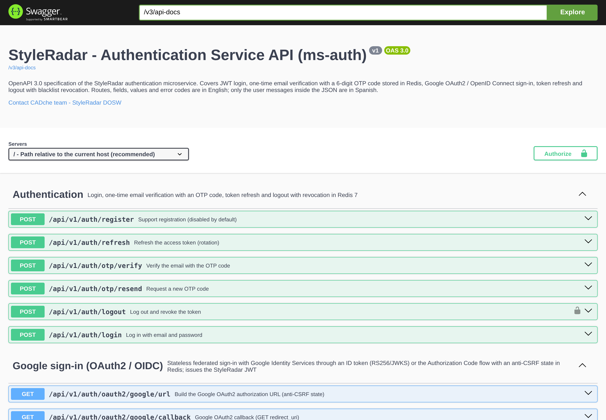

[⬅ Volver al README Principal](../../README.md)

---

## 3. ENDPOINTS Y ENLACE A SWAGGER

### Enlaces por Ambiente

| Ambiente | URL base | Swagger UI | Health |
| :--- | :--- | :--- | :--- |
| **PROD** | `https://styleradar-auth-prod.azurewebsites.net` | [Swagger PROD](https://styleradar-auth-prod.azurewebsites.net/swagger-ui/index.html) | [`/actuator/health`](https://styleradar-auth-prod.azurewebsites.net/actuator/health) |
| **QA** | `https://styleradar-auth-qa.azurewebsites.net` | [Swagger QA](https://styleradar-auth-qa.azurewebsites.net/swagger-ui/index.html) | [`/actuator/health`](https://styleradar-auth-qa.azurewebsites.net/actuator/health) |
| **Local** | `http://localhost:8100` | [Swagger local](http://localhost:8100/swagger-ui.html) | `http://localhost:8100/actuator/health` |

El front **siempre** llama al API Gateway (`:8080`), que enruta `/api/v1/auth/**` a este servicio.

<!-- evidencias -->
### Evidencia: Swagger desplegado

<div align="center">
  
  <p><sub><b>Figura 3.1:</b> Swagger UI de ms-auth en QA (Azure App Service), con rutas y esquemas en inglés.</sub></p>
</div>

<div align="center">
  
  <p><sub><b>Figura 3.2:</b> Swagger UI de ms-auth en PROD.</sub></p>
</div>

<!-- /evidencias -->

### Convención de rutas

* Todas las rutas están **en inglés** y empiezan por **`/api/v1`**.
* **Análisis de requerimientos v2 (17/11/2026):** rutas, nombres de campos JSON, valores (roles, estados) y códigos de error van **en inglés**; Swagger también. **Solo los mensajes para el usuario dentro del JSON** (`message`, `detail` y los mensajes de `errors`) están en español.
* Roles: `BUYER`, `STORE_ADMIN`, `FOUNDATION_REPRESENTATIVE` y `STYLERADAR_ADMIN` (respuesta y claim `roles` del JWT). Si ms-usuarios todavía envía los nombres anteriores (`COMPRADOR`, `ADMIN_ALMACEN`…), ms-auth los traduce.
* El proyecto **no usa `/me`**. Cuando un recurso pertenece a un usuario, la ruta lo nombra explícitamente con `/users/{id}` y el backend comprueba que quien hace la petición tenga permiso sobre ese usuario. ms-auth no expone recursos por usuario: identifica a la persona con las credenciales o con el JWT.
* `/actuator/health` y la documentación OpenAPI (`/v3/api-docs`, `/swagger-ui`) son rutas de operación y quedan fuera de esta convención.

### Endpoints Expuestos

| Método | Ruta | Entrada | Respuesta | Acceso |
| :---: | :--- | :--- | :--- | :--- |
| `POST` | `/api/v1/auth/login` | `email`, `password` (8 a 30) | `200 LoginResponseDTO` (token directo o `otpRequired=true`) | Público · 15 req/min |
| `POST` | `/api/v1/auth/otp/verify` | `email`, `otpCode` | `200 LoginResponseDTO` con token | Público |
| `POST` | `/api/v1/auth/otp/resend` | `email` | `200` `email`, `message`, `expiresInSeconds`, `attemptsRemaining`, `resendsRemaining` | Público |
| `POST` | `/api/v1/auth/refresh` | `refreshToken` (JWT vigente, máx. 2048) | `200 LoginResponseDTO` (SR-RF-113: token rotado, `email` nulo, `emailVerified` true) | Público |
| `POST` | `/api/v1/auth/logout` | `Authorization: Bearer` | `204` sin cuerpo (SR-RF-112) · `401 INVALID_TOKEN` sin token, mal formado o inválido | JWT |
| `POST` | `/api/v1/auth/register` | `name`, `email`, `phone`, `password`, `dataPolicyAccepted` | `201` (`id`, `name`, `email`, `phone`, `registeredAt`, `roles`) en `dev`/`test` · `503` en QA/PROD | Público |
| `POST` | `/api/v1/auth/oauth2/google` | `idToken` | `200 LoginResponseDTO` | Público |
| `GET` | `/api/v1/auth/oauth2/google/url` | `redirectUri` (opcional) | `200` `authorizationUrl`, `state`, `expiresInSeconds`, `redirectUri` | Público |
| `GET` | `/api/v1/auth/oauth2/google/callback` | `code`, `state` | `200 LoginResponseDTO` | Público |
| `POST` | `/api/v1/auth/oauth2/google/code` | `code`, `state`, `redirectUri` | `200 LoginResponseDTO` | Público |

### Ejemplos (análisis de requerimientos v2)

Login con correo **sin verificar** (se envía el OTP):

```json
{
  "accessToken": null, "tokenType": "Bearer", "expiresIn": 28800, "userId": 12,
  "roles": ["BUYER"], "email": "buyer@correo.com", "emailVerified": false,
  "otpRequired": true, "otpExpiresInSeconds": 300, "otpAttemptsRemaining": 3,
  "message": "Código de verificación OTP enviado a su correo electrónico"
}
```

`expiresIn` sale de `JWT_DURATION`. Con el correo verificado llega `accessToken`, `otpRequired=false` y `message` «Inicio de sesión exitoso».

Los errores salen en formato **ProblemDetail (RFC 9457)** con `Content-Type: application/problem+json`, el mismo formato de ms-usuarios y ms-tiendas (CADCHE-121). Además de `type`, `title`, `status`, `detail` e `instance` lleva las extensiones del análisis v2 (`code`, `errors`, `attemptsRemaining`, `retryAfterSeconds`). `type` es `https://api.styleradar.com/errors/{code en minúsculas con guiones}`. `error`, `message` y `path` se mantienen como alias de `title`, `detail` e `instance` para no romper al front. Ejemplo (tercer código incorrecto):

```json
{
  "type": "https://api.styleradar.com/errors/otp-attempts-exhausted",
  "title": "Too Many Requests", "status": 429,
  "detail": "Se agotaron los intentos. Espere 60 segundos y solicite un nuevo código.",
  "instance": "/api/v1/auth/otp/verify",
  "timestamp": "2026-11-16T10:15:30", "error": "Too Many Requests",
  "code": "OTP_ATTEMPTS_EXHAUSTED",
  "message": "Se agotaron los intentos. Espere 60 segundos y solicite un nuevo código.",
  "path": "/api/v1/auth/otp/verify", "errors": {},
  "attemptsRemaining": 0, "retryAfterSeconds": 60
}
```

Catálogo de `code`: `INVALID_DATA`, `INVALID_CREDENTIALS`, `ACCOUNT_NOT_ACTIVE`, `OTP_INCORRECT`, `OTP_EXPIRED`, `OTP_ATTEMPTS_EXHAUSTED`, `OTP_RESEND_BLOCKED`, `RESENDS_EXHAUSTED`, `OTP_SESSION_NOT_FOUND`, `RATE_LIMIT_EXCEEDED`, `SERVICE_UNAVAILABLE`, `INVALID_TOKEN`, `ACCESS_DENIED`, `METHOD_NOT_ALLOWED` y `INTERNAL_ERROR`. Todos los `429` incluyen la cabecera `Retry-After`.

---

[⬅ Volver al README Principal](../../README.md)
