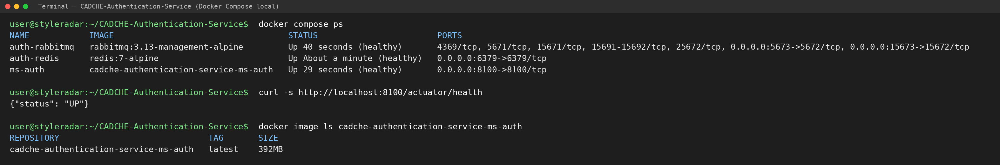

[⬅ Volver al README Principal](../../README.md)

---

## 6. CÓMO EJECUTAR LOCAL Y CON DOCKER

### Prerrequisitos

* JDK 21 (`java -version`) y Docker 24+. Maven no hace falta: el repositorio trae el Maven wrapper (`./mvnw`, o `mvnw.cmd` en Windows).

### Ejecución local con Maven (perfil `dev`)

```bash
git clone https://github.com/StyleRadar1/CADCHE-Authentication-Service.git
cd CADCHE-Authentication-Service
cp .env.example .env            # opcional: el perfil dev lo carga automáticamente
docker compose up -d auth-redis auth-rabbitmq   # Redis 7 y RabbitMQ locales
./mvnw spring-boot:run "-Dspring-boot.run.profiles=dev"
```

### Ejecución contenerizada

El pipeline compila y prueba el JAR una sola vez y la imagen reutiliza ese JAR validado, por eso hay que empaquetar antes de construir:

```bash
./mvnw -B -DskipTests package
docker compose up -d --build    # ms-auth :8100 + auth-redis :6379 + auth-rabbitmq :5673/:15673
docker compose ps
```

### Comprobación de salud

```bash
curl http://localhost:8100/actuator/health
# Swagger: http://localhost:8100/swagger-ui.html
```

### Evidencia: contenedores en ejecución

<div align="center">
  
  <p><sub><b>Figura 6.1:</b> `docker compose ps` con todos los contenedores de `ms-auth` en estado *healthy* y `/actuator/health` respondiendo `UP`.</sub></p>
</div>

---

[⬅ Volver al README Principal](../../README.md)
