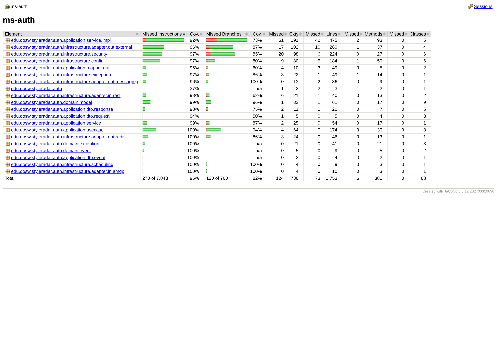

[⬅ Volver al README Principal](../../README.md)

---

## 8. PRUEBAS Y COBERTURA (≥ 85%)

```bash
./mvnw -B clean verify                                                         # pruebas + JaCoCo (≥ 85 % líneas, ≥ 80 % ramas)
./mvnw -B com.github.spotbugs:spotbugs-maven-plugin:4.8.6.6:check -Dspotbugs.excludeFilterFile=spotbugs-exclude.xml
```

| Métrica (`./mvnw verify` con Docker, rama `feature/arreglos`) | Resultado | Umbral (rompe el build) |
| :--- | :---: | :---: |
| Pruebas | **321**, 0 fallos | 100 % en verde |
| Cobertura de líneas (JaCoCo) | **95.8 %** | ≥ 85 % |
| Cobertura de ramas (JaCoCo) | **82.9 %** | ≥ 80 % |
| Cobertura de instrucciones (JaCoCo) | **96.6 %** | ≥ 85 % |
| SpotBugs | 0 hallazgos | 0 |

La regla vive en `pom.xml` (`jacoco-maven-plugin`, objetivo `check` en la fase `verify`) con los mismos umbrales del repo base: 85 % de líneas y 80 % de ramas, más 85 % de instrucciones. Los tres pipelines ejecutan `./mvnw verify`, así que una caída de cobertura detiene el PR o el despliegue.

### Pirámide de pruebas (espejo de `src/main`)

| Nivel | Qué cubre | Herramientas |
| :--- | :--- | :--- |
| **Unitarias de aplicación** | Casos de uso (`CasosDeUsoSesionTest`), servicios OTP/JWT/Email/Google | JUnit 5, Mockito, AssertJ |
| **WebMvc de punta a punta** | Controladores con casos de uso reales y mocks solo en los bordes; análisis v2 (`code`, `errors`, `Retry-After`) | MockMvc, Spring Security Test |
| **Integración con Redis 7 real** | `OtpRedisIntegrationTest`: 3 fallos → espera → reenvío sin nuevo login, lista negra, revocación e idempotencia | Testcontainers (`redis:7-alpine`) |
| **Seguridad** | `OwaspTop10SecurityTest` (A01–A10), filtros y cabeceras | MockMvc |
| **Requerimientos** | `RequerimientosCompletosAuditoriaAuthTest` (SR-RF-02 / SR-RF-92) | MockMvc |
| **Trazabilidad Word y contrato** | `TrazabilidadRequerimientosAuthTest`: un caso por flujo alterno y regla de negocio de SR-RF-02 y SR-RF-92 (análisis v2), por cada punto del contrato Front ↔ ms-auth y por los nombres en inglés del v2, sobre Redis 7 real | Testcontainers, MockMvc |

> Las pruebas de Testcontainers se omiten solas si la máquina no tiene Docker. Con Docker 29+ y Testcontainers 1.19 en local, exporte `DOCKER_API_VERSION=1.44`.

<!-- evidencias -->
### Evidencia: reporte de cobertura JaCoCo

<div align="center">
  
  <p><sub><b>Figura 8.1:</b> reporte JaCoCo de `./mvnw verify` (con Docker): líneas 95.8 %, ramas 82.9 %, instrucciones 96.6 %.</sub></p>
</div>

<!-- /evidencias -->

---

[⬅ Volver al README Principal](../../README.md)
