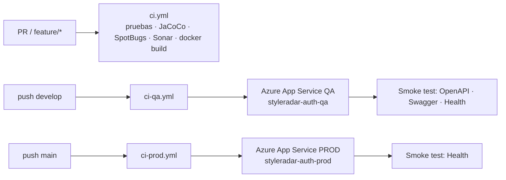
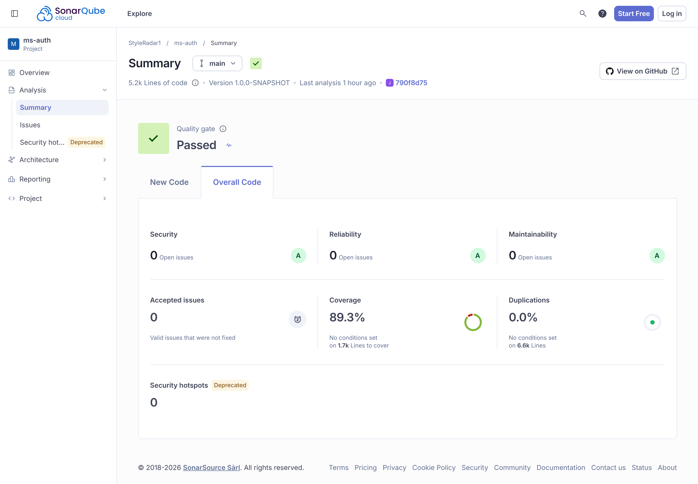

[⬅ Volver al README Principal](../../README.md)

---

## 9. CI/CD CON EL BADGE DEL PIPELINE

Tres workflows, igual que el repo base:

| Workflow | Disparador | Etapas | Destino |
| :--- | :--- | :--- | :--- |
| [`ci.yml`](../../.github/workflows/ci.yml) | PR a `develop` y `main`; push a `feature/**`, `fix/**`, `docs/**` | `./mvnw verify` (JaCoCo ≥ 85 % líneas / ≥ 80 % ramas) → SpotBugs → SonarCloud → build de la imagen sin publicar | Solo revisión, no despliega |
| [`ci-qa.yml`](../../.github/workflows/ci-qa.yml) | Push a `develop` o manual | Pruebas → SpotBugs → SonarCloud → imagen `styleradar-auth:<sha>` (+ `qa-latest`) → Azure QA → smoke test | `styleradar-auth-qa` |
| [`ci-prod.yml`](../../.github/workflows/ci-prod.yml) | Push a `main` o manual (solo despliega desde `main`) | Pruebas → SpotBugs → SonarCloud → imagen `styleradar-auth:<sha>` (+ `prod-latest`) → Azure PROD → smoke test | `styleradar-auth-prod` |

* El JAR se compila y prueba una sola vez por ejecución; la imagen reutiliza ese JAR validado (`actions/upload-artifact`).
* Los despliegues usan la etiqueta inmutable del commit (`<sha>`), no `latest`.
* **Quality Gate:** confiabilidad, seguridad y mantenibilidad en **A**, 100 % de *hotspots* revisados y cobertura del código nuevo ≥ 80 %. Si no se cumple, el pipeline se detiene antes de construir la imagen.

<!-- evidencias -->
### Evidencia: pipelines y calidad

  
  
<b>Figura 9.1:</b> ejecuciones de `ci-qa.yml` hacia QA (rama `develop`).

  
  
<b>Figura 9.2:</b> ejecuciones de `ci-prod.yml` hacia PROD (rama `main`).

  
  
<b>Figura 9.3:</b> SonarCloud sobre `main`: Quality Gate *Passed*, cobertura 89.3 % y 0 issues abiertos.

<!-- /evidencias -->

---

[⬅ Volver al README Principal](../../README.md)
