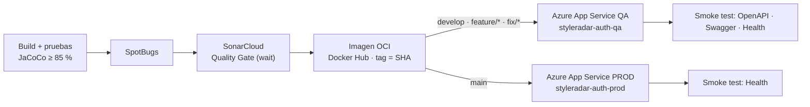
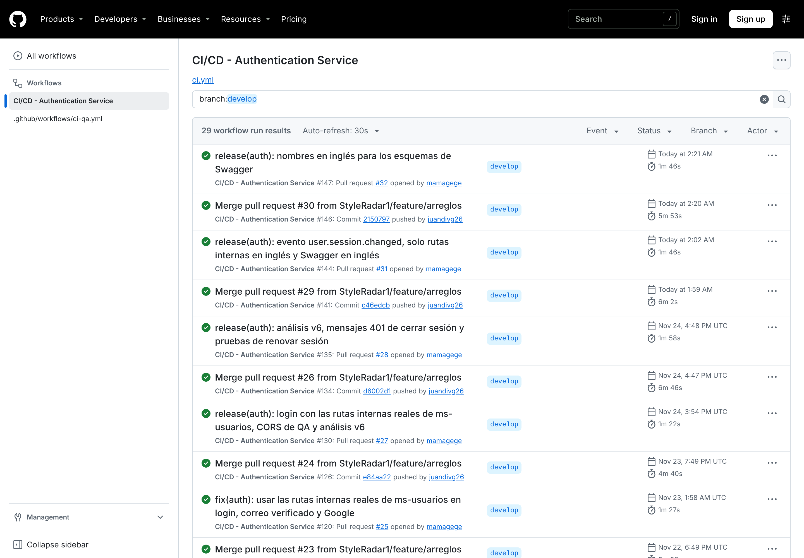
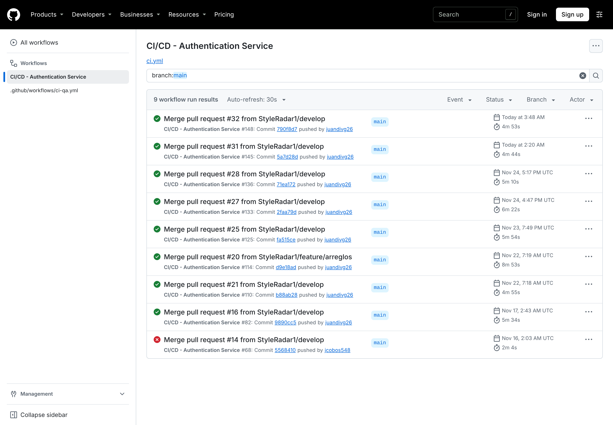

[⬅ Volver al README Principal](../../README.md)

---

## 9. CI/CD CON EL BADGE DEL PIPELINE

Un solo workflow, [`.github/workflows/ci.yml`](../../.github/workflows/ci.yml):

| Ambiente | Rama | App Service | Imagen |
| :--- | :--- | :--- | :--- |
| QA | `develop`, `feature/*`, `fix/*` | `styleradar-auth-qa` | `styleradar-auth:<sha>` (+ `qa-latest`) |
| PROD | `main` | `styleradar-auth-prod` | `styleradar-auth:<sha>` (+ `prod-latest`) |

* El JAR se compila y prueba una sola vez; la imagen reutiliza ese JAR validado (`actions/upload-artifact`).
* Los despliegues usan la etiqueta inmutable del commit (`<sha>`), no `latest`.
* **Quality Gate:** confiabilidad, seguridad y mantenibilidad en **A**, 100 % de *hotspots* revisados y cobertura del código nuevo ≥ 80 %. Si no se cumple, el pipeline se detiene antes de construir la imagen.

<!-- evidencias -->
### Evidencia: pipelines y calidad

  
  
<b>Figura 9.1:</b> ejecuciones de `ci.yml` hacia QA (rama `develop`).

  
  
<b>Figura 9.2:</b> ejecuciones de `ci.yml` hacia PROD (rama `main`).

  
  
<b>Figura 9.3:</b> SonarCloud sobre `main`: Quality Gate *Passed*, cobertura 89.3 % y 0 issues abiertos.

<!-- /evidencias -->

---

[⬅ Volver al README Principal](../../README.md)
